CUDA Path Tracer
================

**University of Pennsylvania, CIS 565: GPU Programming and Architecture, Project 3**

* Walson Li
  * [LinkedIn](https://www.linkedin.com/in/walsonli), [personal website](https://www.walsonli.com)
* Tested on: Windows 11 Home, i5-10300H @ 2.50GHz, RTX 2060 6GB (Personal Laptop)

The following CMakeLists changes have been made:

* compiler=/Zc:preprocessor for msvc issue with newer cuda versions
* adjustments for tiny_gltf (header, sources, include_directories)

## Gallery

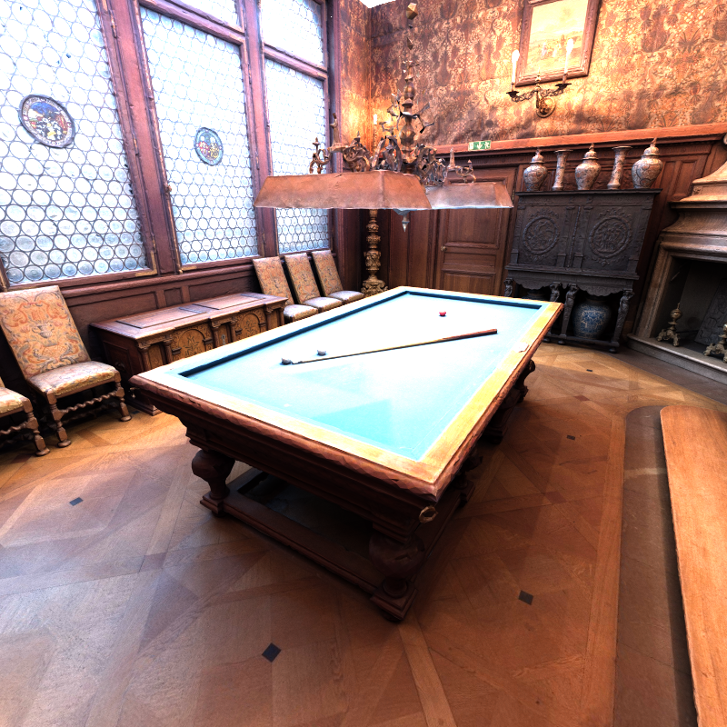

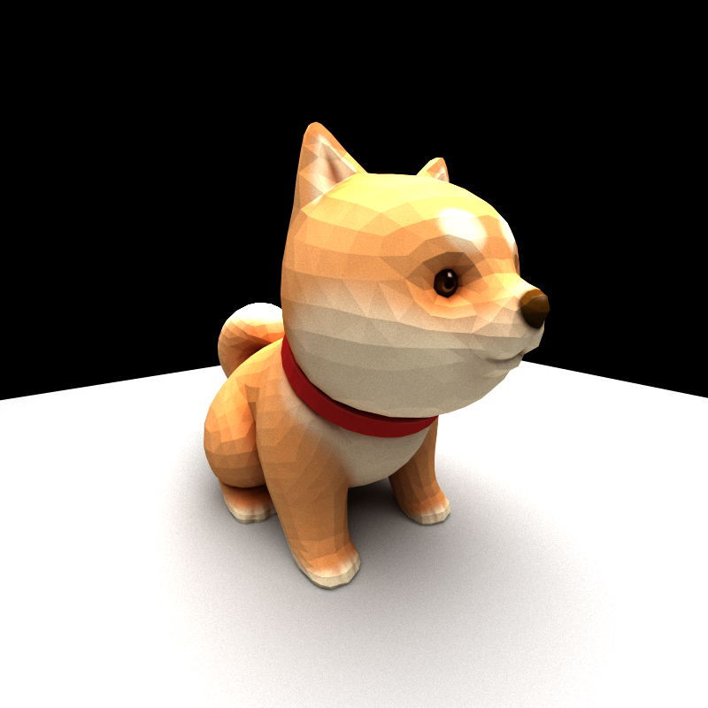

## Features and Analysis

### Basic BSDF pathtracer

Here is the basic BSDF pathtracer. Some toggles have been added in pathtracer.cu for comparing different functionalities:

`COMPACT_TOGGLE` - 1 to toggle on stream compaction.

`CONTIGUOUS_TOGGLE` - 1 for thrust ordering paths into contiguous memory.

`ANTIALIASING_ON` - 1 to turn on stochastic sampled antialiasing

`LOAD_TRIANGLES` - 1 to load triangles within a scene, for example glTF triangular meshes.

`BASIC_BOUND_CHECK` - 1 to enable the basic bound check where there is 1 bounding box around the entire loaded triangle mesh.

`BETTER_BOUND_CHECK` - 1 to enable bound check where many bounding boxes are created in a spatial tree.

`PROCEDURAL_TEXTURE` - 1 to enable procedural textures on triangle mesh.

`CUSTOM_TEXTURE` - 1 to enable custom texture loading from glTF/glb.

`SHOW_KERNEL_RUNTIMES` - 1 to enable debugging for kernel runtimes.

### Contiguous Memory Comparison

For contiguous memory the paths were ordered based on their material. Here are the average kernel runtime results in the main pathtrace loop over 50 iterations at depth 8 for cornell.json:

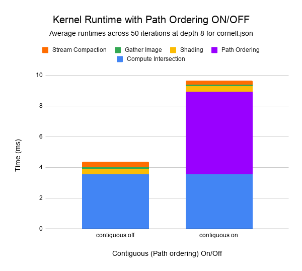

**Kernel Runtime (ms) for cornell.json:**
|  | Compute Intersection | Path Ordering | Shading | Gather Image | Stream Compaction |
|---|---|---|---|---|---|
| Contiguous ON | 3.5579424 | 5.37293343 | 0.35451512 | 0.09859112 | 0.24840016 |
| Contiguous OFF | 3.54930032 | 0 | 0.32247923 | 0.13551937 | 0.34463202 |

These results show that the path ordering doesn't significantly decrease the times of the other kernels.

The path ordering is suppose to improve the consistency within each warp by making each kernel take a similar path. For example right now there are two main paths which call their own tools: `if (material.textureId >= 0)` and `if (material.emittance > 0.0f)`. The path ordering might be more useful if there were more paths with greatly varying runtimes, that way faster kernels don't have to wait for the kernels that take slow branches.

To test more I made the cornell_more_materials.json and cornell_more_materials_emitters.json files. The cornell_more_materials.json scene has the same number of emitters, but a few more objects with their own materials. The cornell_more_materials_emitters.json scene has 1 extra emitter, so the paths should hit the second if more often.

**Render of cornell_more_materials (left) and cornell_more_materials_emitters (right):**

  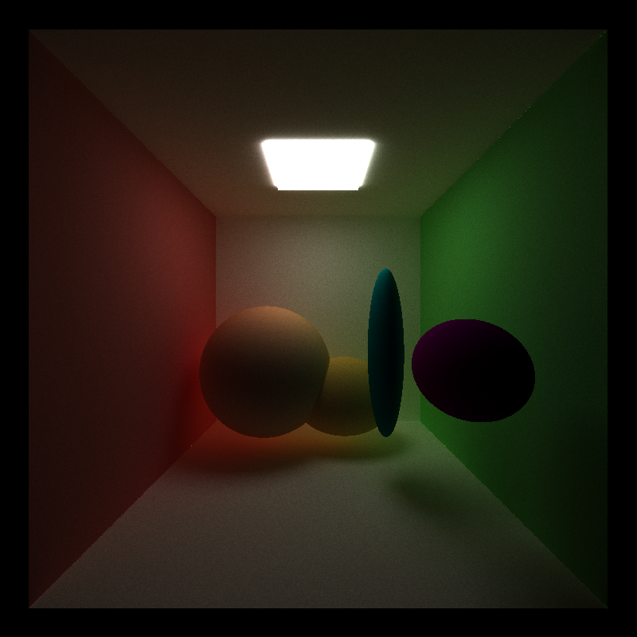
  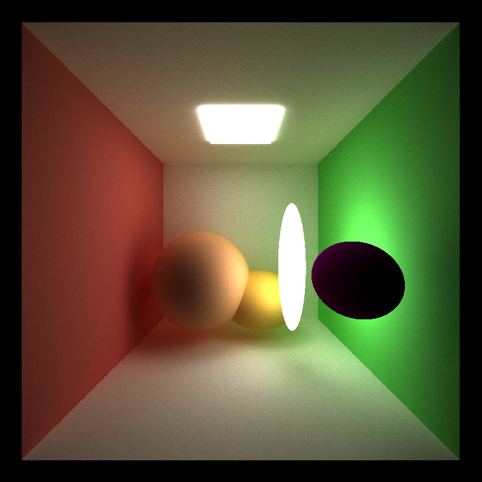

**Run for cornell_more_materials.json at 50 iterations with depth 8:**

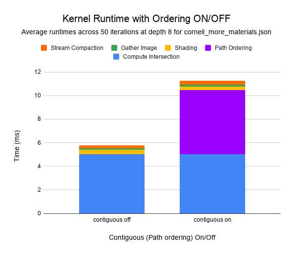

|  | Compute Intersection | Path Ordering | Shading | Gather Image | Stream Compaction |
|---|---|---|---|---|---|
| Contiguous ON | 5.03863216 | 5.42788092 | 0.30803592 | 0.13978504	| 0.35092032 |
| Contiguous OFF | 5.04280576 |0 | 0.3670988 | 0.10159536 | 0.26625672 |

**Run for cornell_more_materials_emitters.json at 50 iterations with depth 8:**

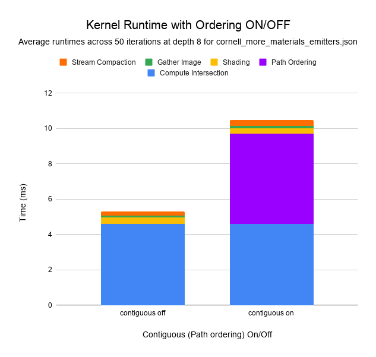

|  | Compute Intersection | Path Ordering | Shading | Gather Image | Stream Compaction |
|---|---|---|---|---|---|
| Contiguous ON | 4.59917176 | 5.11708727 | 0.28077768 | 0.13177448 | 0.33282032 |
| Contiguous OFF | 4.61362872 | 0 | 0.34560152 | 0.09516152 | 0.24451576 |

The runs with the cornell_more_materials scene variants show the same trend as the cornell.json results. Path ordering takes a lot of runtime, and there weren't significant reductions in the kernel runtimes. Maybe this would be more impactful if the branches had significantly different complexities.

### Stochastic Sampled Antialiasing

Here are comparison renders of cornell.json with the stochastic sampled antialiasing enabled (left) and disabled (right):

  
  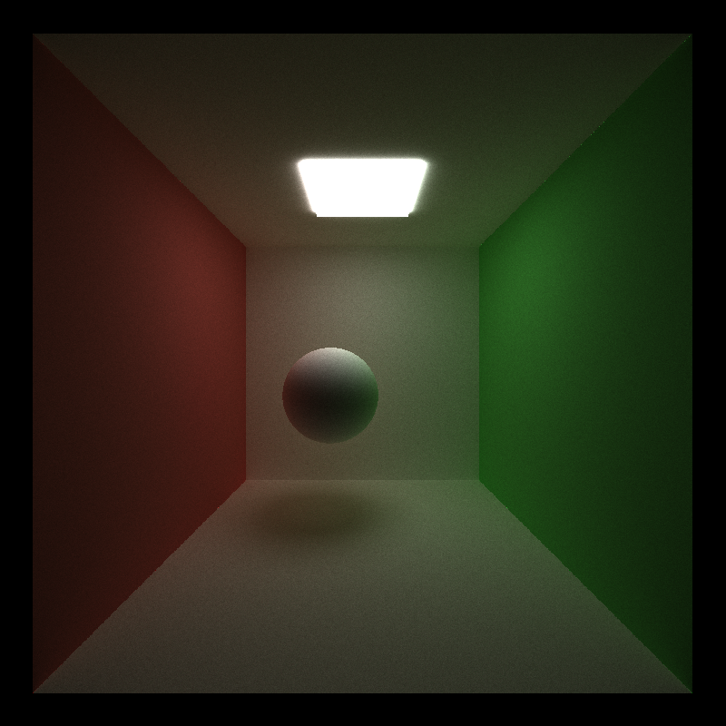

Zoomed in you can tell that the colors look more blended:

  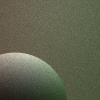
  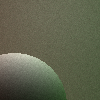

These are both with 5000 iterations at depth 8.

### Arbitrary glTF mesh loading

To load custom glb/glTF meshes, I used the C++ version files of the tinygltf repo to help with objects. For meshes, I have downloaded models from Sketchfab. I've also set up some custom translation/lighting/camera settings for the billiard, car, andshiba models. Other models can be downloaded as well, and can be passed in similar to the jsons: `cis565_path_tracer.exe <path_to_gltf/path_name_to_gltf>.gltf` or `cis565_path_tracer.exe <path_to_glb/path_name_to_glb>.glb`.

By default for mesh loading the scene will just have a light and the mesh, like this silent_ash.glb render:

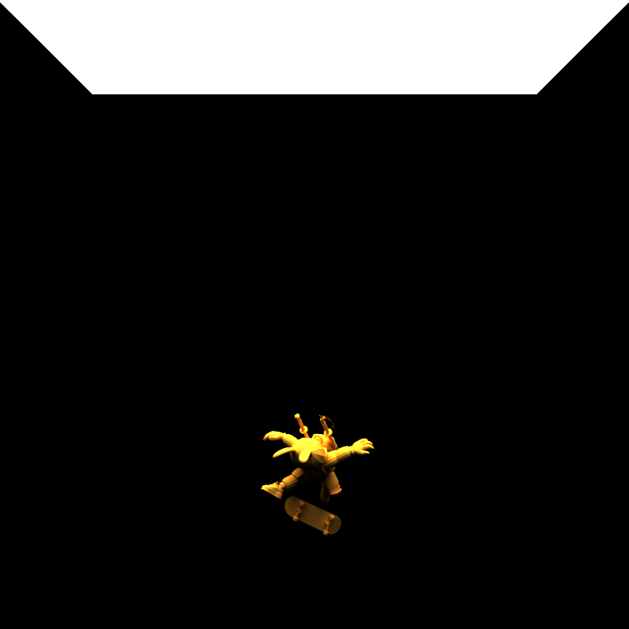

The point data from the glTF meshes are converted into triangles, which are then rendered. It's easier to see the triangles when zoomed in on low-poly meshes:

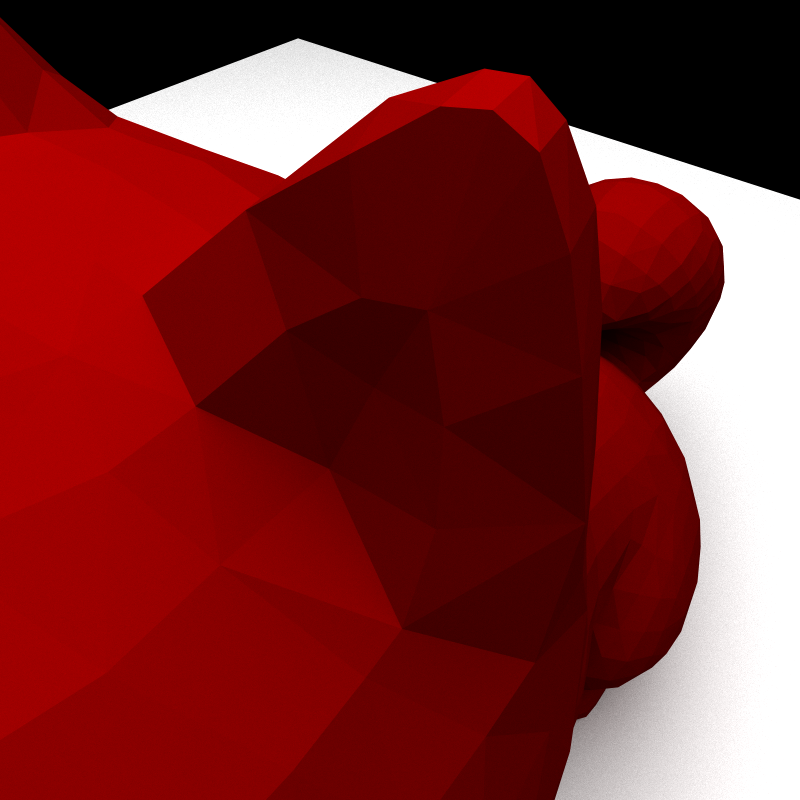

Something that could be implemented in the future is setting up the other normals within the triangles to provide smoother looking meshes. Also performance could improve by reserving the indices and triangles instead of push_back.

Currently, the mesh is being loaded with the cpu once before pathtracing begins. I think this makes sense, but I imagine you could do it with the gpu as well (e.g. kernels that index indices with stride 3 to build triangles faster instead of for loop to build triangles in serial).

#### Toggleable Bounding Volume Intersection Culling

Loading the custom meshes dropped the fps a lot, so adding bounding volume intersection culling was important to keep the program from freezing my laptop for larger meshes. The bounding volume min/max for each axis is calculated during the mesh loading phase, and during the collision kernel it helps reduce checks on the triangles in the loaded mesh if there is no valid intersection with the mesh bounding box.

To show this, here are the average times in milliseconds per frame for two scenes, with culling on/off:

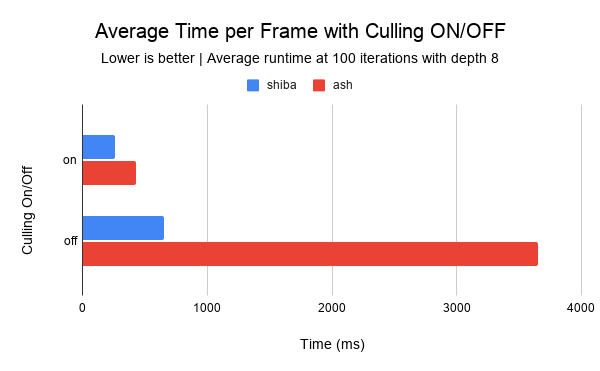

||Shiba|Ash|
|-|-|-|
|Culling on|261.958|425.17|
|Culling off|649.748|3652.812|

Adding the bounding box was a significant improvement, especially in small but more complex meshes like silent_ash, where most of the time paths will not intersect with the bounding box. However I was still unable to load the_billiards_room, which brought me to hierarchical spatial data structures.

The current implementation finds the min/max of the entire mesh during load in on cpu, and checks intersections in the gpu. I think this makes sense because you only need to find the min/max once here, and the intersection checks should be able to run in parallel.

### Hierarchical spatial data structures

The min/max bounding volume box was helpful for the frames, but I wanted to render really complex meshes. With the basic bounding volume method, I was unable to load and run scenes like the_billiards_room because there are so many triangles and each iteration takes too much time:

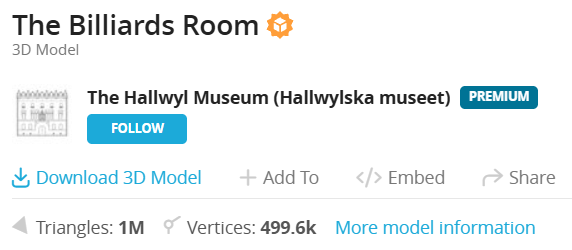

Therefore I decided to implement a hierarchical spatial data structure. The implementation basically sets up a binary search tree for the triangles. Each leaf node has 4 or less triangles, and the tree traversal supports up to 32 levels, which means the implementation would support (2^32)*4 triangles, which is way more than what the scenes I wanted to render contain.

In the typical case, in a massive mesh, intersection testing can go through 32 layers and then iterate through 4 triangles to find the one that's closest, instead of iterating through a worst case of all (2^32)*4 triangles.

Here are the average time (ms) per frame results for shiba, silent_ash, and the_billiards_room scenes using basic and hierarchical bounding volumes:

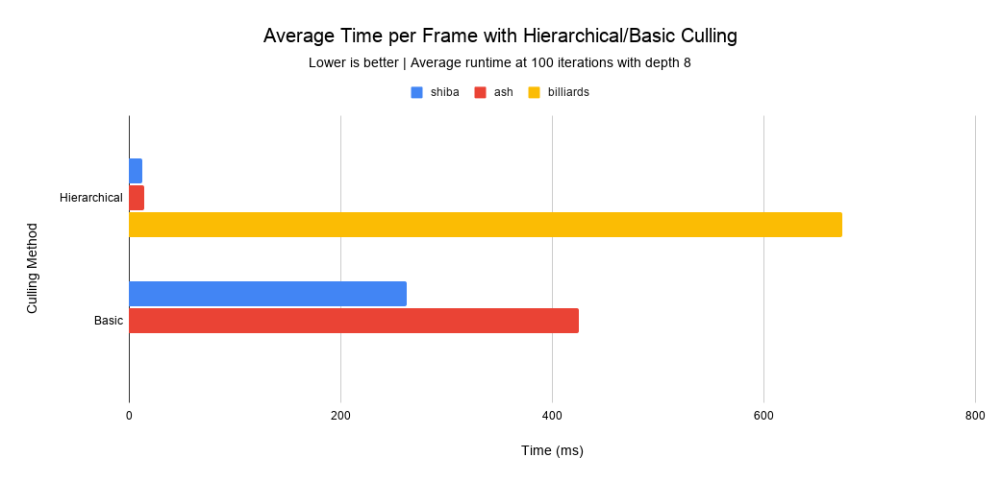

||Shiba|Ash|Billiards|
|-|-|-|-|
|Hierarchical|12.291|14.292|673.956|
|Basic|261.958|425.17|unresponsive|

The data shows that there is a massive speedup from using the hierarchical spatial volumes for culling instead of the basic min/max bounding box.

The current implementation loads the mesh and builds the volume tree on the cpu. I think this makes sense because each node in the tree is based off of each other, so it would be difficult to paralellize the building of the tree.Similarly, I think it makes sense that intersection testing is run on the gpu instead of cpu because it's done in parallel per path.

### Texture Mapping and Basic Procedural Texture

I added this because I wanted to use the colors from the glTF/glb files. I did not implement bump mapping, but I did add a simple grid style procedural mapping.

A lot of the previous images have textures mapped but here's another one for this section:

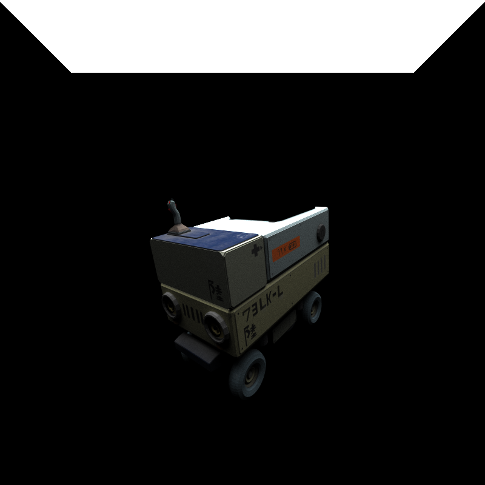

And here's a procedural grid style texture:

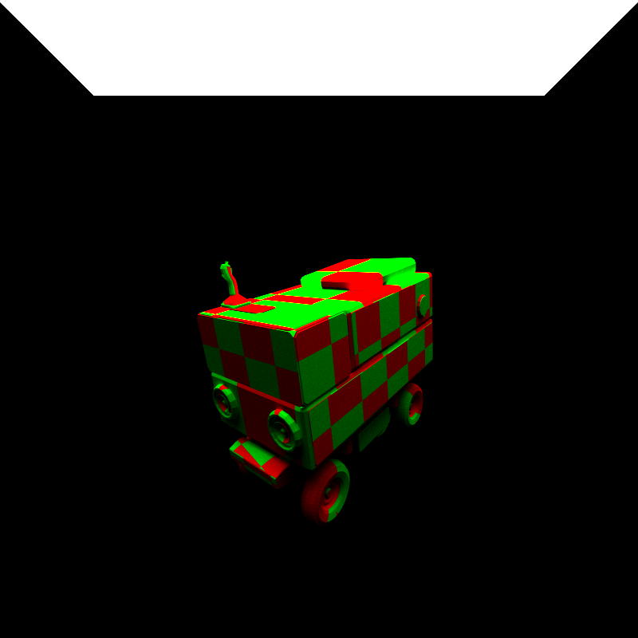

Here is an average frame time comparison between the two texture types at 100 iterations with depth 8:

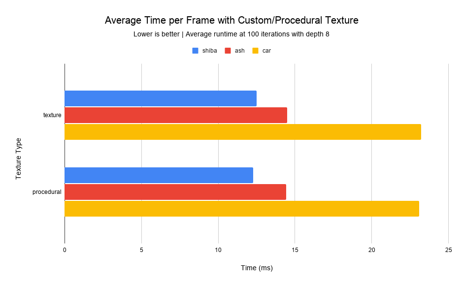

Switching from the gltf/glb texture to the procedural texture does not seem to have much of a difference. I think the runtime here really depends, for example if I have some super large textures with massive uv maps, it the custom texture may take more time. Similarly, if the procedure was very complex, that would take more time. Right now neither is super complex so they're both similarly speeds. I imagine the procedural method I implemented could be improved because I have it inside the shade kernel as `if ((checkerU + checkerV) % 2 == 0)`. It would probably be better to precompute and create a texture for it during mesh loading.

With the current implementation, it makes sense for it to be on GPU because each point runs the same procedure in parallel.

### Stream Compaction

Stream compaction is useful because it reduces the number of kernels that need to get run whenever a path reaches its termination conditions. To see the impact of stream compaction, below are the number of unterminated rays over 8 bounces in cornell_closed with and without stream compaction. The cornell_closed scene is just cornell but with 6 walls instead of 5, and with the camera shifted to be inside the room. The 6th wall (behind the camera) can be toggled on and off. Both open and closed share an "OFF" column because there is nothing to reduce the number of paths to start kernels for.

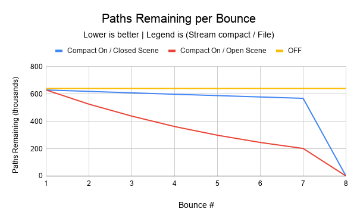

||Bounce 1|Bounce 2|Bounce 3|Bounce 4|Bounce 5|Bounce 6|Bounce 7|Bounce 8|
|-|-|-|-|-|-|-|-|-|
|Compact On, Open|628992|525228|437713|361574|298040|245174|201373|0|
|Compact On, Closed|628992|618738|608032|597767|587860|577896|567914|0|
|No Compact|640000|640000|640000|640000|640000|640000|640000|640000|

From this, it is clear that stream compaction reduces the number of paths remaining. Kernels are created based on the number of paths remaining, therefore stream compaction reduces the number of kernels that are created, which improves runtime. With `iterationComplete` being based off of num_paths left, stream compaction can even end iterations early, which is another time saver.

This behavior is expected because paths can either hit a light, hit an object, or hit nothing. For the cases of hitting a light or hitting nothing, remaining bounces is set directly to 0. When a path hits an object, remaining bounces is decremented, and will carry on to the next bounce. As shown in the chart, the open scene gets compacted more because some of the paths will point towards the outside where there will be no collisions, and their bounces remaining will be set to 0.

## Credits

[**tinygltf:**](https://github.com/syoyo/tinygltf/) I took three files from the tinygltf repo linked in the instructions:

- tiny_gltf.cc
- tiny_gltf.h
- tinygltf_json.h

**Sketchfab meshes:**

- [Car by cuadot.fbx](https://skfb.ly/owHIr)

- [Shiba by zixisun02](https://skfb.ly/6WxVW)

- [Silent Ash by maxpanysh](https://skfb.ly/ooWKu)

- [The Billiards Room by The Hallwyl Museum (Hallwylska museet)](https://skfb.ly/6w99H)
