**University of Pennsylvania, CIS 565: GPU Programming and Architecture, Project 3**

* Alice Liu
  * [LinkedIn](https://www.linkedin.com/in/aliceliuu/), [personal website](https://aliceliu.xyz/)
* Tested on: Windows 11, AMD Ryzen 5 7640HS @ 4.30GHz 16GB, RTX 4060 Laptop GPU 8GB (Personal Laptop)

## CUDA Path Tracer

  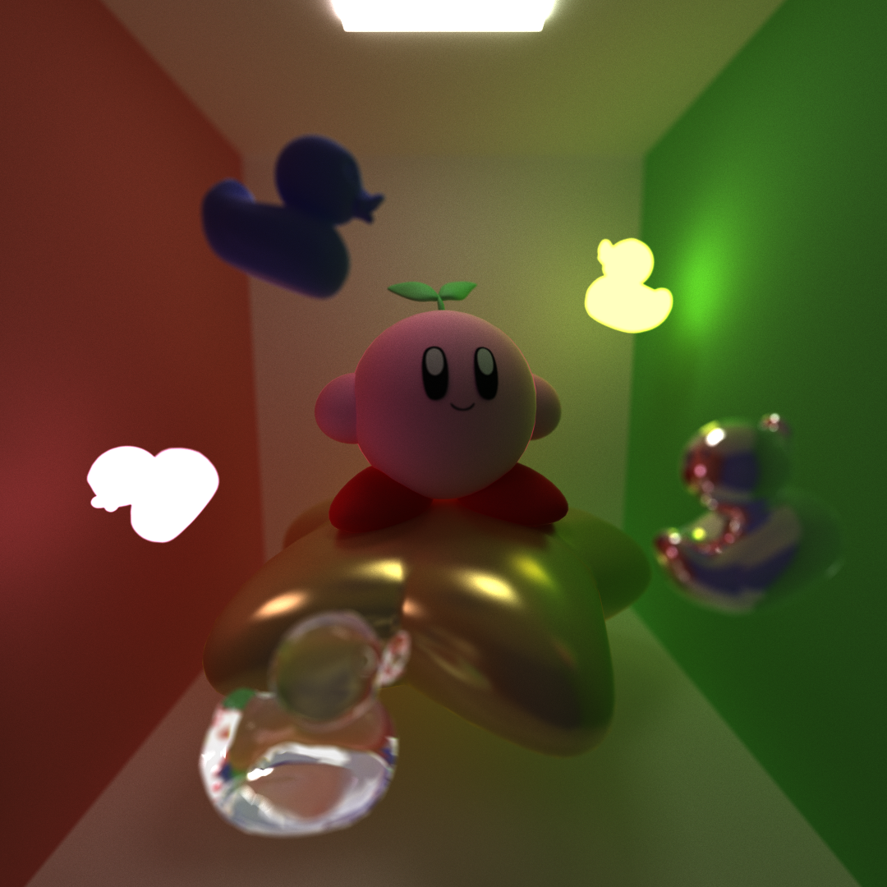 
  1080 x 1080 pixels, 7000 iterations, 8 depth, ~31.5k triangles

## Overview
In this project, I implemented a GPU based path tracer with CUDA and C++. It simulates how light bounces around a scene by tracking light rays for each pixel in parallel on the GPU. With each iteration, the scene converges into an image of the scene. 

Core Features Implemented:
- Basic path tracing
- Diffuse, specular, non-perfect specular, and refractive materials
- Stochastic sampled anti-aliasing
- Stream Compaction
- Material sorting
- Depth-of-field (thin lens model)
- GLTF mesh and basic material loading
- Bounding Volume Hierarchy (BVH) 

## Materials and BSDFs

| Diffuse | Specular with 0.5 Roughness | Specular with 0.0 Roughness | 
|---|---|---|
|  | 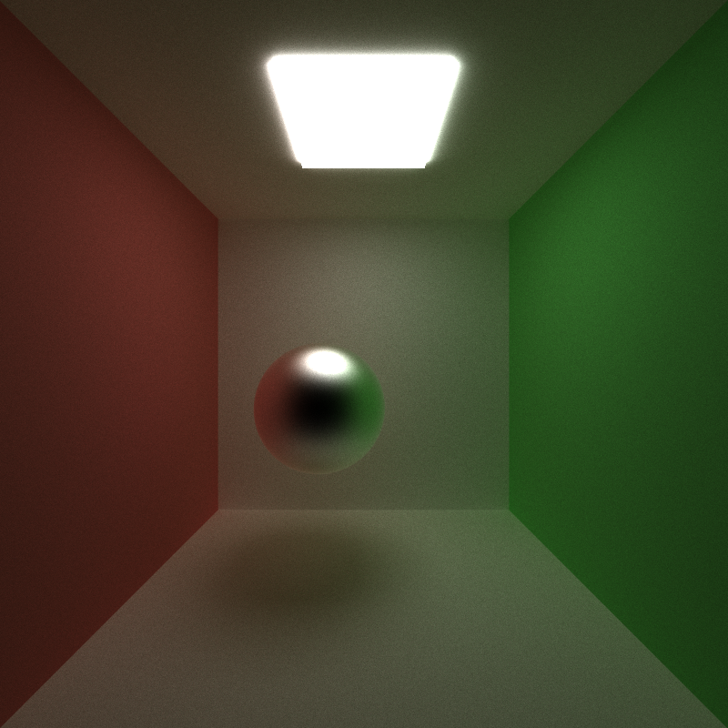 | 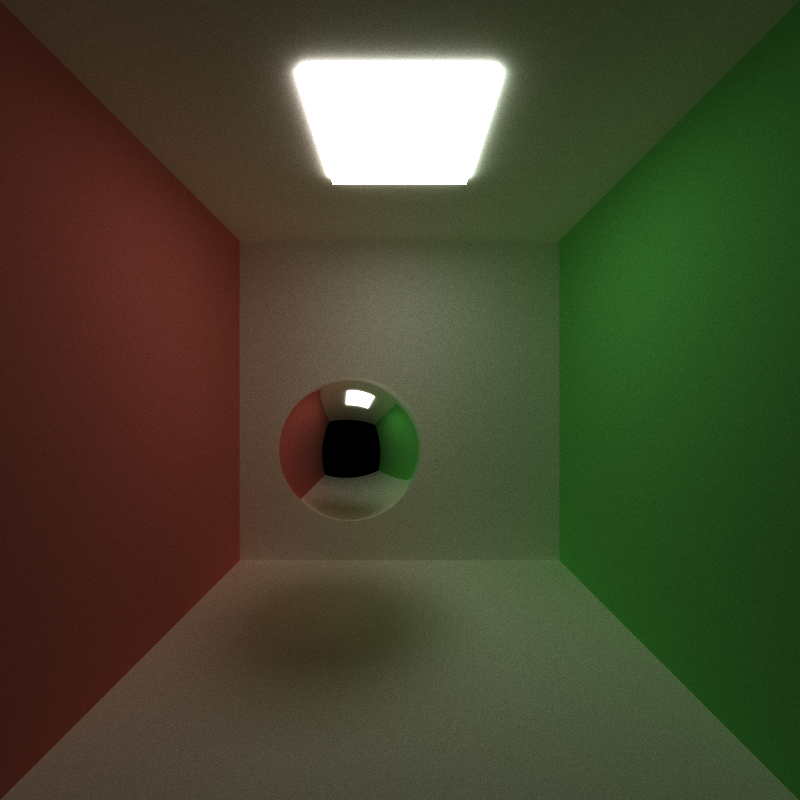 |

I implemented a stochastic scattering model that combines diffuse reflection, glossy specular reflection, metallic reflection, and refraction. At each intersection, the material selects a scattering event probabilistically based on the material's metallic, roughness, and transmission properties.

Glossy reflections are sampled around the perfect reflection direction, with roughness controlling the spread of the sampled directions. A roughness of 0.0 produces a perfect specular reflection, while increasing roughness produces increasingly diffuse reflections as seen in the images above. 

As an optimization, I sorted the rays by materialId before shading (using thrust::sort_by_key), as different materials/BSDF evaluations take different amounts of time to complete. Grouping rays by material helps make threads within the same warp execute the same shading logic to prevent warp divergence. 

### Refraction
| 10000 iterations, 8 depth, IOR of 1.52 (glass) | 10000 iterations, 8 depth, IOR of 2.417 (diamond) |
|---|---|
| 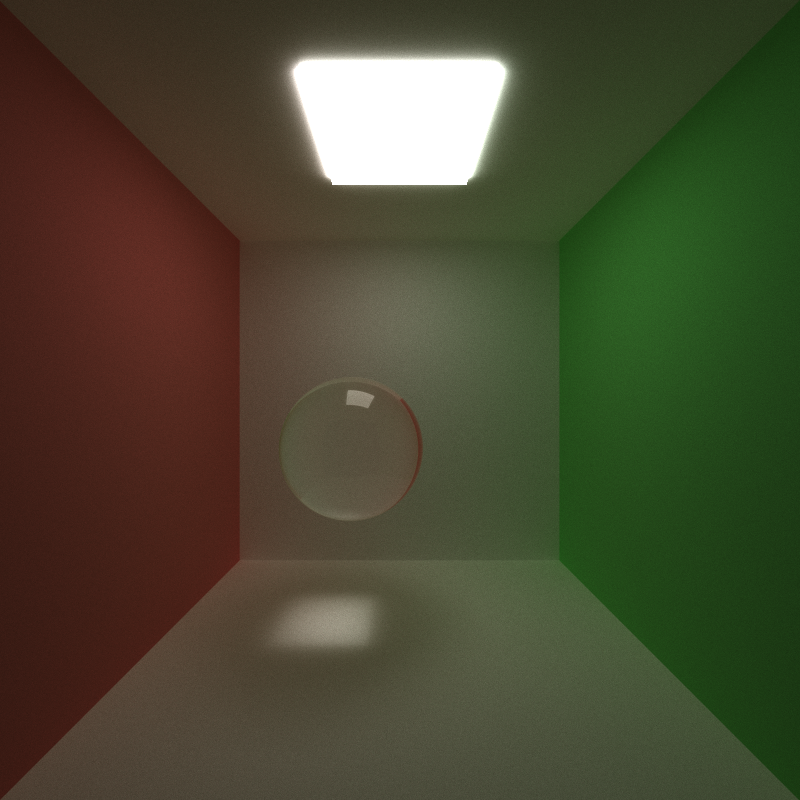 | 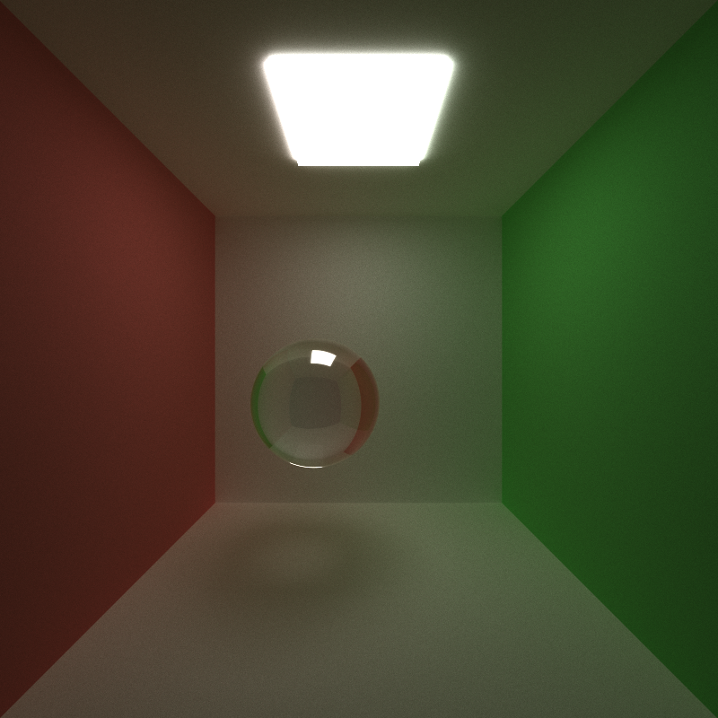 | 
| 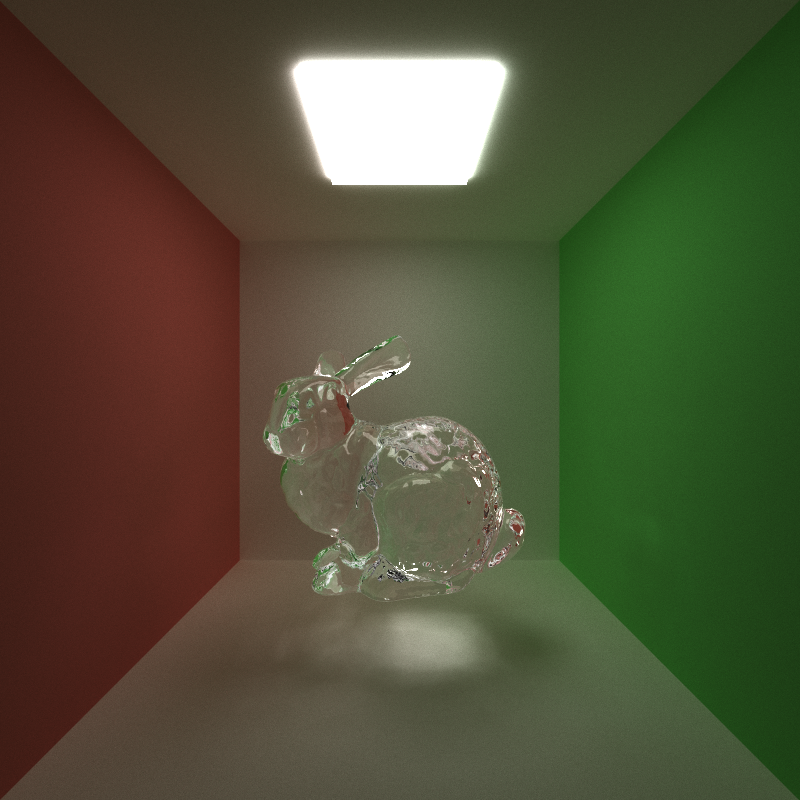 | 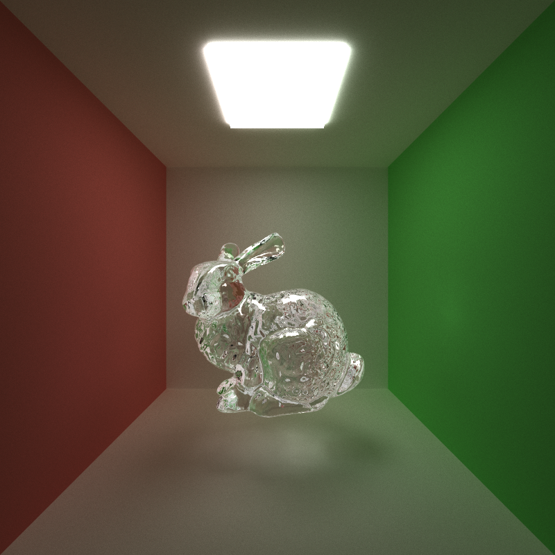 |

I implemented dielectric refraction using Schlick's approximation for Fresnel reflectance and Snell's law for transmitted ray directions. The Fresnel term determines the probability of reflection vs transmission, producing stronger reflections at grazing angles. The implementation also handles total internal reflection when refraction is not possible.

The above images show some of the possibilities with the implementation, as you can adjust the Index of Refraction (IOR) of the material to achieve different results. 

## Stochastic Sampled Anti-Aliasing
| Pre anti-aliasing | Post anti-aliasing |
|---|---|
| 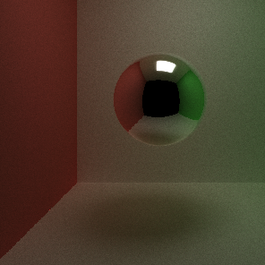 | 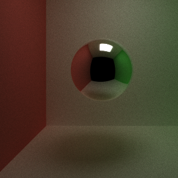 | 

I implemented anti-aliasing by simply jittering each ray by a random small factor. This results in much smoother, less pixelized renders as seen above. 

## Physically-Based Depth-of-Field
| No depth of field | With depth of field |
|---|---|
|  |  |
| 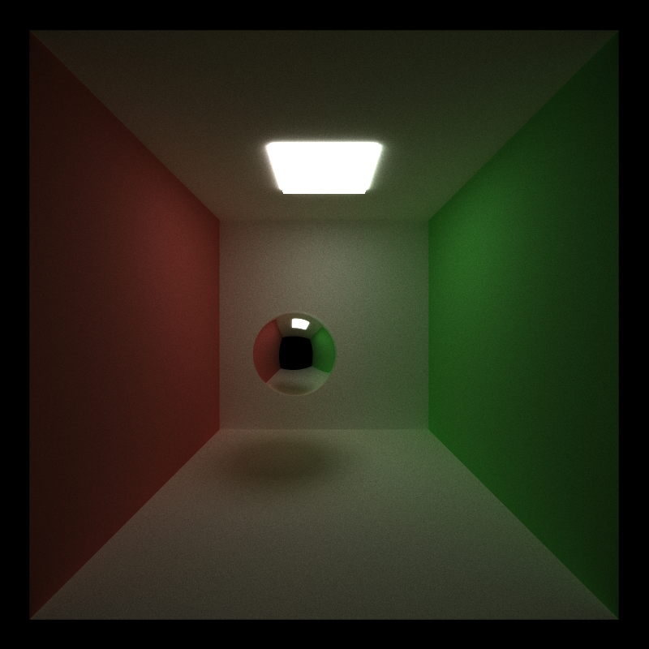 | 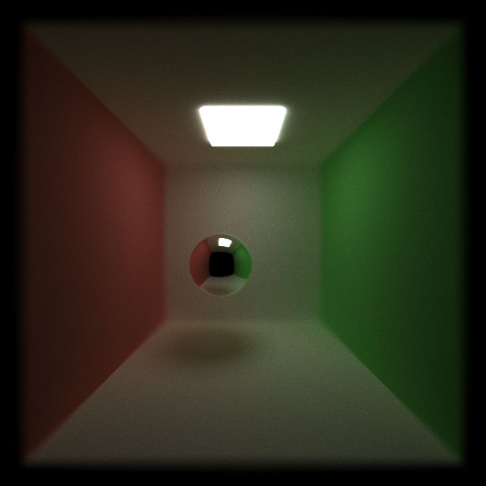 |

Pinhole cameras produce images where each object in the scene is sharp and in focus. I implemented depth of field using a thin lens approximation to emulate objects being in and out of focus.  Lens radius and focal distance are editable parameters that can be tweaked to achieve different results. 

## GLTF Mesh Loading
| Kirby + star model (material loading) | Khronos ducks |
|---|---|
| 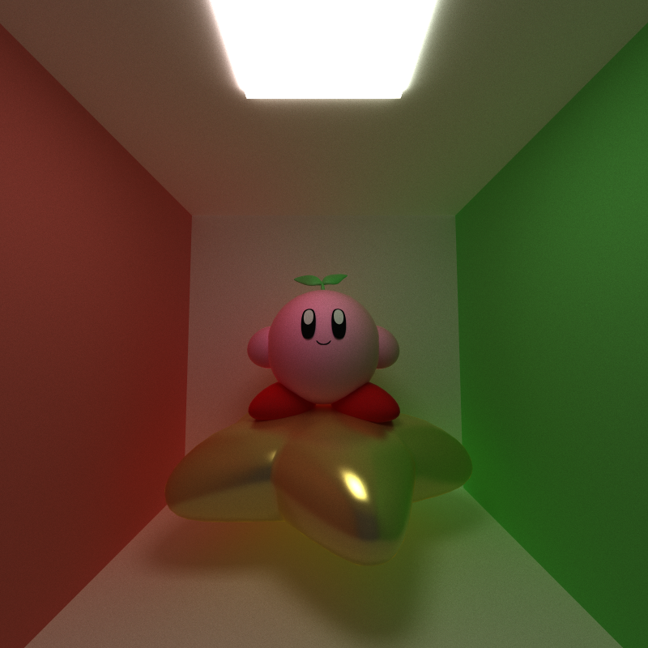 | 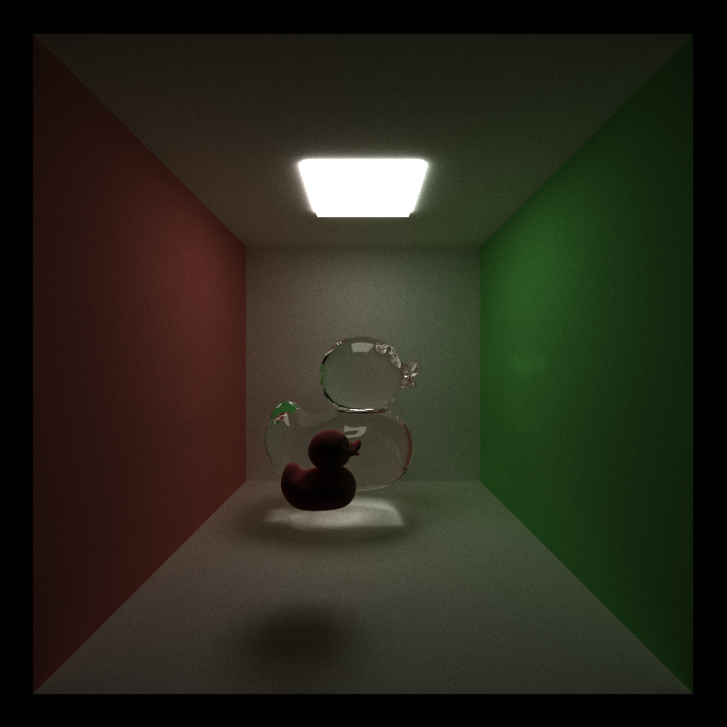 | 

I added GLTF mesh loading using the tinygltf library. This works by getting the vertex positions and normals from the node based file and converting them to triangles. I also implemented Möller–Trumbore ray-triangle intersection to support rendering of this new filetype. 

The implementation also extracts basic materials, by parsing base color, metallic/roughness factors, and transmission values. You can see this in the kirby model, where all the materials on kirby and the star are from the GLB file. 

## Bounding Volume Hierarchy
I implemented Bounding Volume Hierarchy (BVH) a hierarchical spatial data structure for better intersection testing. It is highly inefficient to test a ray intersection with every single triangle in the scene. BVH allows us to test against a much smaller subset. I have one BVH tree that encompasses every mesh that is in the scene. 

BVH starts with CPU Tree Construction, where the meshes are partitioned into an axis-aligned bounding box (AABB) tree. At each node, triangles are sorted along their longest axis and split at the median centroid. Then, DFS is used to flatten the tree into a 1D array.

Then, the tree is traversed iteratively on the GPU. Where sub-trees are pruned if the ray misses a box. Near and far child bounds are checked so the traversal stack prioritizes the closer node, reducing unnecessary leaf-level triangle intersections.

## Performance Analysis

All analysis was taken from the average of 1000 iterations, stream compaction on, and material sorting off unless otherwise specified. 

### Stream Compaction Analysis

  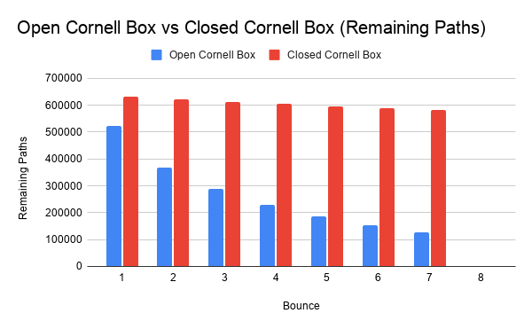 

From the graph, we can see the stream compaction helped a lot with reducing the number of paths for the open cornell scene. However, for the closed cornell scene, it did not have as large as an effect. This makes sense because the open cornell scene would have mich more terminating rays that fly out the open side past the kill threshold and are terminated, while in the closed scene, rays are not able to escape as easily. 

### Material Sorting Analysis

  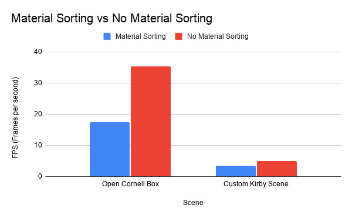 

The Open Cornell scene has 5 materials and the Custom Kirby scene has 13 materials. From the graph, you can see that material sorting actually decreased performance for both of the scenes. In the open cornell scene with less materials, performance decreased by 50.87%, while in the custom kirby scene with more materials, performance only decreased by 30.40%. With more materials, the optimization will likely give a performance boost, but since my scenes are relatively simple, it was actually worse for performace. 

### Bounding Volume Hierarchies Analysis

  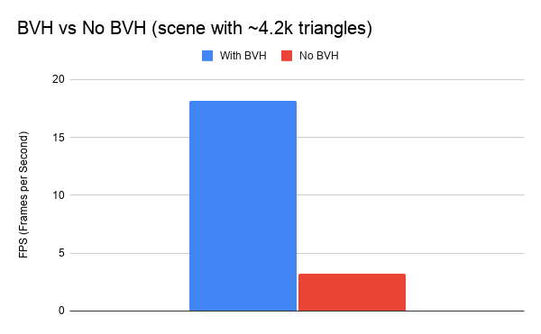 

From the graph, we can see that BVH greatly increased performance (~5.7x), even for a scene with not too many triangles. This makes sense because without BVH, each active ray performs a linear $O(N)$ intersection test across all ~4,200 triangles on every bounce. BVH reduces the average search space per ray to $O(\log N)$.

  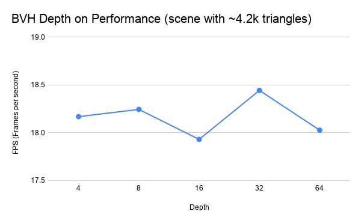 

We can see that changing the depth of the BVH tree did not have a large impact on performance. It looks like for this scene specifically, a depth of 32 performed the best. 

## Bloopers

  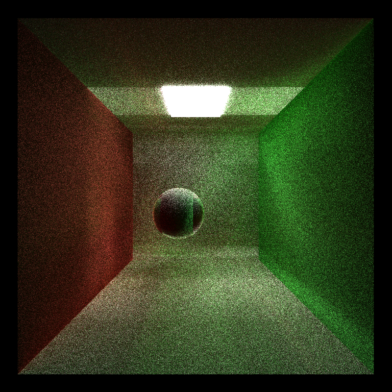 
  Blooper from the very beginning where I forgot to mark iterations as complete after   reaching the max trace depth. Resulted in these lines/sections in the render. 

  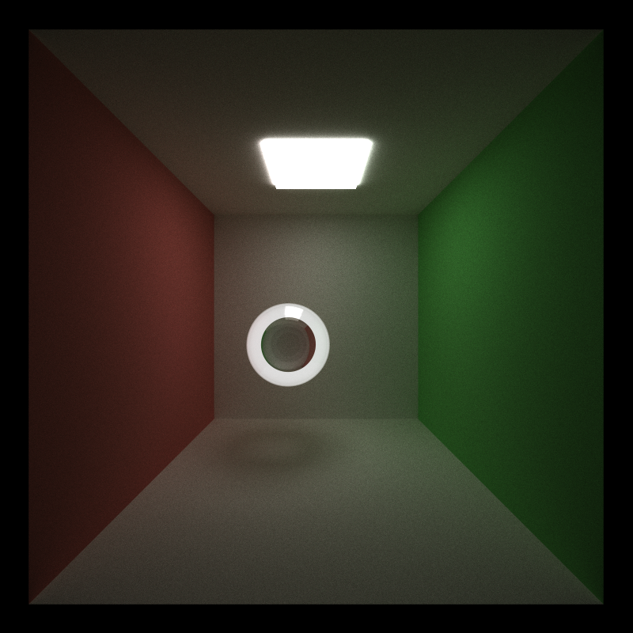 
  Refraction implementation blooper where my original ray origin epsilon (0.0001) offset was   not large enough,  causing the white ring. Increasing epsilon to 0.001 fixed this!

## Attribution
### Libraries: 
- [tinygltf](https://github.com/syoyo/tinygltf)

### References: 
- [Diffuse Materials](https://pbr-book.org/4ed/Reflection_Models/Diffuse_Reflection)
- [Generating Specular Rays](https://developer.nvidia.com/gpugems/gpugems3/part-iii-rendering/chapter-20-gpu-based-importance-sampling)
- [Specular and Refractive Materials](https://pbr-book.org/4ed/Reflection_Models/Specular_Reflection_and_Transmission)
- [Schlick's Approximation](https://en.wikipedia.org/wiki/Schlick%27s_approximation)
- [Stochastic Anti-Aliasing](https://paulbourke.net/miscellaneous/raytracing/)
- [Thin Lens Camera/Depth of Field](https://pbr-book.org/4ed/Cameras_and_Film/Projective_Camera_Models#TheThinLensModelandDepthofField)
- [Bounding Volume Hierarchy](https://pbr-book.org/3ed-2018/Primitives_and_Intersection_Acceleration/Bounding_Volume_Hierarchies#)

### Models:
- [Duck](https://github.khronos.org/glTF-Assets/model/Duck)
