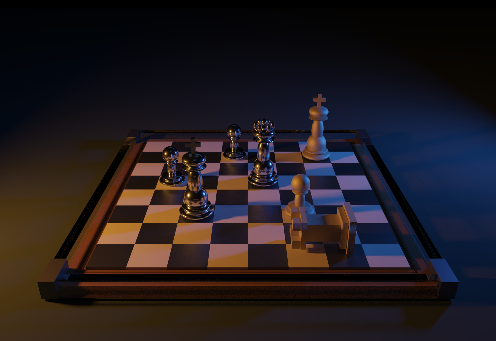
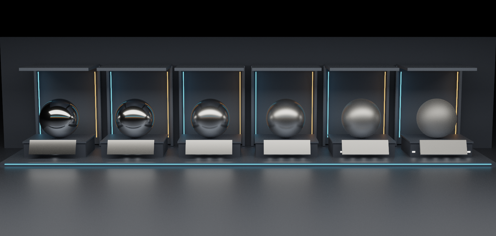
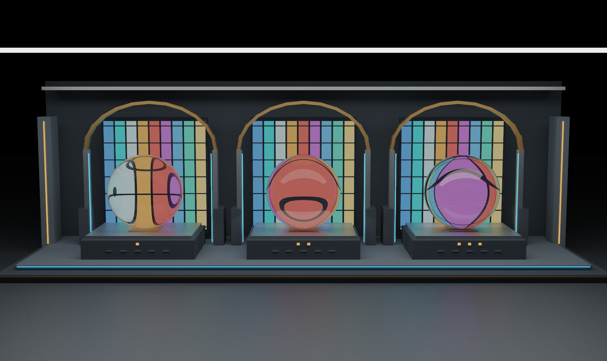
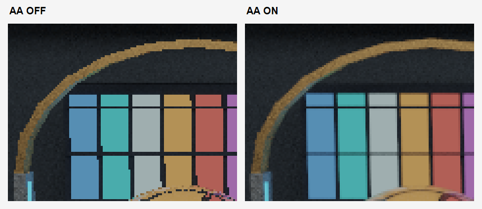
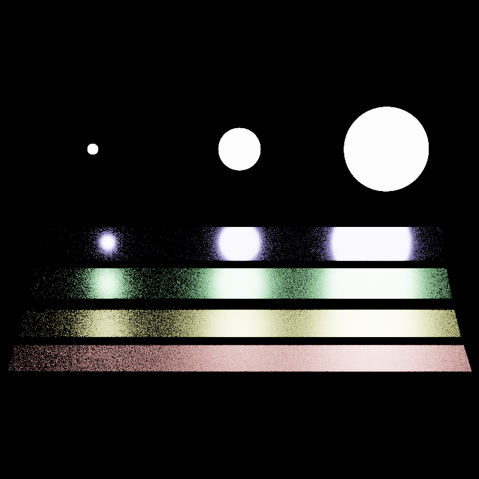
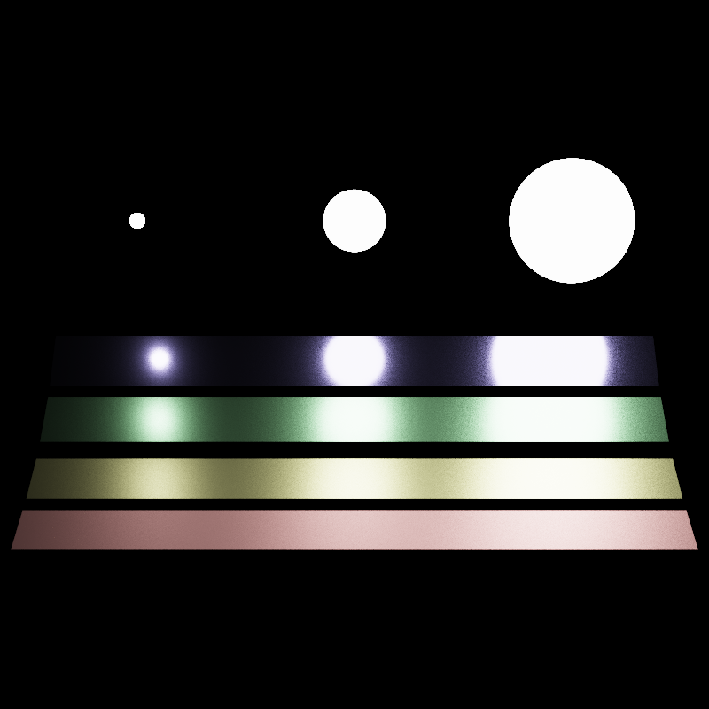
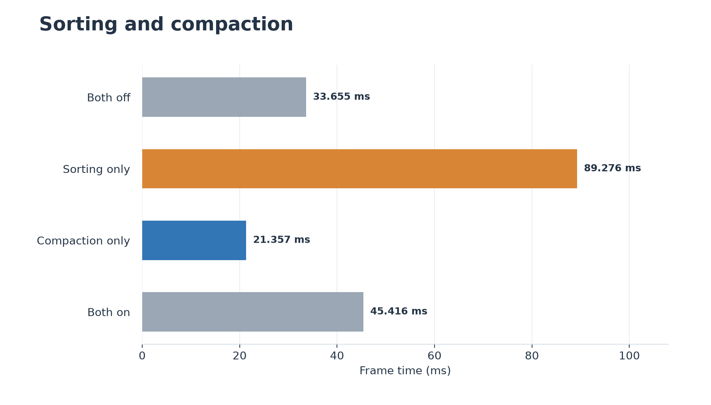
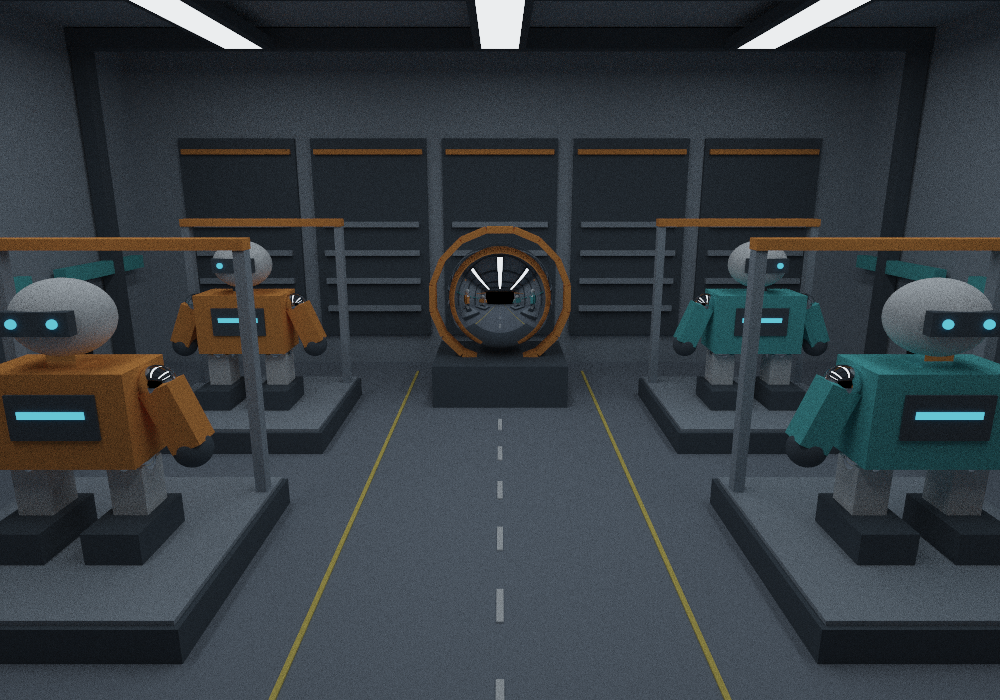
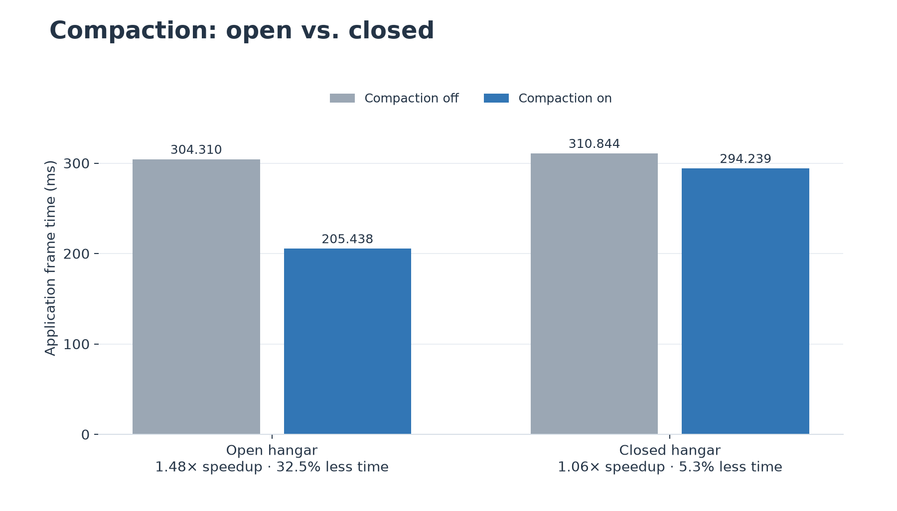
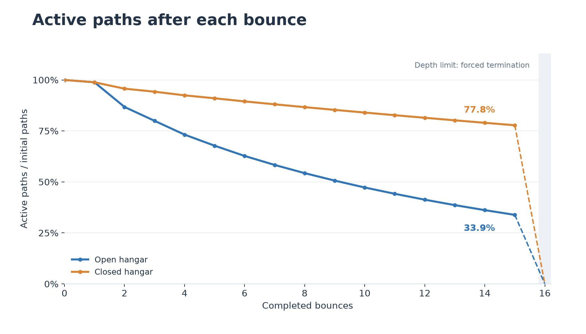

# CUDA Path Tracer

**Zi Yang** · [LinkedIn](https://www.linkedin.com/in/zi-yang-3359653b2/)

*The Last Move — rough and polished metals, a glass border, and warm–cool lighting.*

## Features

- Diffuse, mirror, dielectric, and GGX materials
- Next-event estimation with multiple importance sampling
- Stochastic antialiasing
- Toggleable material sorting and stream compaction

## Test Environment

Windows 11 · AMD Ryzen 9 7845HX · 16 GB RAM  
NVIDIA GeForce RTX 4060 Laptop GPU · 8 GB VRAM

## Materials

### Diffuse and Mirror Reflection

Cosine-weighted Lambertian sampling and ideal specular reflection. The cover scene uses diffuse board tiles and mirror backing beneath the glass frame.

### GGX Microfacet Reflection

*Left to right: roughness α = 0.01, 0.02, 0.05, 0.10, 0.20, 0.40; F₀ = (0.8, 0.8, 0.8).*

GGX distribution, Smith masking-shadowing, and Schlick Fresnel, with half-vector sampling. Increasing roughness broadens the highlights.

### Dielectric Refraction

*Left to right: IOR = 1.10, 1.33, 1.50.*

Schlick Fresnel selects reflection or transmission, with total internal reflection handled explicitly. The colored grid reveals refraction through clear glass.

## Sampling

### Stochastic Antialiasing

*Matching crops enlarged 4× with nearest-neighbor scaling.*

Random subpixel positions replace pixel-center rays, smoothing silhouettes without extra rays per iteration.

### Next-Event Estimation and MIS

| BSDF-only | NEE + MIS |
|:---:|:---:|
|  |  |

*Same scene, camera, and sample count. The MIS toggle enables both NEE and MIS weighting.*

Light and BSDF samples are combined using the power heuristic, reducing noise on diffuse and GGX surfaces. Mirrors and dielectrics use BSDF sampling only.

## Performance Analysis

Release build; fixed camera after warm-up. Times are means of three application-display readings, including synchronization, readback, and display overhead.

### Material Sorting

`thrust::sort_by_key` groups paths by material type before shading, reordering paths and intersections together.

*Roughness gallery; AA and MIS enabled. Lower is better.*

Sorting was slower; compaction alone achieved **1.58× speedup**. Limited material diversity may leave little divergence to eliminate, while sorting adds work each bounce.

### Stream Compaction

An alive mask, exclusive scan, and scatter pass remove terminated paths after each bounce. The scan uses global-memory up-sweep/down-sweep passes; the active count is read back to the CPU.

*Open hangar. The closed variant adds only a wall behind the camera.*

Tests use 1000 × 700 resolution, depth 16, sorting off, and AA/MIS on.

Compaction saves **32.5%** in the open scene versus **5.3%** in the closed scene. Escaping paths leave less work for later bounces.

*One iteration per scene, starting with 700,000 paths. Dashed segments indicate forced termination at depth 16.*

At bounce 15, **33.9%** of paths remain in the open scene versus **77.8%** in the closed scene, consistent with the larger compaction benefit.

## Scene Format

JSON scenes define `Materials`, `Objects`, and `Camera`. Geometry supports `cube`, `sphere`, and `rectangle`. Added materials: `Dielectric` with `IOR` (default 1.5), and `Microfacet` with `ROUGHNESS` (GGX α, default 0.5, clamped to 0.001–1). `Mirror` aliases `Specular`; camera `ITERATIONS` and `DEPTH` set sample count and path depth.

## References & Acknowledgments

Most rendering code was developed with reference to [my own CIS 5610 Path Tracer](https://github.com/CIS-4610-2026/homework-07-global-illumination-GuoRen0830), from the Global Illumination assignment.

- [PBRT — Roughness Using Microfacet Theory](https://pbr-book.org/4ed/Reflection_Models/Roughness_Using_Microfacet_Theory)
- [PBRT — A Better Path Tracer](https://pbr-book.org/4ed/Light_Transport_I_Surface_Reflection/A_Better_Path_Tracer)
