CUDA Path Tracer
================

**University of Pennsylvania, CIS 565: GPU Programming and Architecture, Project 3**

Thomas Lee

[LinkedIn](https://www.linkedin.com/in/thomas-lee-6353b5253/) · [Portfolio](https://thomaslee03-github-io.vercel.app/)

* Tested on: Windows 11 Pro, AMD Ryzen 9 7845HX, 64 GB RAM, NVIDIA GeForce RTX 4070 Laptop GPU (8 GB). Personal laptop.
* Build: Visual Studio 2022, MSVC 14.44, CUDA 13.3, NVIDIA driver 610.88, Release x64.

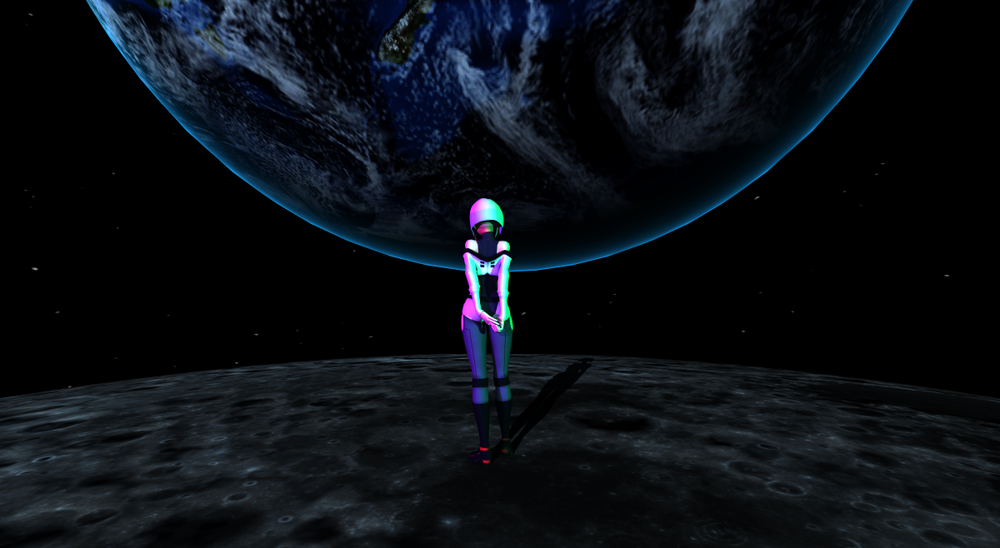

## Introduction

This project implements a CUDA path tracer with imported triangle meshes, image textures, procedural textures, and bump mapping. I built a scene referencing a character from Cyberpunk Edgerunners using colored directional lights, textured and bump mapped spheres, and a procedurally generated sky.

The performance work compares material sorting, active path compaction, and BVH traversal. The largest improvement came from the BVH: a test scene with BVH rendered about 73.5 times faster than using the brute force method. One interesting find was that sorting and compaction, which should have been performance optimizations, actually added more overhead than they saved in the scenes tested here.

## Implemented Features

- Diffuse scattering and ideal mirror reflection, with multiple bounces.
- Stochastic antialiasing using jittered samples in a repeating 2×2 pixel subdivision.
- Toggleable material sorting with thrust::sort_by_key.
- Active-path compaction with thrust::partition.
- Static glTF/GLB mesh loading and triangle intersection.
- CPU-built BVH with iterative GPU traversal for surface and shadow rays.
- File loaded color textures and a custom procedural texture.
- Height-based bump mapping.
- Directional lights with shadow rays, optional accent lighting, an atmosphere rim effect, and a procedural star sky.

**Mesh Loading and BVH**

I added gltf mesh loading so I could bring more detailed models into the renderer. The loader turns the imported geometry into triangles that the GPU can intersect with rays. To avoid checking every triangle for every ray, I built a BVH containing both the mesh triangles and the scene’s spheres and cubes. At each level, I split the objects into two roughly equal groups based on their centers along the longest bounding-box axis. I repeat this until each leaf contains one primitive. I store the nodes in an array, with indices connecting parents to their children. The GPU walks this hierarchy using a stack, skipping regions that cannot contain a closer hit.

**Textures and Bump Mapping**

I added image textures so I could give the imported models more surface detail. I load the texture pixels into a shared GPU buffer and use the UV coordinates at each intersection to look up the color. During loading, I convert color textures from sRGB to linear values for the lighting calculations. I also implemented a procedural 16x8 texture, which calculates its colors directly from UV coordinates instead of reading an image. For bump mapping, I wanted the some of my objects surface's (specifically a moon I use in a scene) to show divots without adding more geometry. I sample a height map at the intersection and at two nearby UV positions, using a fixed offset of 0.01. The height differences tell me how to adjust the surface tangents, and I take their cross product to calculate a new shading normal. This changes how light interacts with the surface while keeping the actual geometry and silhouette unchanged.

**Direct Lighting and Scene Effects**

I wanted to have light sources like the sun in my final scene, so I decided to implement directional lights. For each light, I trace a shadow ray to check whether anything blocks it. If the surface is visible to the light, I calculate its diffuse contribution using the surface normal and light direction. I also wanted colored lighting on Lucy without giving the moon and Earth the same tint, so I added flags that let individual materials ignore the accent lights. I also added a blue rim around Earth and a procedural star field to complete the space setting. 

## Benchmarking Methodology

All recorded runs used the Release executable. CUDA events measure stages in the default stream. One iteration generates one camera sample per pixel. The first 10 iterations are omitted from timing output.

For my initial comparisons, I ran each configuration once and averaged the timings across many rendering iterations. All my tests used either my final scene or the Cornell box with an open and closed variations. I tested most implementations with an open version of the Cornell box, where rays could escape through the front, and a closed version, where the walls kept paths inside until they hit a light or reached the bounce limit. I later repeated the open scene tests in separate runs to check how consistent the results were, and I report those results separately. I kept the preview active while benchmarking. Using CUDA events, I measured rendering from camera ray generation through final image accumulation, including buffer clears and gaps between stages. These timings exclude scene loading, CPU BVH construction, image saving, and display/readback. The shading measurements also include shadow-ray traversal. I used Nsight separately to examine the individual kernels and CUDA API calls behind these stage timings.

| Comparison | Resolution | Maximum depth | Matched measured iterations |
| --- | --- | --- | --- |
| Compaction, open and closed | 800 × 800 | 8 | 4,990 per configuration |
| Material sorting | 800 × 800 | 8 | 2,544 per configuration |
| BVH, Lucy scene | 128 × 128 | 2 | 90 per configuration |
| Image / procedural textures | 800 × 800 | 8 | 4,990 per configuration |
| Bump mapping | 800 × 800 | 8 | 4,990 per configuration |
| Antialiasing | 400 × 400 | 8 | 4,990 per configuration |
| Rim lighting | 1200 × 1200 | 2 | 4,990 per configuration |
| Procedural sky | 1200 × 1200 | 2 | 4,990 per configuration |
| Directional lighting | 800 × 800 | 8 | 4,990 per configuration |

Sorting is disabled except in its own comparison. Compaction is disabled for the sorting, BVH, texture, and bump comparisons. BVH is enabled except in its brute-force baseline. Ray counts are collected separately from timing. Random seeds use pixel identity and remaining depth so path reordering does not change the samples assigned to a pixel.

## Performance Analysis

**Antialiasing**

| Antialiasing off | Antialiasing on |
| --- | --- |
|  | 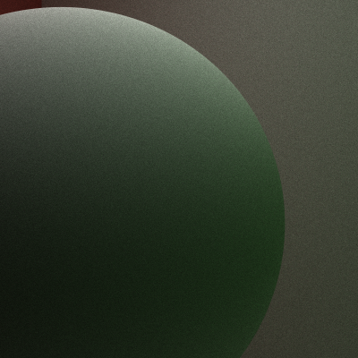 |

Both images use the same close-up camera, diffuse sphere, 400 × 400 resolution, depth 8, and 5,000 samples per pixel. With antialiasing disabled, each pixel traces the same primary direction every iteration. With it enabled, we can see that the silhouette is smoother with antialiasing enabled.  

Across 4,990 measured iterations, total rendering averages 3.314 ms with antialiasing off and 3.311 ms with it on. This difference is too small to establish a performance advantage, thus these runs show no meaningful overall cost difference.

**Active Paths in Open and Closed Scenes**

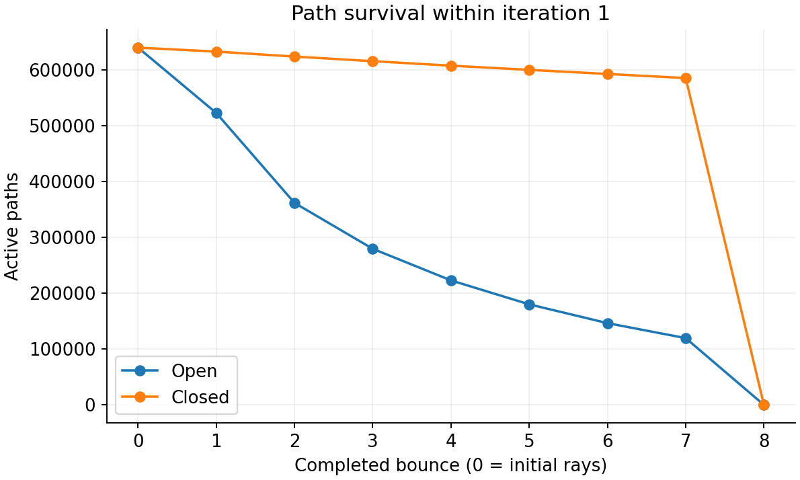

I wanted to compare open and closed scenes to see how quickly paths terminate and how much work stream compaction could remove. Both scenes start with 640,000 paths. Both scenes begin with 640,000 paths. By bounce 7, only 18.7% remain active in the open scene, compared with 91.5% in the closed scene. This gives compaction much more opportunity to reduce later work in the open scene, while the closed scene still needs to process nearly all its paths. Both curves reach zero at bounce 8 because of the maximum-depth limit.

**Stream Compaction**

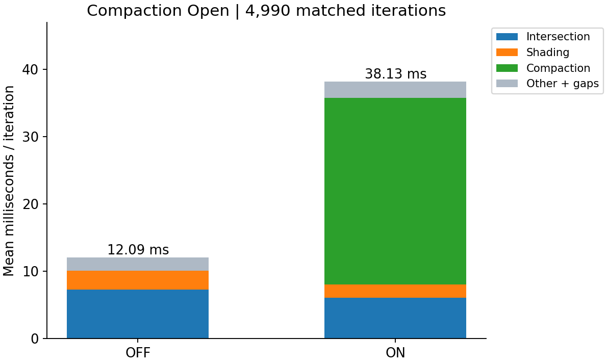

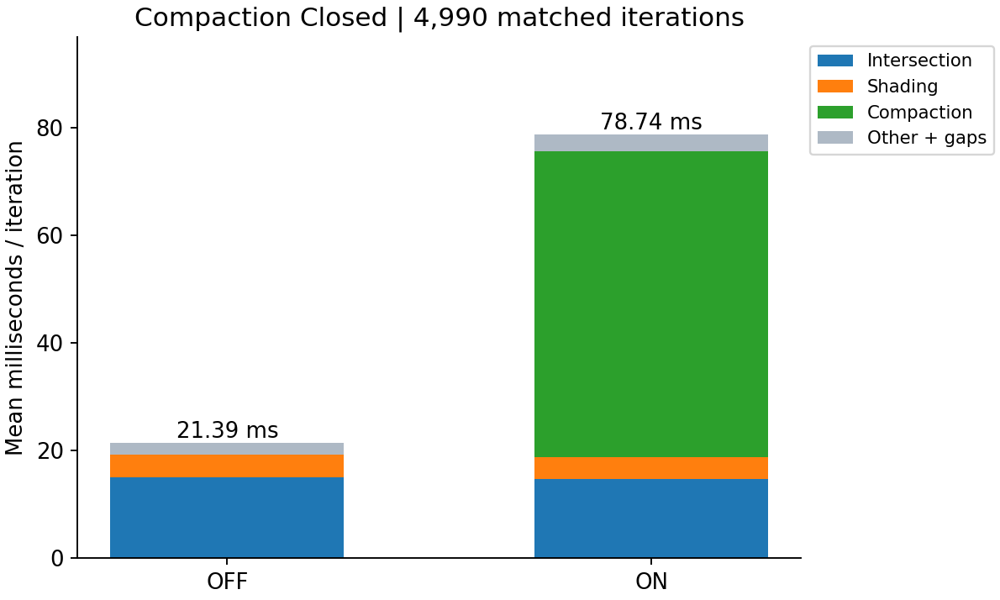

| Scene | Compaction off | Compaction on | On / off runtime |
| --- | ---: | ---: | ---: |
| Open | 12.09 ms | 38.13 ms | 3.15× |
| Closed | 21.39 ms | 78.74 ms | 3.68× |

Based on the ray counts, I expected compaction to help more in the open scene, where many paths terminate early. My implementation moves surviving paths to the front of the array so later kernel launches process fewer entries. Without compaction, I launch the full array each bounce, but threads assigned to terminated paths return immediately.

Surprisingly, that reduction in work did not translate into faster rendering in either scene. In the open scene, intersection and shading together dropped from 10.09 to 8.07 ms, but partitioning added 27.65 ms, which is far more than the time saved. In the closed scene, intersection and shading saved only about 0.49 ms while partitioning added 56.89 ms. 

The compaction timings also varied considerably within each run, with total-render standard deviations of 14.01 ms for the open scene and 15.09 ms for the closed scene. That led me to repeat the open-scene measurements and investigate with Nsight. Since the CUDA-event measurements can include synchronization and idle gaps between operations, I needed those traces to understand how much of the cost came from actual GPU work.

**Repeated Open-Scene Trials**

To check whether the slowdowns were consistent across separate runs, I repeated the open-scene tests three times for each configuration. Each run used 200 iterations, with the first 10 discarded as warmup. I also rotated the configuration order so the same test did not always run first. These shorter trials are reported separately from the original 5,000-iteration runs.

| Configuration | Mean render time | Standard deviation of trial means |
| --- | ---: | ---: |
| Baseline | 11.99 ms | 0.08 ms |
| Compaction | 24.72 ms | 0.35 ms |
| Sorting | 142.94 ms | 0.59 ms |

The repeated tests showed the same overall result: compaction was 2.06× slower and sorting was 11.92× slower than the baseline. The averages were fairly consistent across the three trials, although both slowdowns were smaller than in the earlier long runs.

This confirmed that the overhead was reproducible, but it did not explain where that time was going or why the longer runs were slower. I used Nsight next to investigate the internal kernels, allocations, and synchronization behind these results. The closed-scene comparison has not yet been repeated.

**Nsight Systems Follow-Up**

To understand where the overhead was coming from, I captured 50 iterations each of sorting and compaction in Nsight Systems. I disabled my event profiler during these captures. Since the traces include startup and warmup, I used them to investigate the work being performed rather than replace the benchmark timings above.

**Sorting**

The sorting trace showed that most GPU kernel time was spent inside CUB's merge-sort implementation. Merge kernels accounted for 82.4%, block-sort kernels for 9.0%, and merge-partition kernels for 1.2%.

Across 400 bounce level sorts, Nsight recorded 4,800 merge launches, 4,800 merge partition launches, and 400 block sort launches. My implementation sorts full intersection records using a custom material comparator, so grouping paths by material involves many internal passes. This helps explain why sorting costs much more than it saves in shading for this scene. 

**Compaction**

Compaction also involved more work than a single filtering pass. Nsight recorded selection, initialization, and two groups of internal for each kernels. Together, these accounted for approximately 54% of GPU kernel time in the capture.

This also explains why removing terminated paths is not "free" as the renderer must first do additional work to rearrange them. In my tests, that cost outweighed the savings in later intersection and shading stages.

**Allocation and Synchronization**

Both traces also showed frequent memory allocation and synchronization:

| CUDA API call | Sorting | Compaction |
| --- | ---: | ---: |
| `cudaMalloc` | 411 | 811 |
| `cudaFree` | 422 | 822 |
| `cudaStreamSynchronize` | 400 | 1,600 |

These counts include initialization and cleanup, but they suggest that reusing temporary buffers could be worth investigating.

Synchronization occupied a large share of CPU CUDA API time. However, the CPU can be waiting while GPU kernels execute, so this time overlaps device work, meaning it is not an additional cost to add to the kernel totals.

The traces helped explain the substantial work behind sorting and compaction, but they did not fully explain why the longer benchmark runs were slower.

**Material Sorting**

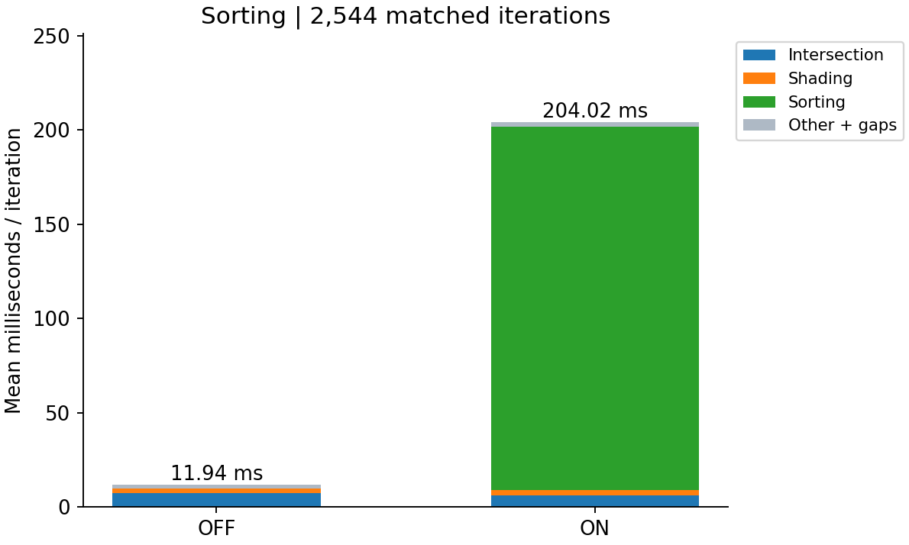

Sorting by material also ended up costing more than it saved. I expected grouping paths with the same material to reduce branching during shading, but in the initial run, average rendering time increased from 11.94 to 204.02 ms. Sorting alone took 192.53 ms, while shading barely changed from 2.753 to 2.745 ms.

The Cornell scene has only a few simple materials, so there may not be enough variation in shading work to justify sorting them. With compaction disabled for this comparison, I also sort the full path and intersection arrays every bounce, including terminated paths. The Nsight results above show how much internal sorting work this creates.

For this configuration, the shading savings were too small to recover that cost. A useful next test would be sorting only active paths or using a scene with more expensive, varied materials to see whether grouping them becomes worthwhile.

**BVH Acceleration**

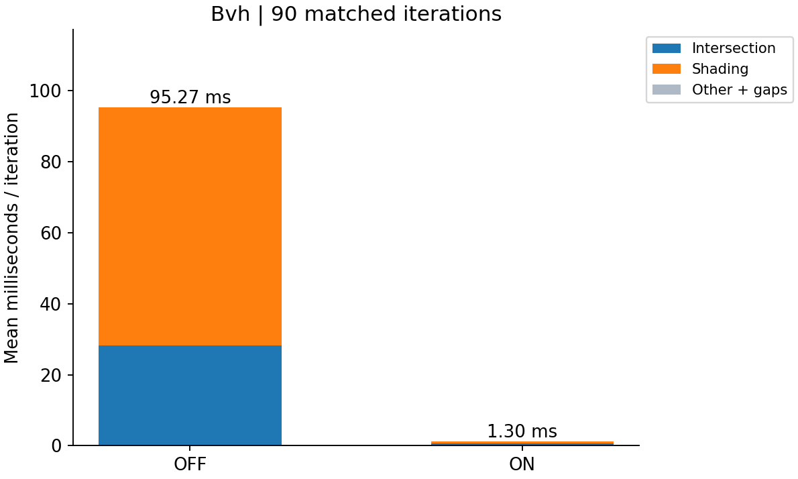

| Stage | Brute force | BVH |
| --- | ---: | ---: |
| Intersection | 28.29 ms | 0.70 ms |
| Shading, including shadow rays | 66.92 ms | 0.55 ms |
| Total rendering | 95.27 ms | 1.30 ms |

Although my other optimizations strategies did not pan out as well as I wished, the BVH optimization helped significantly. The BVH improves total rendering time by approximately 73.5×. It reduces primitive tests for camera/indirect rays and for shadow rays inside shading. Build time is excluded, so this measures traversal benefits after the structure is available.

**Image Textures vs. Procedural Textures**

| Moon image texture | Procedural checkerboard |
| --- | --- |
| 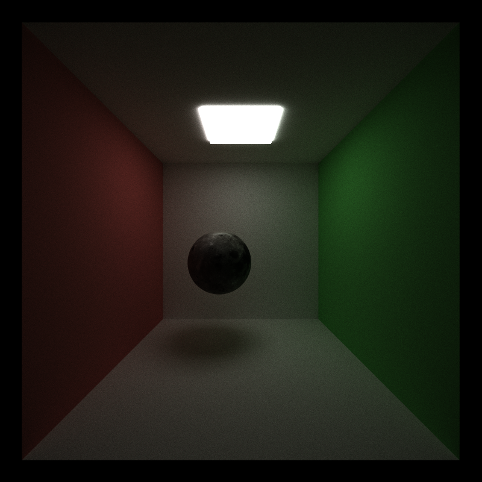 | 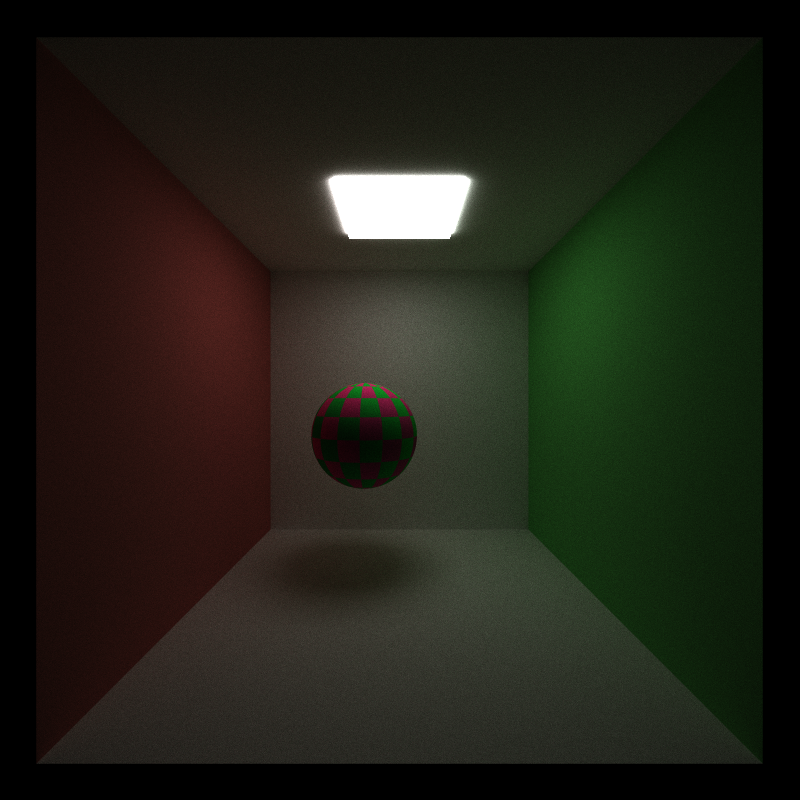 |

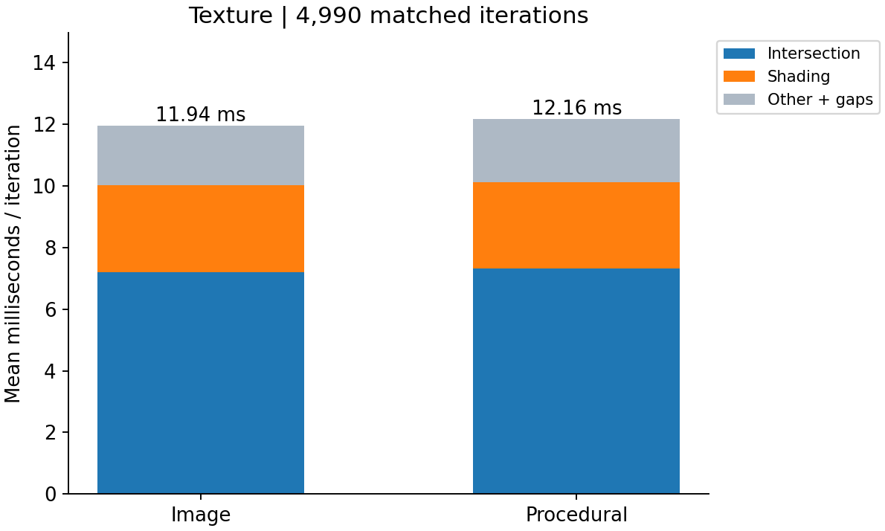

I wanted to see whether looking up colors from an image would be more expensive than calculating them procedurally. The moon image run averaged 11.94 ms overall and 2.808 ms in shading, while the procedurally generated checkerboard averaged 12.16 ms overall and 2.810 ms in shading. Shading time was almost identical. 

For this comparison, I changed only the sphere's color texture setup. One version reads an 8K moon image, and the other calculates colored checks from UV coordinates. Since the patterns and colors differ, this compares two representative texture workloads rather than two ways of producing exactly the same image. I also excluded texture loading and upload from the timings, and the rest of the scene used unchanged materials.

**Bump Mapping**

| Bump off | Bump on |
| --- | --- |
| 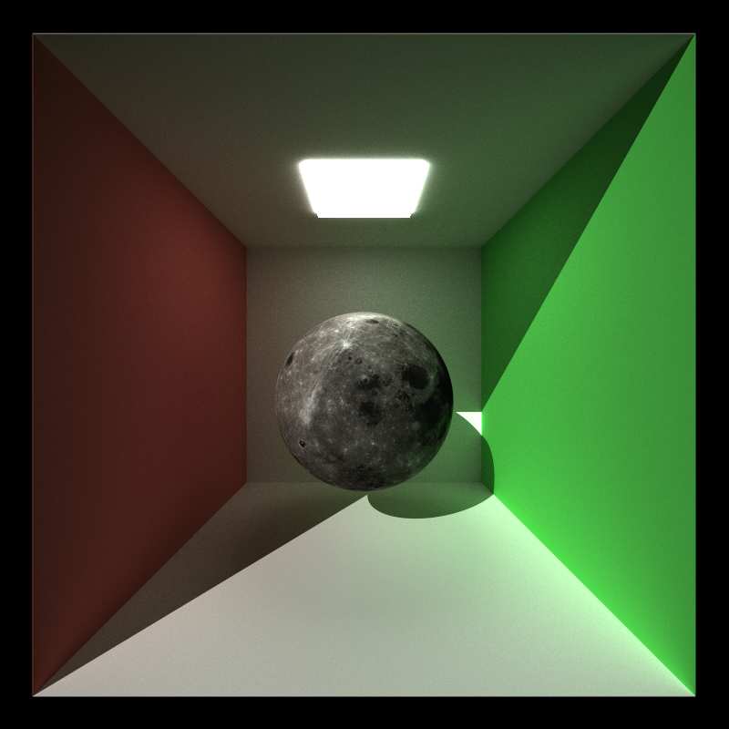 | 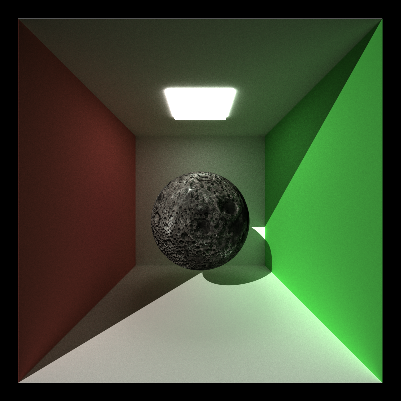 |

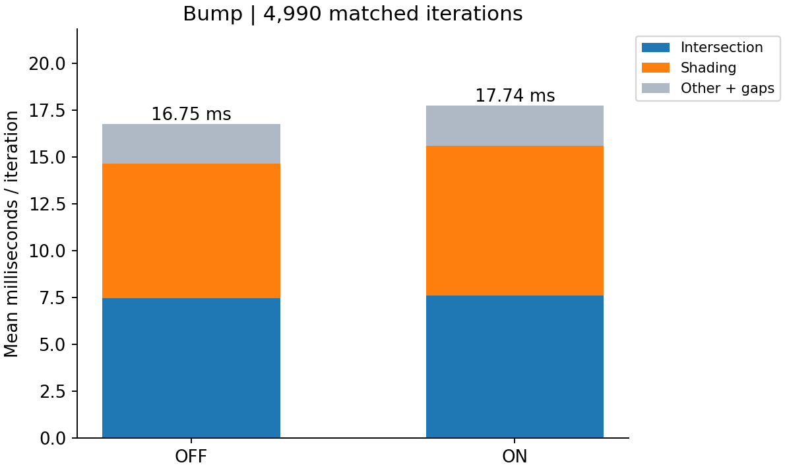

Next, I tested how much it cost to add surface relief with bump mapping. I kept the scene and lighting the same and enabled the moon's height map in the second render. Shading time increased from 7.20 to 8.01 ms, and total rendering time increased from 16.75 to 17.74 ms, about 5.9%.

The extra height samples and normal calculations add work at each affected intersection. Changing the normal also changes where a path bounces next, so the timing difference includes those later path changes as well as the bump calculation itself.

**Artistic Rim Lighting**

| Rim off | Rim on |
| --- | --- |
| 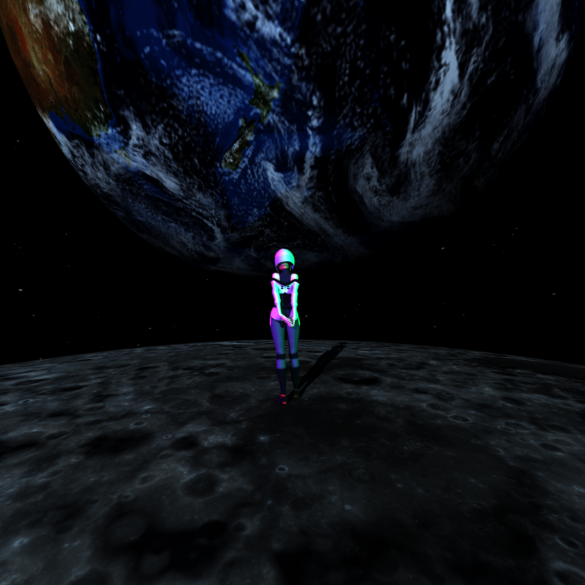 |  |

I added the blue rim because I wanted Earth's silhouette to stand out against space. To show its effect, I rendered the final scene with the Earth's with and without the rim light, leaving the other settings unchanged. Both images use 1200 × 1200 pixels, depth 2, and 5,000 samples. The effect adds blueish emission where the surface is viewed at a grazing angle. I used it to achieve the look I wanted rather than simulate atmospheric scattering.

Across 4,990 measured iterations, shading increased from 7.44 to 7.73 ms, and total rendering increased from 24.17 to 25.12 ms, about 3.9%. 

**Procedural Sky**

| Sky off | Sky on |
| --- | --- |
|  | 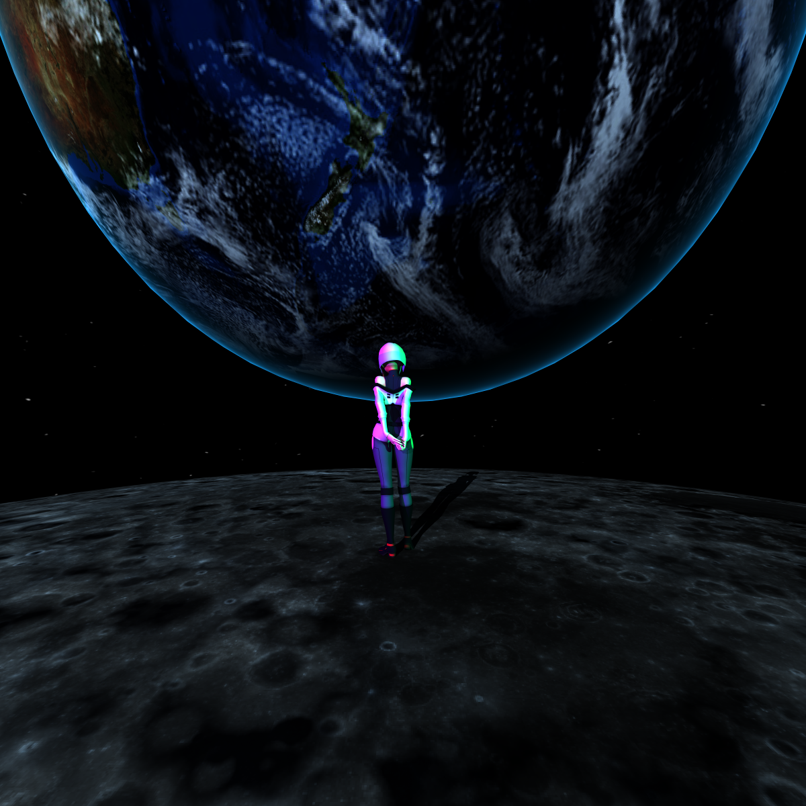 |

I also wanted a star field around the scene, so I adapted the Shadertoy code credited below. To compare it, I rendered the final scene with with and without the starry sky, keeping the camera at 1200x1200 pixels, depth 2, and 5,000 samples. The sky is evaluated whenever a ray misses the geometry. This means it can appear in the background and contribute through indirect rays.

With the sky enabled, average shading time increased from 7.45 to 7.71 ms. Total rendering increased from 24.49 to 25.15 ms, about 2.7%, over 4,990 measured iterations. Like the rim lighting comparison, this is a small difference.

**Directional Lighting**

| Ceiling light only | Ceiling light plus directional light |
| --- | --- |
|  | 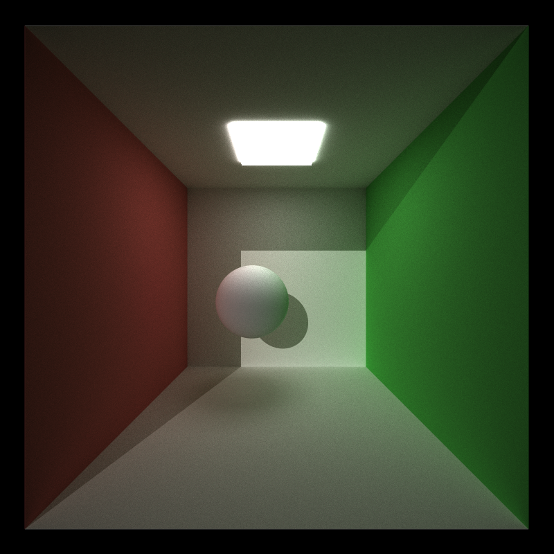 |

Finally, I tested the cost of adding a directional light. I used a diffuse sphere in the Cornell box and kept the ceiling light in both versions. For the second version, I added a white directional light through the opening. Both runs use 800x800 pixels, depth 8, and 5,000 samples. The goal here was to show the visual effect and added work of another light; the two scenes do not have identical illumination.

Adding the light increased average shading time from 2.80 to 6.29 ms and total rendering from 12.15 to 15.89 ms, about 30.8%, over 4,990 measured iterations. This was a larger increase than the rim and sky effects.

The directional light requires a shadow ray at eligible diffuse hits to check whether anything blocks it, followed by the lighting calculation. Those shadow rays use the BVH, but they still add intersection work inside the shading stage. I discuss possible improvements to that traversal below.

## GPU vs. a Hypothetical CPU Implementation

I did not implement or benchmark a CPU renderer, but I also considered how each feature would behave on a CPU. The table below summarizes those expectations and the potential improvements I could try next.

| Feature | How I would expect it to compare on a CPU | What I could try next |
| --- | --- | --- |
| Mesh rendering | The GPU can test many rays against triangles at once. A CPU could do the same work, but with fewer rays running in parallel. On the GPU, scattered reads of triangle data can still limit the benefit. | I could try arranging triangle data so nearby rays read nearby memory, and check whether sharing vertex data helps. |
| BVH | Both processors would benefit from skipping large parts of the scene. On the GPU, nearby threads can take different routes through the tree, which makes it harder for them to work efficiently together. | I could test putting several primitives in each leaf and choosing splits that reduce overlap between bounding boxes. |
| Image textures | Both versions would look up colors using UV coordinates. The GPU can handle many lookups at once, while a CPU may reuse cached pixels when nearby rays sample the same area. | I could try CUDA texture objects to use the GPU's texture sampling hardware and also investigate filtering and mipmaps for image quality. |
| Procedural textures | My procedurally generated texture is cheap to calculate on either processor. It already runs inside the shading kernel, so it does not need a separate GPU launch. | I could try to make a more complex pattern (maybe generate the moon). |
| Bump mapping | The GPU can calculate new normals for many hits at once, but each hit still needs extra height samples. A CPU could reuse cached height values, although it would process fewer hits in parallel. | I could choose the UV sample spacing based on the texture resolution and look for repeated samples I could reuse. |
| Direct lighting | The GPU can trace many shadow rays at once, but those rays may take different paths through the scene. Either processor can stop an occlusion test as soon as it finds a blocker. | I could look at reducing shadow-ray traversal work. For scenes with many lights, I would also investigate sampling lights instead of testing every light at every hit. |
| Sorting and compaction | The GPU can rearrange many paths in parallel, but moving data and coordinating the work still costs time. For a small number of paths, a CPU might have less overhead. | I could reuse temporary buffers, try moving indices instead of full records, and test whether skipping some sorting or compaction passes helps. |

In summary, the biggest improvement in my tests came from using the BVH to avoid intersection work. Sorting and compaction taught me that later work is only useful if it saves more time than the reordering costs. That is why I would focus next on reducing the amount of data moved and checking when reordering is actually worthwhile.

## References and Credits

- Referenced parts from my path tracer from CIS 5610
- [tinygltf](https://github.com/syoyo/tinygltf): glTF/GLB loading.
- [stb](https://github.com/nothings/stb): image loading and saving.
- [GLM](https://github.com/g-truc/glm), [GLFW](https://www.glfw.org/), [GLEW](https://glew.sourceforge.net/), [Dear ImGui](https://github.com/ocornut/imgui), and [NVIDIA Thrust](https://github.com/NVIDIA/cccl): supporting math, graphics, UI, and parallel algorithms.
- Bump mapping: I referenced [PBRT, 3rd edition — Bump Mapping](https://www.pbr-book.org/3ed-2018/Materials/Bump_Mapping) for height-based surface-normal perturbation.
- Directional lighting: I referenced [PBRT, 4th edition — Distant Lights](https://www.pbr-book.org/4ed/Light_Sources/Distant_Lights).
- Procedural sky: I took code from [this Shadertoy shader](https://www.shadertoy.com/view/3syfDc) and adapted it for the sky in this renderer.
- Rim lighting: I referenced the rim-lighting example in [Unity's Surface Shader Examples](https://docs.unity.cn/430/Documentation/Components/SL-SurfaceShaderExamples.html).
- Lucy model: [LUCY (EDGERUNNER)](https://sketchfab.com/3d-models/lucy-edgerunner-1042ed786b0946b6b1aa910cfb37e96c)
- Moon textures: I used the color and bump maps from NASA's [CGI Moon Kit](https://svs.gsfc.nasa.gov/4720/) for the moon's color texture and bump mapping.
- Earth model: I downloaded the model from NASA Science's [Earth 3D Model](https://science.nasa.gov/learn/heat/resource/earth-3d-model/) resource.