CUDA Path Tracer
================

**University of Pennsylvania, CIS 565: GPU Programming and Architecture, Project 3**

* Weike Qian
* Tested on: Windows 11, i9-13980HX @ 2.20GHz 32GB, RTX 4080 Laptop GPU 12GB (personal machine)

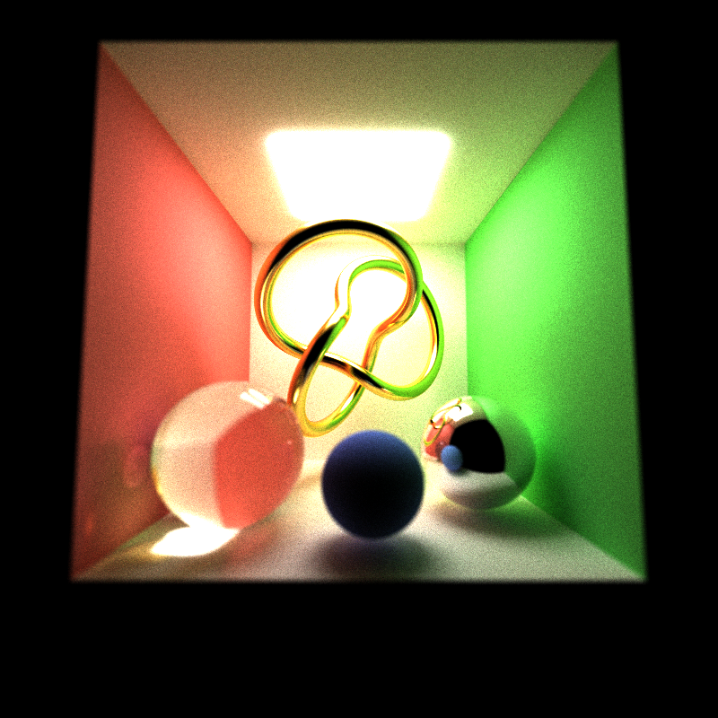

*800x800, 3000 spp, max depth 12. A 38k-triangle torus knot with a rough gold BSDF, a
solid glass sphere casting a caustic, a perfect mirror, and a thin-lens camera focused
on the knot.*

## Features

**Core**

* Iterative GPU path tracer: ray generation, intersection, shading and stream compaction
  are separate kernel launches, looped until every path terminates.
* Ideal diffuse BSDF with cosine-weighted hemisphere importance sampling.
* Stochastic sampled antialiasing (sub-pixel jitter, re-randomized per iteration).
* Stream compaction of terminated paths, three switchable modes: off, `thrust::partition`,
  or a work-efficient Blelloch scan reused from Project 2.
* Material sorting, three switchable modes: off, `thrust::sort_by_key` over the payloads,
  or CUB radix sort of (material, index) pairs plus a gather.

**Visual**

* Perfect and glossy specular reflection; roughness maps to a Phong exponent, sampled per
  GPU Gems 3 ch. 20.
* Dielectric refraction with Schlick Fresnel and total internal reflection.
* Thin-lens depth of field.

**Mesh and performance**

* OBJ mesh loading via tinyobjloader, with interpolated vertex normals, baked to world
  space at load time.
* BVH over all scene triangles: CPU median-split build, flattened to an array, traversed
  iteratively on the GPU with an explicit stack.
* Russian roulette path termination with the unbiased survivor boost.

Toggles at the top of `src/pathtrace.cu`:

```cpp
#define SORT_BY_MATERIAL 0   // 0 = off, 1 = thrust sort_by_key, 2 = CUB pairs + gather
#define COMPACTION_MODE  2   // 0 = off, 1 = thrust::partition, 2 = custom scan
#define RUSSIAN_ROULETTE 1
#define USE_BVH          1
#define PERF_ANALYSIS    0   // print surviving path counts per bounce
#define ERRORCHECK       0   // sync + check after every kernel (debugging only)
```

## Renders

| Refraction off | Refraction on |
|---|---|
| 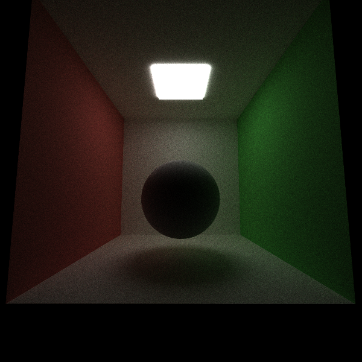 | 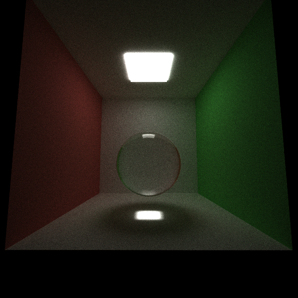 |
| The same sphere as grey diffuse. | IOR 1.55 glass. The room appears inverted inside the sphere and the light focuses into a caustic on the floor. |

| Depth of field off | Depth of field on |
|---|---|
| 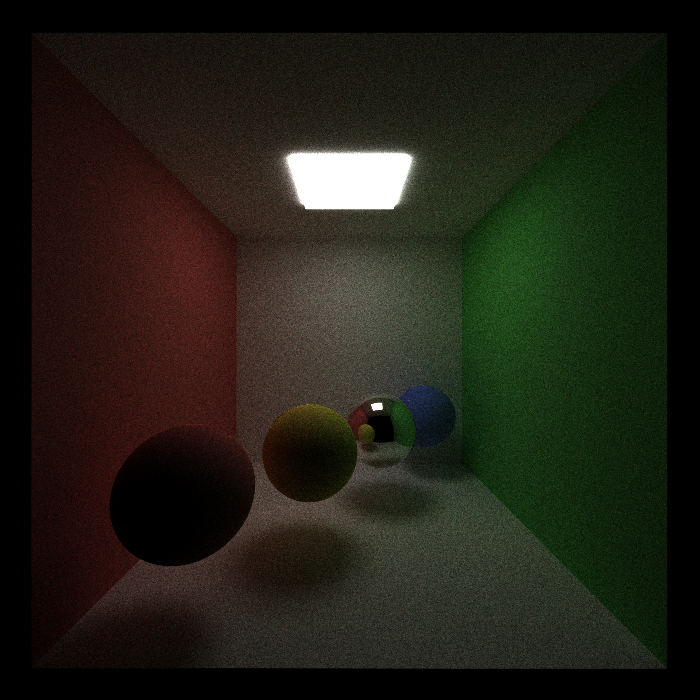 | 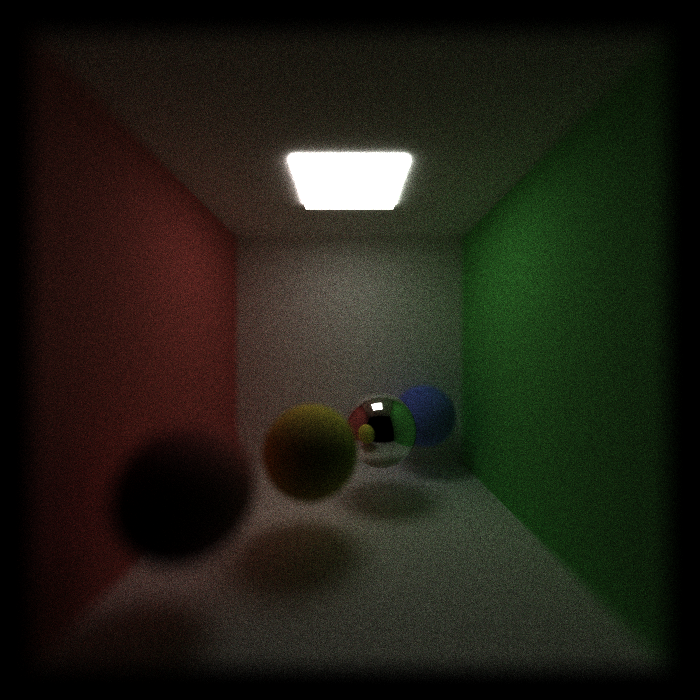 |
| Pinhole camera. | Aperture 0.5 focused on the mirror sphere. |

| Materials | Mesh + BVH |
|---|---|
| 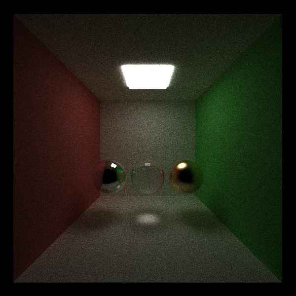 | 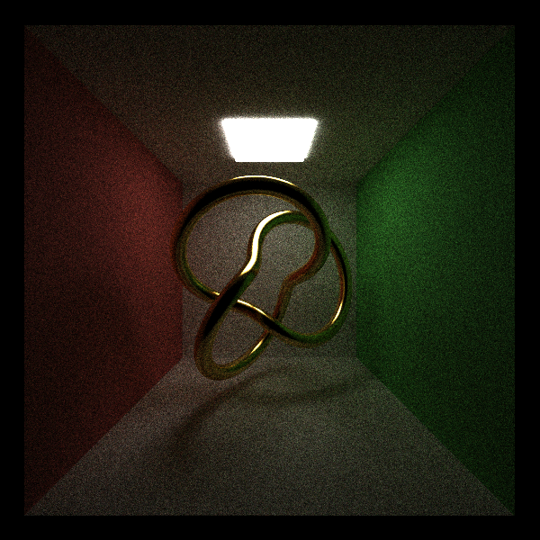 |
| Mirror, solid glass, roughness-0.25 gold. | 38,400 triangles through a 27,647-node BVH. |

Pure-diffuse Cornell box, matching `img/REFERENCE_cornell.5000samp.png`:

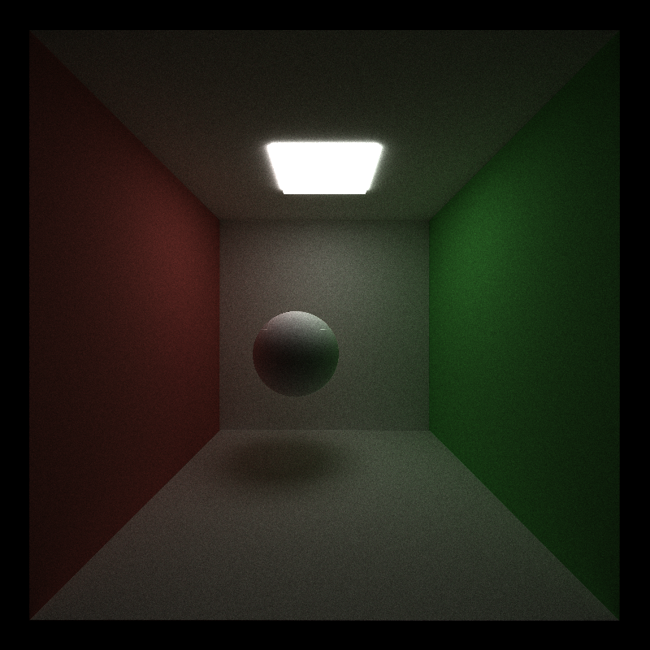

## Performance Analysis

Wall-clock timings are the median of 3 runs after a discarded warm-up run. A single run
of a fixed configuration varied by 11% across five repeats on this laptop GPU, and the
first run after a rebuild was consistently the slowest, so single-run comparisons are not
reported. Measured spread was 1–6% for most configurations; smaller differences are
treated as noise. Each experiment varies one toggle with the rest at their defaults.

Per-kernel data comes from Nsight Systems and Nsight Compute on `scenes/profile.json`
(the showcase scene at 20 iterations).

### Kernel time breakdown

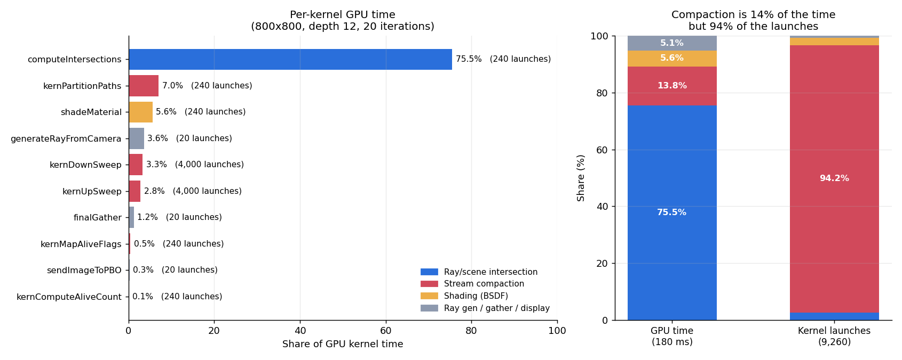

| Kernel | Share | Total | Launches | Avg | Min | Max |
|---|---|---|---|---|---|---|
| `computeIntersections` | 75.5% | 136.2 ms | 240 | 567.6 µs | 127.3 µs | 1.580 ms |
| `kernPartitionPaths` | 7.0% | 12.7 ms | 240 | 53.0 µs | 5.2 µs | 228.5 µs |
| `shadeMaterial` | 5.6% | 10.1 ms | 240 | 42.1 µs | 4.9 µs | 405.8 µs |
| `generateRayFromCamera` | 3.6% | 6.5 ms | 20 | 327.1 µs | 310.4 µs | 336.9 µs |
| `kernDownSweep` | 3.3% | 6.0 ms | 4,000 | 1.50 µs | 0.90 µs | 9.2 µs |
| `kernUpSweep` | 2.8% | 5.1 ms | 4,000 | 1.27 µs | 0.90 µs | 5.6 µs |
| `finalGather` | 1.2% | 2.2 ms | 20 | 110.4 µs | 106.7 µs | 117.5 µs |
| `kernMapAliveFlags` | 0.5% | 0.8 ms | 240 | 3.46 µs | 1.12 µs | 16.0 µs |
| `sendImageToPBO` | 0.3% | 0.5 ms | 20 | 25.9 µs | 24.4 µs | 26.8 µs |
| `kernComputeAliveCount` | 0.1% | 0.2 ms | 240 | 0.99 µs | 0.90 µs | 1.06 µs |

Intersection dominates at 75.5%; shading is 5.6%. That ratio bounds what any
shading-side optimization can return, and is the reason material sorting cannot win in
this renderer.

`computeIntersections` varies 12x between its fastest and slowest launch, with a median
(388 µs) well under its mean (568 µs). The skew is stream compaction: the first bounce
intersects 640k paths, the last few intersect very little. `shadeMaterial` shows the same
distribution, 4.9 µs to 405.8 µs.

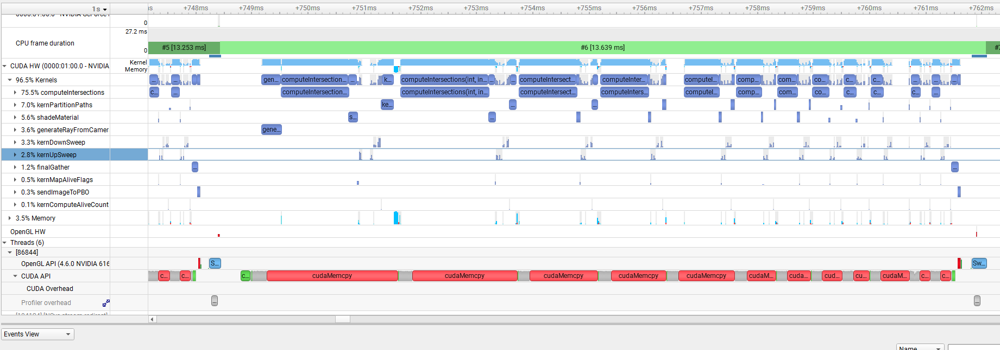

*One iteration (13.6 ms). The `computeIntersections` blocks narrow left to right as
compaction removes dead paths.*

Compaction accounts for 13.8% of GPU time but 94% of all kernel launches. The scan issues
`2·log2(n)` kernels per compaction, roughly 33 per bounce and 8,000 over 20 iterations,
averaging 1.3 µs each.

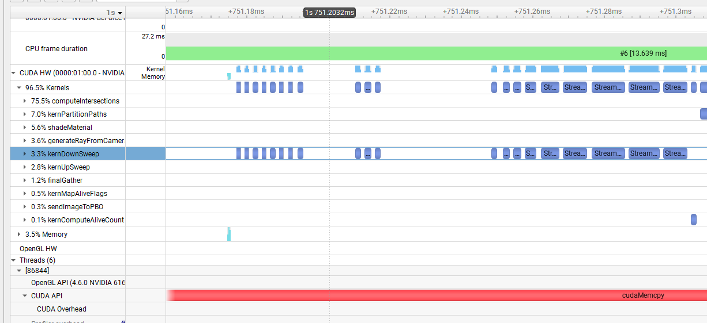

*A 140 µs window during one down-sweep. Launches are separated by idle gaps of 2–3 µs, so
the scan's 6.1% share of kernel time understates its wall-clock cost.*

### Stream compaction

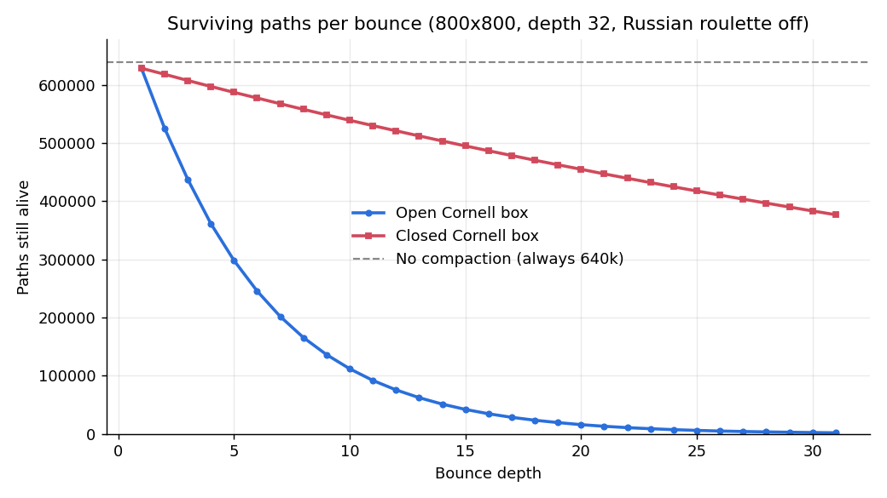

In the open Cornell box about 18% of paths die per bounce, mostly by escaping through the
missing fourth wall, leaving 1,833 of the original 628,877 alive at bounce 31. In the
closed box the only exit is the ceiling light, so 1.6% die per bounce and 60% are still
alive at bounce 31. Without compaction both scenes launch the full 640k threads every
bounce.

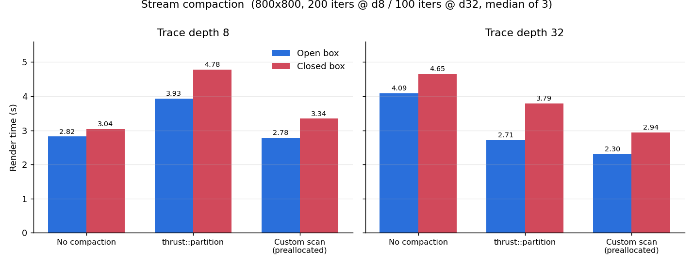

| Config | d8 open | d8 closed | d32 open | d32 closed |
|---|---|---|---|---|
| No compaction | 2.82 s | **3.04 s** | 4.09 s | 4.65 s |
| `thrust::partition` | 3.93 s | 4.78 s | 2.71 s | 3.79 s |
| Custom scan, preallocated | **2.78 s** | 3.34 s | **2.30 s** | **2.94 s** |

Compaction pays off only once enough paths have died. At depth 32 it is a 44% win in the
open box and 37% in the closed box. At depth 8 the open box is a tie within noise and the
closed box is a 10% loss, since few paths have terminated by the end of an 8-bounce trace.
The crossover sits where the survival curve flattens.

The closed-box result at depth 32 depends on Russian roulette. Geometric termination
almost never happens in a closed scene, so without roulette there is nothing for
compaction to remove; roulette creates the terminations that make it worthwhile.

`thrust::partition` is slower than no compaction at all at depth 8 (3.93 s vs 2.82 s).
Switching from `stable_partition` to `partition` changed nothing, ruling out stability
overhead. The cause is that thrust allocates scratch inside every call: one `cudaMalloc`
and `cudaFree` per bounce, and device allocation is synchronizing and millisecond-scale.
At ~1600 compactions per run that is seconds of allocator overhead.

The custom path reuses the Project 2 scan (`kernMapAliveFlags` → up-sweep/down-sweep
exclusive scan → `kernPartitionPaths`) with every buffer allocated once in
`pathtraceInit`. Same algorithm and asymptotics, 29% faster than thrust in the worst case.

The partition kernel writes both alive and dead paths to their slots rather than dropping
the dead ones, because dead paths still carry accumulated color that `finalGather` needs.
Since each bounce only reorders within `[0, num_paths)` and `num_paths` only shrinks,
paths that die at bounce *k* stay parked past the new boundary for the rest of the
iteration.

### Russian roulette

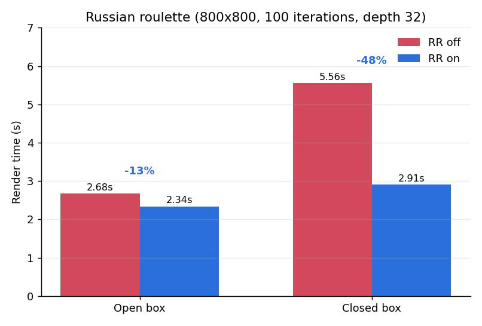

| Scene (800x800, 100 iters, depth 32) | RR off | RR on | |
|---|---|---|---|
| Open box | 2.68 s | **2.34 s** | −13% |
| Closed box | 5.56 s | **2.91 s** | **−48%** |

Survivors are scaled by `1/q` to keep the estimator unbiased. Roulette starts at bounce 3
so the brightest early bounces stay well sampled. The closed box benefits most, since it
is precisely the case where paths otherwise survive to the depth limit while contributing
almost nothing.

### BVH vs. brute force

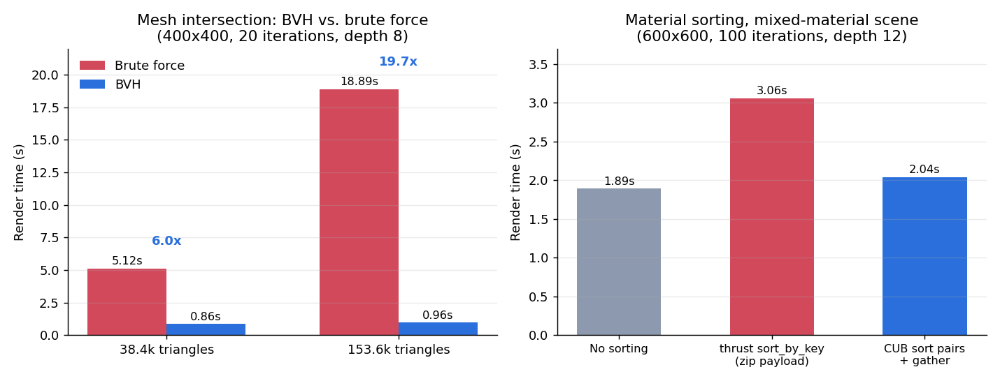

| Mesh | Brute force | BVH | Speedup |
|---|---|---|---|
| 38,400 triangles | 5.12 s | **0.86 s** | 6.0x |
| 153,600 triangles | 18.89 s | **0.96 s** | 19.7x |

Quadrupling the triangle count made brute force 3.7x slower, as expected for a linear
scan, and moved the BVH from 0.86 s to 0.96 s.

Traversal is iterative with a 64-entry stack in local memory. Two implementation details
mattered: leaves hold up to 4 triangles so the leaf test amortizes the node fetch, and the
closest analytic-primitive hit is passed in as `tMax`, letting a ray that already hit a
nearby wall reject whole subtrees.

### Material sorting

| Config (600x600, 100 iters, depth 12, mixed materials) | Time | Overhead |
|---|---|---|
| No sorting | **1.89 s** | — |
| `thrust::sort_by_key` over a zip iterator | 3.06 s | +1.17 s |
| CUB `SortPairs` on (material, index) + gather | 2.04 s | +0.15 s |

The naive version permutes 68 bytes of payload per element (`PathSegment` at 44 bytes plus
`ShadeableIntersection` at 24) and allocates scratch on every call. Sorting only 8-byte
(key, index) pairs with CUB, with temp storage sized once at startup and the permutation
applied by a single gather kernel, cuts the sorting overhead by 87%.

Nsight Compute on `shadeMaterial`, same launch index in both builds:

| Metric | Sorting off | Sorting on |
|---|---|---|
| Duration | 45.12 µs | **39.33 µs** (−12.8%) |
| Avg. divergent branches | 46.02 | **0.02** |
| Branch efficiency | 93.62% | **99.99%** |
| Branch instructions | 328,632 | 179,417 (−45.4%) |
| L2 hit rate | 79.00% | 83.35% |
| Achieved occupancy | 28.08% | 28.33% |

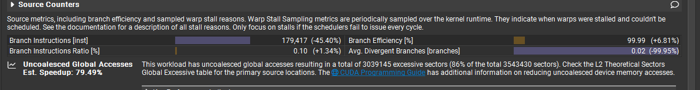

*Source Counters for the sorted build, with the unsorted run as the Nsight Compute
baseline. Percentages in parentheses are the delta against that baseline.*

Sorting does exactly what it is supposed to. Divergence is eliminated, branch instructions
drop by 45% because whole warps can now take the early-out paths together instead of
executing `scatterRay` under a mask, and the material lookup becomes more cache-friendly.
The kernel gets 12.8% faster.

It is still a net loss, and the breakdown above says why: `shadeMaterial` is 5.6% of the
frame, so a 12.8% kernel win returns 0.72% of frame time against a sort that costs 7.9%.
The limit is Amdahl's law, not the sort implementation. Sorting becomes worthwhile when
shading is a much larger share of the frame, for example with texture fetches, multi-lobe
microfacet BSDFs, or subsurface scattering.

### Host/device synchronization

Four sources of unnecessary synchronization were removed:

* The error-check macro called `cudaDeviceSynchronize` after every kernel, 2–4 full device
  syncs per bounce. Now compiled out by default (`ERRORCHECK 0`).
* A redundant explicit `cudaDeviceSynchronize` after one of those checks.
* Compaction read back two separate 4-byte values to compute the surviving path count. A
  one-thread kernel now computes the total on the device and the partition kernel reads it
  through a pointer, leaving one readback.
* The image was copied device-to-host every iteration, 7.7 MB at 800x800, although nothing
  reads it until the user saves. That copy moved to `pathtraceCopyImageToHost`, called from
  `saveImage`.

| Scene | Both present | Sync only | Image copy only | Neither |
|---|---|---|---|---|
| Open box, depth 8 | 3.06 s | 2.84 s | 2.96 s | **2.78 s** |
| Open box, depth 32 | 2.49 s | 2.37 s | 2.41 s | **2.30 s** |
| Mixed-material mesh scene | 2.05 s | 1.94 s | 1.96 s | **1.89 s** |

The two measurable fixes are worth about 8% together, split roughly 2–3% for the syncs and
4–6% for the image copy. The remaining two changes fall below the noise floor and were
kept for correctness rather than speed.

One synchronization point remains by design: compaction ends with a 4-byte device-to-host
read of the surviving path count, which the host needs to size the next launch. On the
timeline that call blocks the CPU for 2.4 ms of a 13.6 ms frame, but the kernel rows show
the GPU saturated for the entire wait. `cudaMemcpy` cannot return until the stream drains,
so the wait is for queued work, not for the transfer. Removing it would require overlapping
bounces across multiple streams.

### GPU vs. a hypothetical CPU implementation

Compaction exists because of the GPU. On a CPU, dropping dead paths is a sequential
`remove_if`: trivial, cheap, and obviously worth doing. On the GPU it becomes map, prefix
sum and scatter, costs a full read and write of the path buffer, and as measured can cost
more than it saves. The benefit also differs in kind: a CPU skips work inside a loop, while
the GPU shrinks the launch grid so that whole warps leave the schedule.

Material sorting has no CPU analogue. A CPU thread branching differently from its neighbour
costs nothing, so reordering work by material would be pure overhead. It is only a
candidate optimization because of SIMT lockstep execution, and the Nsight Compute numbers
above confirm it addresses a real GPU-specific cost, just one too small to matter here.

Refraction and depth of field are the opposite case. Both are effectively free on the GPU
and neither is measurably slower at equal sample counts. The reflect/refract split is
chosen randomly with probability equal to the Fresnel weight, so each path still follows
exactly one ray, with no recursion or fan-out. Depth of field only perturbs the primary
ray. Both would cost the same on a CPU.

The BVH helps both architectures but for partly different reasons. A CPU BVH wins by
reducing total work; the GPU version wins by that and by keeping neighbouring rays, which
tend to follow similar paths down the tree, inside the same warp. The corresponding
weakness is GPU-specific: divergent rays in a warp walk different subtrees, and every
thread pays for the union of all nodes any of them visit.

### Remaining optimizations

Ranked by profiled cost.

* **Intersection, at 75.5% of the frame.** A SAH build instead of the current median split,
  and wider 4- or 8-way nodes to cut traversal steps and improve locality.
* **Scan launch count.** 8,000 launches averaging 1.3 µs, with 2–3 µs gaps between them, is
  mostly launch overhead. A shared-memory block scan would collapse ~33 launches per bounce
  into two or three.
* **Path buffer layout.** Nsight Compute reports 82% of requested L2 sectors as excessive
  and attributes them to three lines that read single fields out of the 44-byte
  `PathSegment`. Splitting `PathSegment` and `ShadeableIntersection` into structs-of-arrays
  would make those reads contiguous and would also shrink `kernPartitionPaths`, currently
  7.0% and more expensive than the scan it depends on. The tool's 79% estimated speedup is
  optimistic: the L1 hit rate is 86%, so most of those sectors never reach L2.

  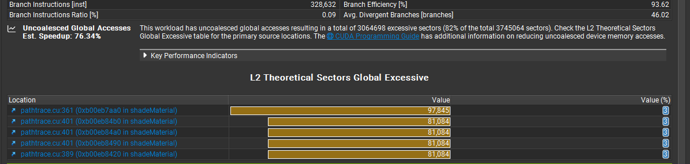
* **Register pressure.** `shadeMaterial` uses 99 registers per thread, which caps occupancy
  at 33% (4 blocks per SM) and leaves too few warps to hide memory latency. Passing
  `Material` by reference instead of copying 44 bytes into a local is the obvious first
  experiment.
* `generateRayFromCamera` is 3.6% for one launch per iteration, comparable to a median
  intersection pass, because it always runs at the full 640k width and pays for RNG
  construction plus the lens transcendentals.

## Scene format additions

```jsonc
// Materials
"mirror":  { "TYPE": "Specular",   "RGB": [0.98,0.98,0.98], "ROUGHNESS": 0.0 },
"gold":    { "TYPE": "Specular",   "RGB": [0.95,0.78,0.35], "ROUGHNESS": 0.10 },
"glass":   { "TYPE": "Refractive", "RGB": [1.0,1.0,1.0],    "IOR": 1.55 },

// Camera; omitting LENS_RADIUS keeps the pinhole camera
"LENS_RADIUS": 0.16,
"FOCAL_DISTANCE": 12.5,

// Objects
{ "TYPE": "mesh", "MATERIAL": "gold", "FILE": "knot.obj",
  "TRANS": [0,5.2,-1], "ROTAT": [25,35,0], "SCALE": [1.25,1.25,1.25] }
```

Mesh paths resolve relative to the scene file. `scenes/showcase.json` and `scenes/dof.json`
produce the renders above; `scenes/profile.json` is the showcase scene at 20 iterations for
profiling runs.

## Build notes

`CMakeLists.txt` was modified beyond the `SOURCE_FILES` list:

* `add_subdirectory(stream_compaction)` and the matching `target_link_libraries` entry were
  uncommented, plus `include_directories(.)` so `stream_compaction/*.h` resolves.
* Added `-Xcompiler=/Zc:preprocessor` for MSVC. Recent CUDA toolkits ship a CCCL that does
  not compile under MSVC's traditional preprocessor, so any `.cu` file including a thrust
  header fails with C1189 without it.

## Third-party code

* [tinyobjloader](https://github.com/tinyobjloader/tinyobjloader) (MIT) for OBJ parsing,
  vendored at `external/include/tiny_obj_loader.h`.
* CUB, shipped with the CUDA Toolkit, for the radix sort in material sorting mode 2.
* `scenes/knot.obj` is a procedurally generated (2,3) torus knot, not a third-party model.

## References

* [PBRT 3rd ed.](https://www.pbr-book.org/3ed-2018/contents) and
  [4th ed.](https://pbr-book.org/4ed/contents) for BSDFs, the thin lens camera and Russian
  roulette.
* [GPU Gems 3, ch. 20](https://developer.nvidia.com/gpugems/gpugems3/part-iii-rendering/chapter-20-gpu-based-importance-sampling) for specular lobe sampling.
* [GPU Gems 3, ch. 39](https://developer.nvidia.com/gpugems/gpugems3/part-vi-gpu-computing/chapter-39-parallel-prefix-sum-scan-cuda) for the work-efficient scan.
* [Schlick's approximation](https://en.wikipedia.org/wiki/Schlick's_approximation).
* Antialiasing and Raytracing, Chris Cooksey and Paul Bourke.
  https://paulbourke.net/miscellaneous/raytracing/
