CUDA Path Tracer
================

**University of Pennsylvania, CIS 565: GPU Programming and Architecture, Project 3**

* Ximing Luo
  * [LinkedIn](https://www.linkedin.com/in/ximingluo), [personal website](https://ximingluo.com)
* Tested on: Windows 11 Home 10.0.26200, AMD Ryzen 9 8945HS @ 4.0GHz 32GB, NVIDIA GeForce RTX 4070 Laptop GPU 8GB (personal laptop), CUDA 13.3, Visual Studio 2022

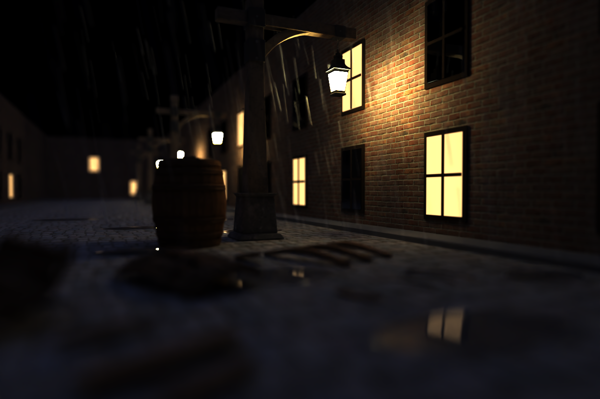

*`scenes/lantern_rain.json`: 1200 x 800, 2500 iterations, denoised. 423 objects and 54,718 triangles: four glTF lanterns lit by their own emissive textures, a glTF barrel, bump-mapped brick and cobblestone, glass puddles, depth of field, and rain drawn as motion-blurred spheres.*

## Overview

A path tracer that runs entirely on the GPU. Each iteration shoots one path per pixel, bounces every path through the scene in parallel, and adds the paths that reach a light to the image.

Core:

* Diffuse and perfect specular shading
* Stream compaction of finished paths
* Optional sorting of paths by material
* Stochastic antialiasing

Materials and camera:

* Refraction with Fresnel reflection
* Subsurface scattering
* Texture mapping, bump mapping and normal mapping, from files and procedural
* Procedural shapes (Mandelbulb, Menger sponge) and procedural textures (checker, marble)
* Depth of field
* Motion blur
* Direct lighting
* Halton sampling

Geometry:

* glTF mesh loading with bounding box culling
* Bounding volume hierarchy (BVH)

Speed and workflow:

* Russian roulette path termination
* Open Image Denoise with albedo and normal buffers
* Checkpoints: stop a render and resume it later

Every feature has a toggle in the GUI or a command line flag, so each one below is measured on and off.

**How the numbers were measured.** Release build, 800 x 800 unless noted. Each stage of an iteration (intersect, sort, shade, compact) is timed on the host with `cudaDeviceSynchronize` before each reading, and averaged over the run. Image error is the root-mean-square error against a 5000-iteration render, on 0 to 255 pixel values.

## Core features

### Shading

`shadeMaterial` handles one bounce for every live path. A path that misses the scene stops. A path that hits a light multiplies its color by the emission, adds the result to its pixel, and stops. Any other hit calls `scatterRay`, which picks the next direction: a cosine-weighted random direction for diffuse surfaces, the mirror direction for specular ones.

| Open Cornell box, 5000 iterations | Closed Cornell box |
|---|---|
|  |  |

### Stream compaction

After each bounce, `thrust::copy_if` copies the paths that are still alive into a second buffer and the two buffers swap. The next bounce only launches threads for live paths.

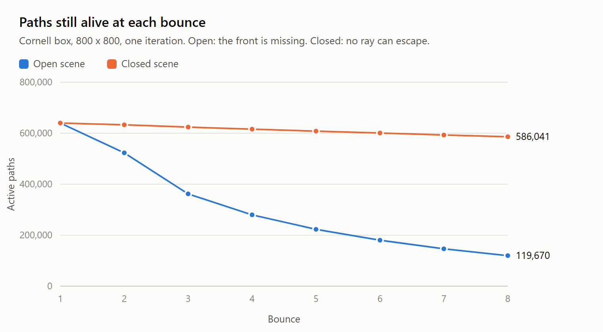

In the open box, rays leave through the missing front wall or hit the light, so only 19% of the paths (119,670 of 640,000) are still alive at the eighth bounce. In the closed box nothing can escape and 92% (586,041) are still alive.

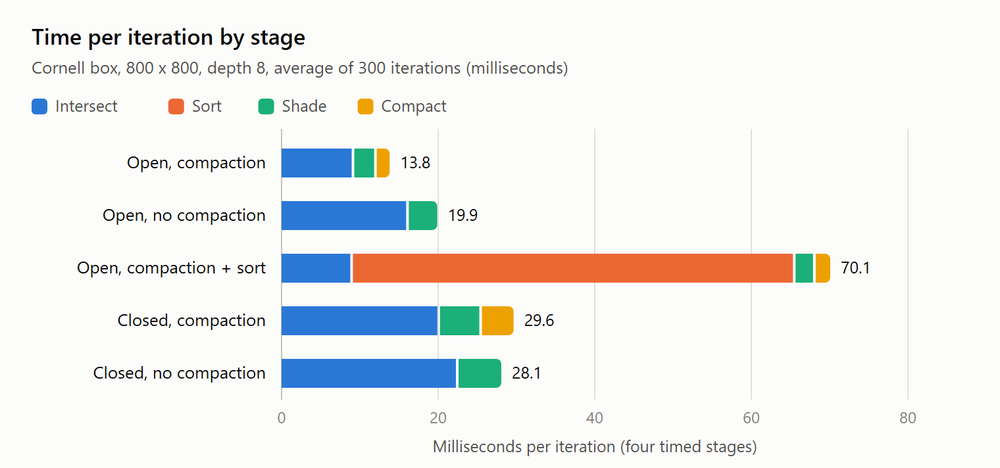

| Scene | With compaction | Without | Result |
|---|---|---|---|
| Open | 15.5 ms | 21.8 ms | 29% faster |
| Closed | 31.4 ms | 30.0 ms | 4% slower |

Compaction pays for itself only when paths terminate. In the open scene it nearly halves intersection time (15.9 ms to 9.0 ms) for 2.0 ms of compaction. In the closed scene there is almost nothing to remove, so the 4.4 ms spent compacting is not earned back.

**An optimization that mattered.** The first version used `thrust::partition` on the path array, keeping finished paths at the back so a final kernel could gather their colors. Partitioning in place needs a temporary buffer and copies every 64-byte path there and back. It was the most expensive stage in every scene. Adding a path's color to the image at the moment it reaches a light means finished paths carry nothing worth keeping, so compaction became a one-way copy into a second buffer. The images are byte-identical.

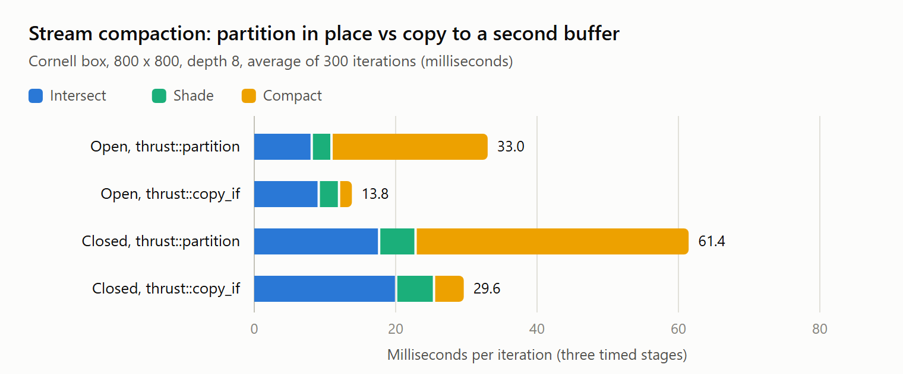

| Scene | Compaction stage | Whole iteration |
|---|---|---|
| Open | 22.3 ms to 2.0 ms | 34.9 ms to 15.5 ms |
| Closed | 38.8 ms to 4.4 ms | 63.4 ms to 31.4 ms |

### Sorting by material

With the toggle on, `thrust::sort_by_key` orders the paths by material id before shading, so neighboring threads run the same branch of the shading kernel.

In this renderer it is a net loss. In the Cornell box the sort takes 56.5 ms and shading drops from 2.87 ms to 2.57 ms. In `scenes/textures.json`, which mixes plain, textured, bump-mapped and glTF materials, shading drops from 4.46 ms to 4.14 ms while the sort costs 52.9 ms (31.6 ms to 83.0 ms per iteration). The materials here differ by a few branches and texture reads, so there is little divergence to remove, and sorting moves two large structs per path. Sorting would start to pay off with far more expensive, far more varied materials, or with a cheaper sort that moves indices instead of whole paths.

### Antialiasing

Each camera ray is offset by a random amount inside its pixel, so edges average out over iterations. It adds two random numbers per path and no measurable time.

## Materials and camera

### Refraction

Glass uses Snell's law (`glm::refract`) and Schlick's approximation: the Fresnel reflectance is the probability that a ray reflects instead of passing through. Total internal reflection always reflects. Each intersection records whether the ray hit from outside or inside, which selects the ratio of refractive indices.

| Diffuse | Glass (`IOR` 1.5) |
|---|---|
|  | 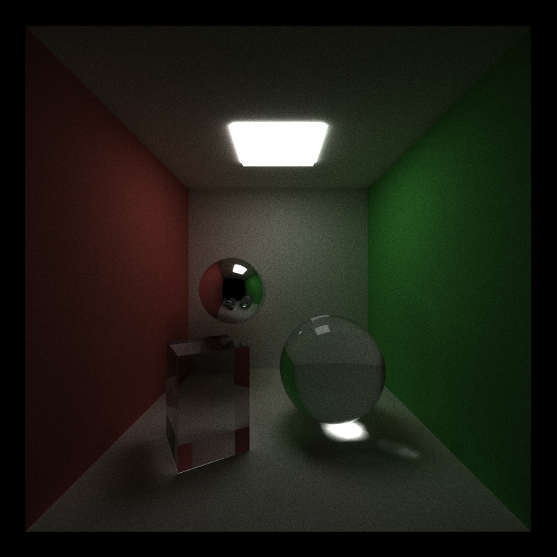 |

* **Performance:** 17.1 ms to 19.4 ms per iteration for this scene. The glass code itself is a few instructions; the cost is that paths through glass survive more bounces.
* **GPU vs CPU:** the same math on both. A CPU tracer would follow reflection and refraction recursively; here each path picks one of the two at random, which keeps one path per pixel and fits the wavefront loop.
* **Next:** rough glass, and colored absorption with distance inside the glass.

### Subsurface scattering

A `Subsurface` material lets light enter the object and scatter inside it. A ray either reflects off the surface (Schlick) or enters. Inside, the shading kernel draws a random travel distance with mean `SCATTER_DIST`. If that is shorter than the distance to the boundary, the path scatters in a random direction at that point and is tinted by the material color; otherwise it reaches the boundary and leaves.

| Diffuse | Subsurface (`SCATTER_DIST` 0.15 center, 0.8 right) |
|---|---|
| 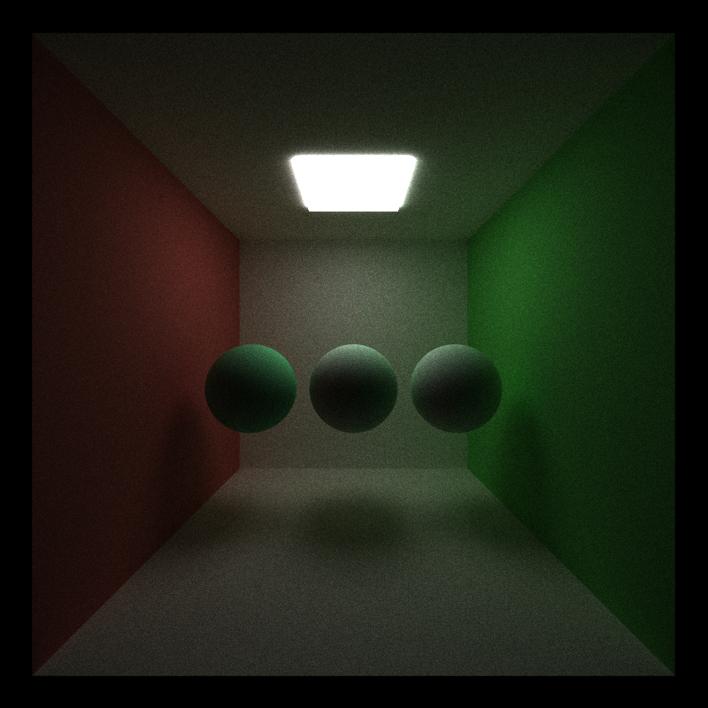 | 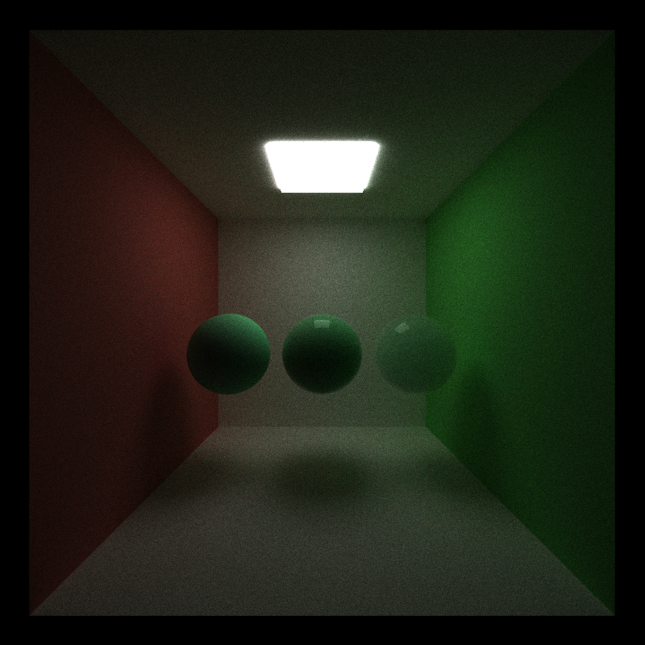 |

* **Performance:** 21.2 ms to 26.2 ms per iteration at depth 48 with Russian roulette. Every scatter inside the object uses one bounce of the main loop, so these scenes need a high depth; paths in this scene run for up to 48 bounces against about 40 without it.
* **GPU vs CPU:** a CPU tracer would run the whole random walk for one path in a tight loop. On the GPU each step is a full bounce through intersection, shading and compaction, which is wasteful for the few paths that are inside an object.
* **Next:** run several scattering steps inside the shading kernel for convex shapes, and bend rays at the boundary.

### Texture, bump and normal mapping

Image files are loaded with `stb_image` into one float buffer on the GPU and sampled with bilinear filtering. Meshes interpolate UVs from their vertices; spheres and cubes compute UVs from the hit position, so walls and floors can be textured too.

* **Color textures** multiply the material color.
* **Bump maps** are height images. The shader reads the height at the hit and at two neighboring texels and tilts the normal by the differences.
* **Normal maps** from glTF files go through the same tangent frame.
* **Emissive textures** from glTF files turn the bright texels of a mesh into light sources. The lantern panes on the cover and the lights on the helmet below work this way.

| Bump mapping off | Bump mapping on |
|---|---|
|  | 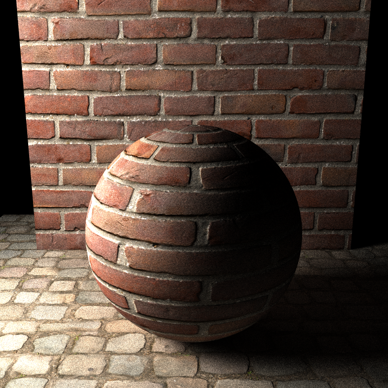 |

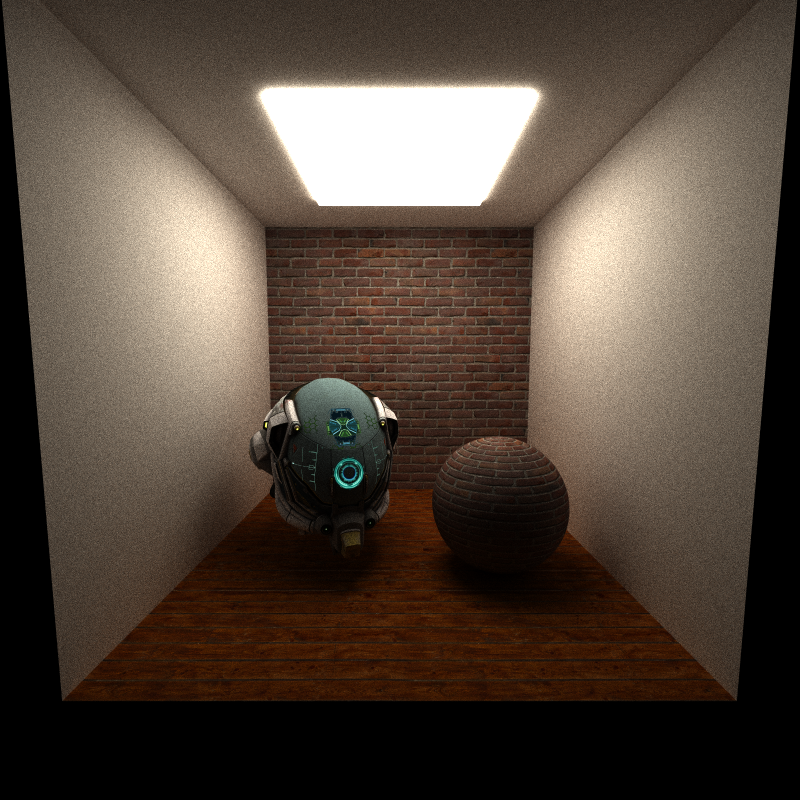

*`scenes/textures.json`: file textures with bump maps on the wall, floor and sphere, and the glTF helmet with its own color, normal and emissive textures.*

File texture against procedural texture, same checker pattern on every wall:

| File (`checker.png`, 512 px) | Procedural |
|---|---|
| 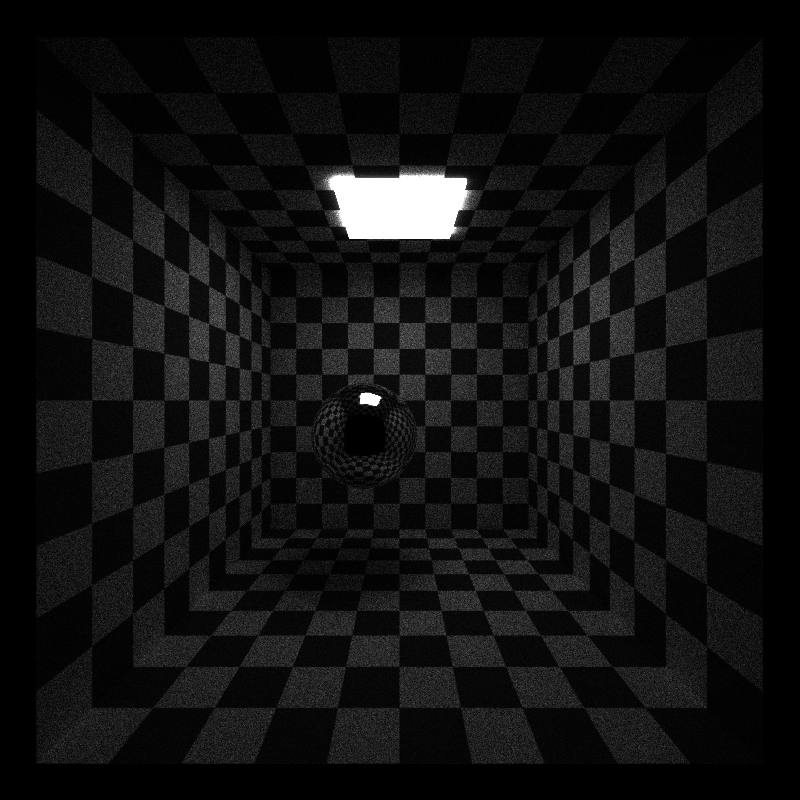 | 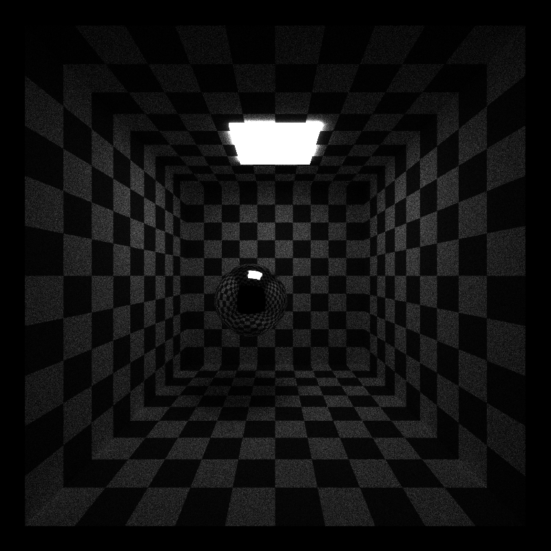 |

| Walls | Shade stage | Whole iteration |
|---|---|---|
| No texture | 2.87 ms | 15.50 ms |
| Procedural checker | 2.94 ms | 15.51 ms |
| File checker | 3.20 ms | 15.85 ms |

* **Performance:** the procedural checker is a few arithmetic operations. The file version costs four memory reads per lookup for bilinear filtering, which shows up as 0.26 ms more shading time. Bump mapping adds three lookups: 2.04 ms to 2.60 ms of shading in `scenes/bump.json`.
* **GPU vs CPU:** texture reads are scattered memory accesses on both. A CPU has a larger cache per thread; the GPU makes up for it by doing all the lookups for a bounce at once.
* **Next:** use CUDA texture objects for hardware filtering, store 8-bit texels instead of floats (a quarter of the memory), and convert color textures from sRGB to linear.

### Procedural shapes and textures

Two shapes are defined by signed distance functions and found by sphere tracing inside the object's unit cube: step along the ray by the distance to the surface until it is closer than a threshold, then take the normal from small differences of the distance. The shapes are a Mandelbulb fractal and a Menger sponge. Two solid textures are computed from the hit position: a 3D checker and a marble made from sine stripes bent by four octaves of value noise.

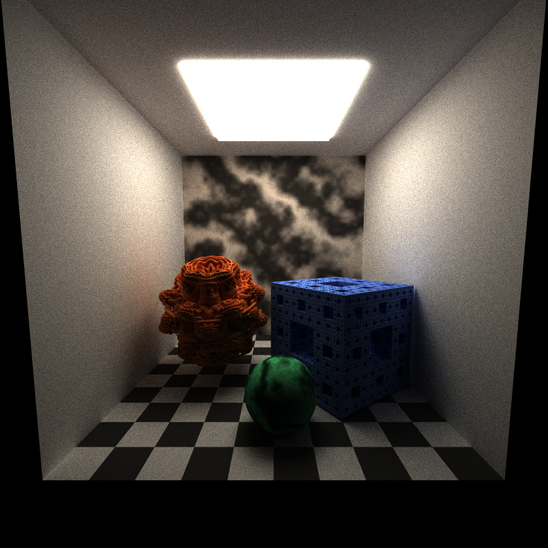

* **Performance:** 82.0 ms per iteration, of which 75.1 ms is intersection (the plain Cornell box needs 8.9 ms). Each ray takes up to 128 steps, each step evaluates the distance function, and the Mandelbulb's has eight iterations of `pow`, `acos` and `atan2`.
* **GPU vs CPU:** sphere tracing is all arithmetic with no memory traffic, which suits the GPU. The step count varies a lot between neighboring rays, so many threads in a warp wait on the slowest one.
* **Next:** skip the march for rays that miss a tighter bound, lower the iteration count with distance, and stop shadowed rays early.

### Depth of field

A thin lens camera. Each ray starts from a random point on a lens disk of radius `LENS_RADIUS` and is aimed at the point where the pinhole ray crosses the plane at `FOCAL_DIST`.

| Pinhole | `LENS_RADIUS` 0.4, focused on the mirror sphere |
|---|---|
|  |  |

* **Performance:** 17.1 ms to 17.6 ms per iteration. It is two random numbers and a few vector operations per camera ray.
* **GPU vs CPU:** no difference in the work; it only changes how camera rays are generated.
* **Next:** shaped apertures for polygonal highlights.

### Motion blur

Objects take an optional `VELOCITY`. Each path gets a random time between 0 and 1, and a moving object is intersected by shifting the ray origin by `-velocity * time`, which is the same as moving the object without rebuilding its matrices. Averaging over iterations produces the blur. The rain on the cover is 300 small spheres with a downward velocity.

| Static | Moving |
|---|---|
| 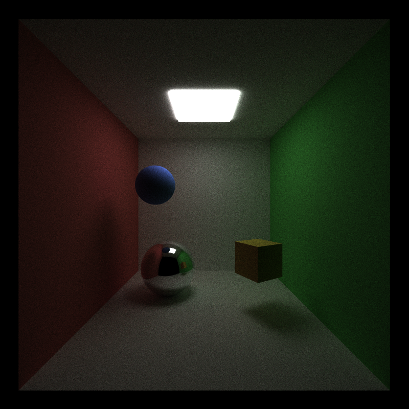 | 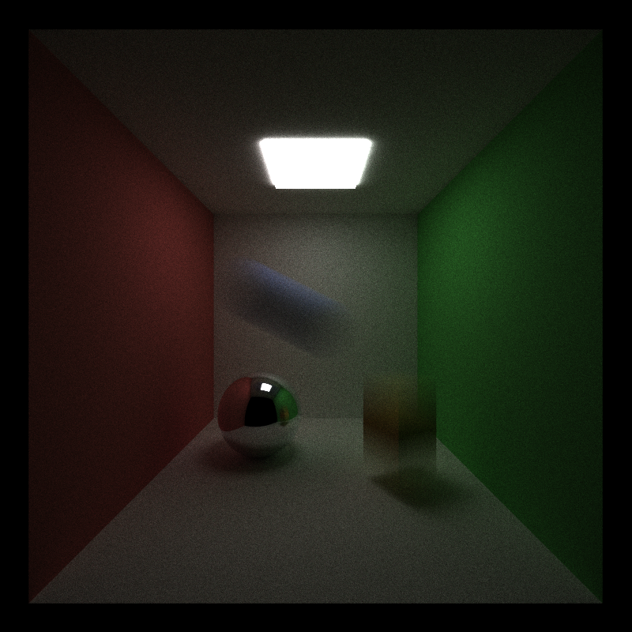 |

* **Performance:** 17.2 ms per iteration either way. One vector subtraction per object test.
* **GPU vs CPU:** identical work. A CPU version could also rebuild a moving object's transform per sample; shifting the ray avoids any per-object state per thread.
* **Next:** rotation and scaling over time, which need a transform interpolated per ray.

### Direct lighting

With the toggle on, the last ray of a path on a diffuse surface is aimed at a random point on a random light instead of a random direction. The path's color is weighted by the light's area, the distance and both angles. Cube and sphere lights are supported.

| Depth 3, 64 iterations, off | Depth 3, 64 iterations, on |
|---|---|
| 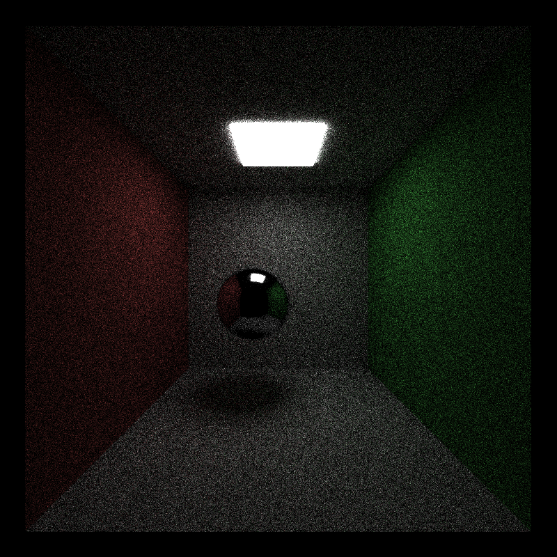 | 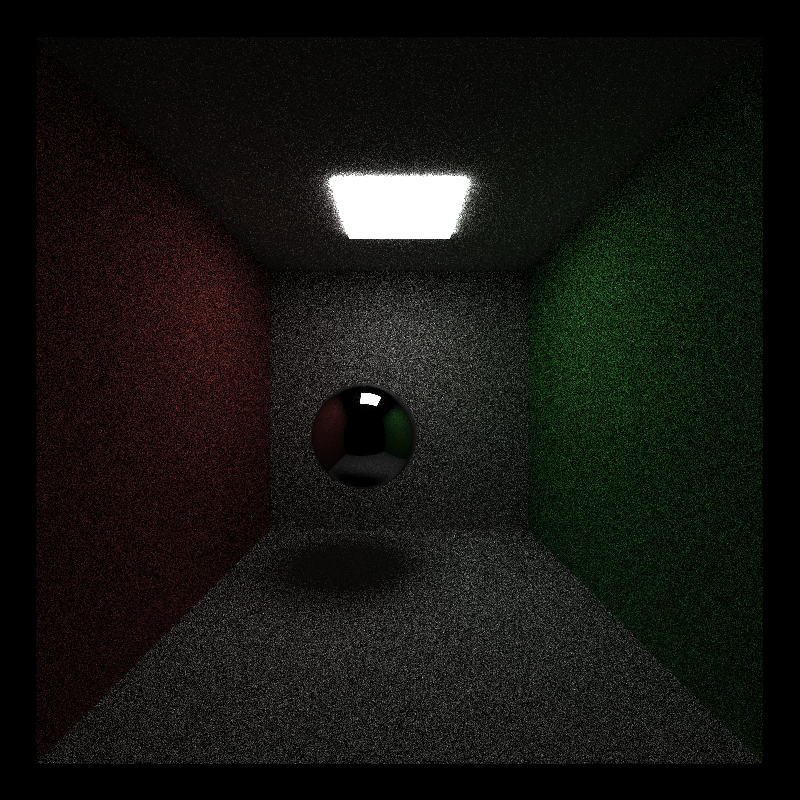 |

* **Performance:** shading goes from 1.72 ms to 1.99 ms per iteration. At depth 3 and 64 iterations, error against a 2000-iteration reference drops from 16.4 to 13.9.
* **GPU vs CPU:** the same estimator on both. On the GPU the sampled ray reuses the normal intersection pass on the next bounce, so no separate shadow ray kernel is needed.
* **Next:** sample lights at every bounce and combine with material sampling by multiple importance sampling.

### Halton sampling

A `Sampler` replaces the random engine in the camera and shading code. With the toggle on, it returns Halton values: dimension `d` of sample `i` is the radical inverse of `i` in the `d`-th prime base, shifted by a hash of the pixel and dimension so pixels do not share a pattern. The first 32 dimensions use Halton (camera jitter, lens, time, and the first three bounces); later ones fall back to the thrust generator.

| Random, 64 iterations | Halton, 64 iterations |
|---|---|
| 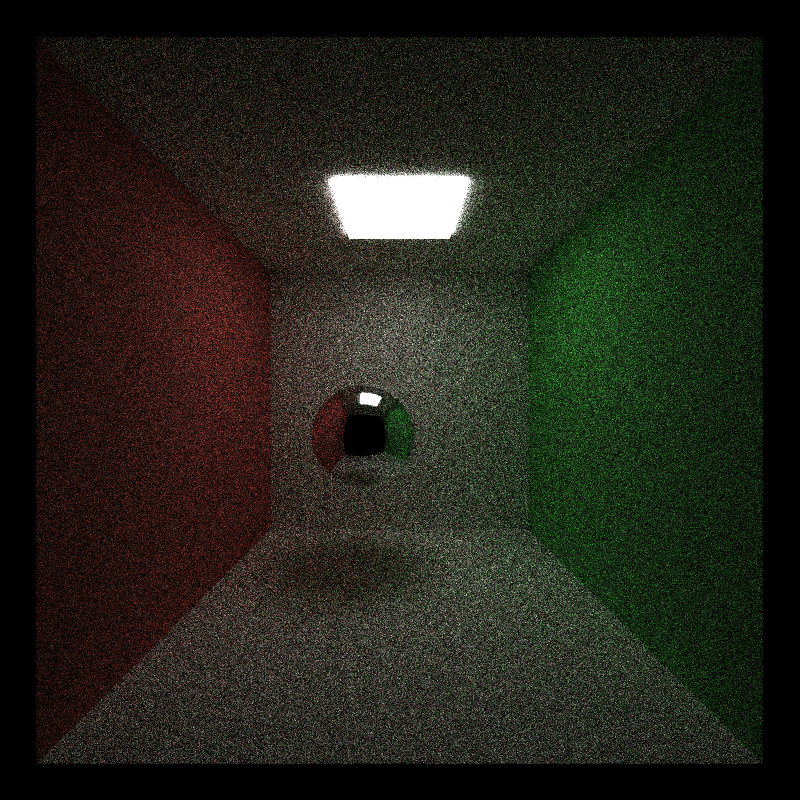 | 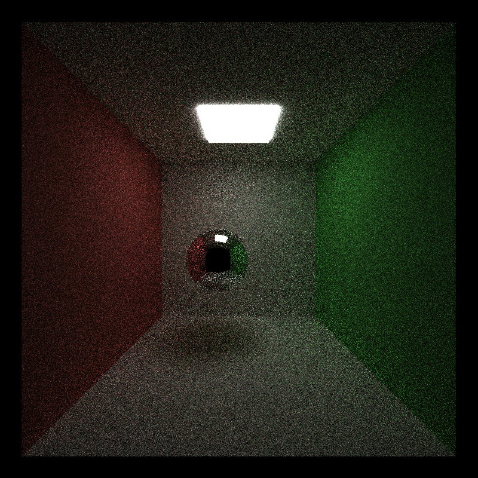 |

The difference is too small to see by eye, so it is measured as error against the reference:

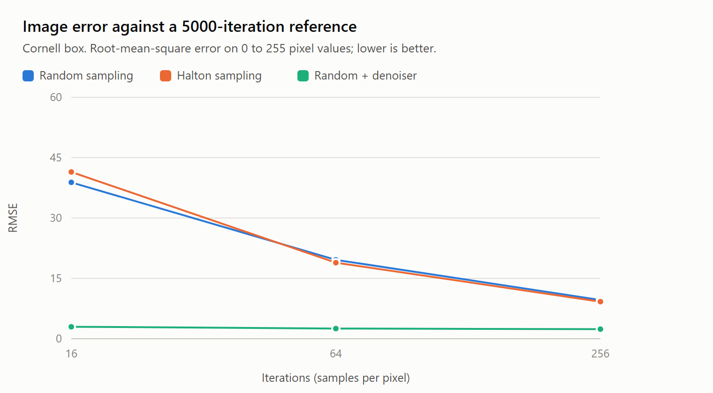

| Iterations | Random | Halton |
|---|---|---|
| 16 | 38.9 | 41.4 |
| 64 | 19.6 | 18.9 |
| 256 | 9.62 | 9.21 |

* **Performance:** no measurable cost. Error is 3.5% lower at 64 iterations and 4.3% lower at 256, and 6.6% higher at 16.
* **GPU vs CPU:** each sample is computed from the iteration number and pixel index alone, with no shared state, which is what a GPU thread needs.
* **Next:** a Sobol sequence with Owen scrambling, which stays well distributed in higher dimensions.

## Geometry

### glTF meshes

`tinygltf` reads `.gltf` and `.glb` files. The loader walks the node tree, applies each node's transform and the object's `TRANS`/`ROTAT`/`SCALE`, and stores world-space triangles with positions, normals, UVs and a material. A mesh object with no `MATERIAL` uses the materials in the file: base color, color texture, normal texture, emissive texture, and glass for transmission materials. Triangles are tested with `glm::intersectRayTriangle`, called a second time with two vertices swapped so back faces are hit too, which glass meshes need.

| Duck, 4,212 triangles | Stanford dragon in glass, 134,995 triangles with its cloth |
|---|---|
| 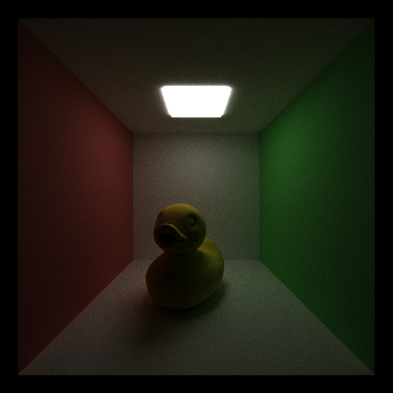 | 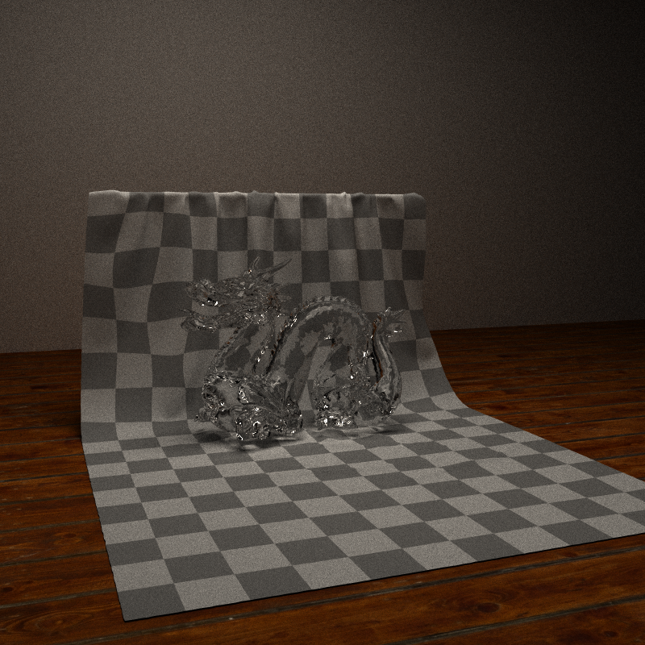 |

### Bounding box culling and BVH

Three ways to intersect a mesh, selectable at run time:

* **None:** test every triangle.
* **Bounding box:** skip the mesh if the ray misses its box.
* **BVH:** a tree of boxes built on the CPU. Each node splits its triangles in half along the longest axis of their centroids. Nodes live in one flat array, and the GPU walks them with a loop and a 64-entry stack, skipping boxes farther than the closest hit so far.

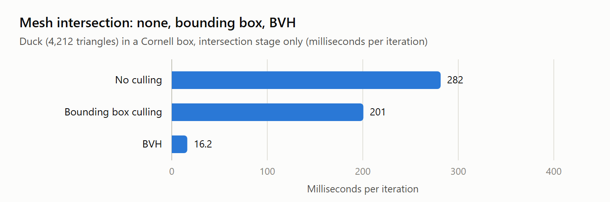

For the duck, the BVH brings intersection from 281.5 ms to 16.2 ms, 17 times faster. The bounding box alone only reaches 200.6 ms, because the duck fills a large part of the view and most rays that reach it still test all 4,212 triangles. The images from all three modes are byte-identical.

The tree shape is set per scene with `BVH_MAX_DEPTH` and `BVH_LEAF_SIZE`. On the dragon scene:

| 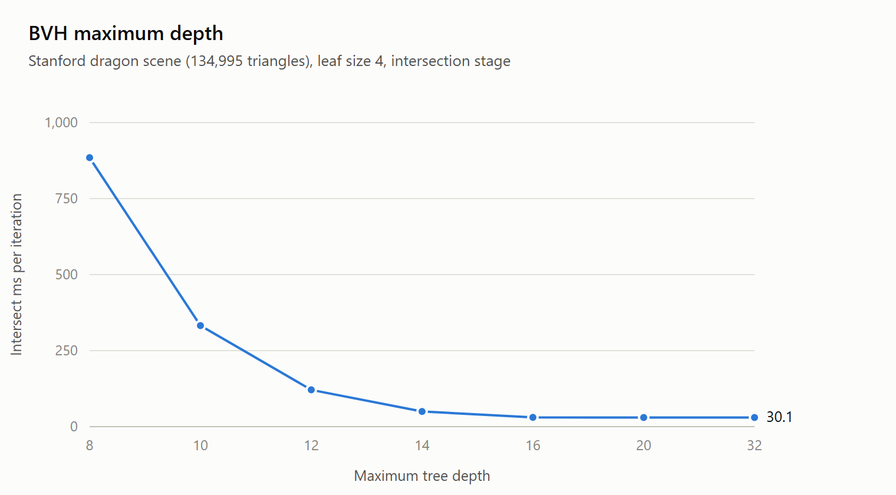 | 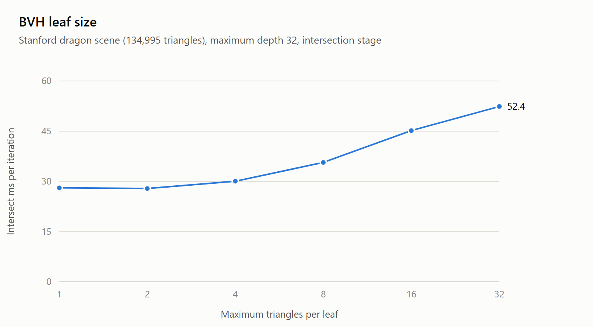 |
|---|---|

| Max depth | 8 | 10 | 12 | 14 | 16 | 20 | 32 |
|---|---|---|---|---|---|---|---|
| Intersect ms | 884 | 332 | 121 | 49.9 | 30.5 | 30.0 | 30.1 |

| Leaf size | 1 | 2 | 4 | 8 | 16 | 32 |
|---|---|---|---|---|---|---|
| Intersect ms | 28.1 | 27.9 | 30.1 | 35.7 | 45.2 | 52.4 |
| Nodes | 269,989 | 138,917 | 73,381 | 40,613 | 24,229 | 16,037 |

A shallow tree leaves hundreds of triangles in each leaf. Past depth 16 the leaves already hold four triangles or fewer and extra depth changes nothing. Small leaves are fastest; the default of 4 is within 8% of the best for about a quarter of the nodes of leaf size 1.

* **GPU vs CPU:** a CPU traverses recursively and benefits from its branch predictor. The GPU needs an explicit stack per thread, and rays in the same warp take different routes through the tree, so some threads idle. It still wins on raw ray count.
* **Next:** split by surface area heuristic instead of the median, visit the nearer child first, and put the scene's primitives in a top-level tree. The cover scene spends 361 of its 372 ms per iteration on intersection, because every ray still loops over all 423 objects.

## Speed and workflow

### Russian roulette

From the fourth bounce on, a path survives with probability equal to its brightest color channel and survivors are divided by that probability. Dim paths stop early and the expected image is unchanged.

| Closed box, 300 iterations, off | Closed box, 300 iterations, on |
|---|---|
| 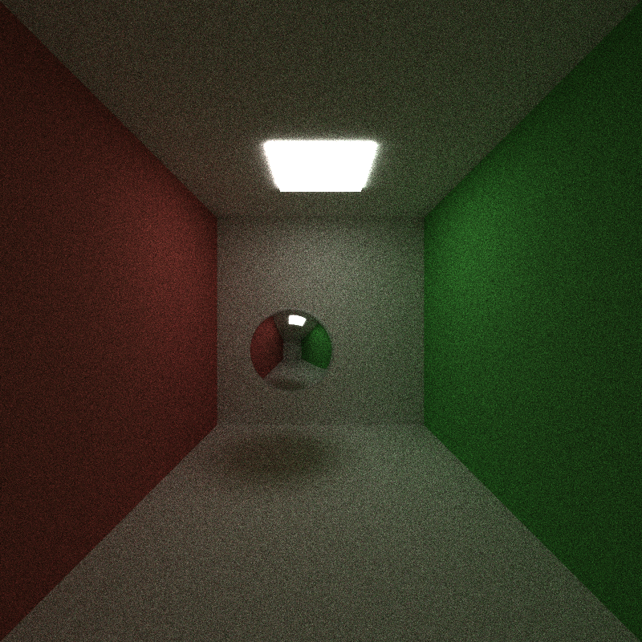 |  |

| Scene | Off | On | Paths alive at bounce 8 |
|---|---|---|---|
| Open Cornell | 15.5 ms | 13.9 ms | 119,670 to 46,490 |
| Closed Cornell | 31.4 ms | 24.1 ms | 586,041 to 213,401 |

* **Performance:** 10% faster in the open scene and 23% faster in the closed one. The closed scene gains most because roulette is the only thing that ends paths there, and it works together with stream compaction. Mean image brightness matches within 0.03% in both scenes.
* **GPU vs CPU:** the test is one random number and a divide on either. On the GPU the saving only appears because compaction removes the dead paths.
* **Next:** start roulette earlier for paths that are already dim.

### Open Image Denoise

The renderer accumulates two extra buffers from the first hit of every path: surface color (albedo) and normal. The denoiser takes those and the image and runs the OIDN `RT` filter on the CPU in HDR mode. It runs on the first iteration, every 50 iterations after that, and on the last one; the window and the saved image show the denoised result when it is on. Calling it every iteration would cost more than the path tracing itself.

| 16 iterations | 16 iterations, denoised | 5000 iterations |
|---|---|---|
| 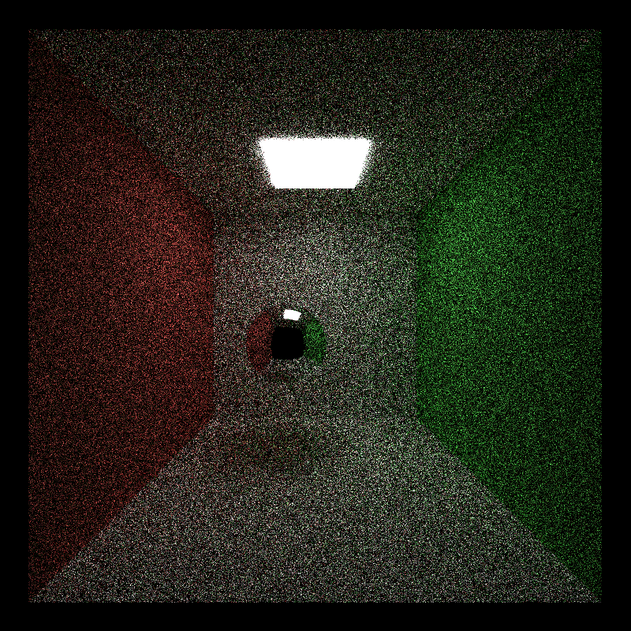 | 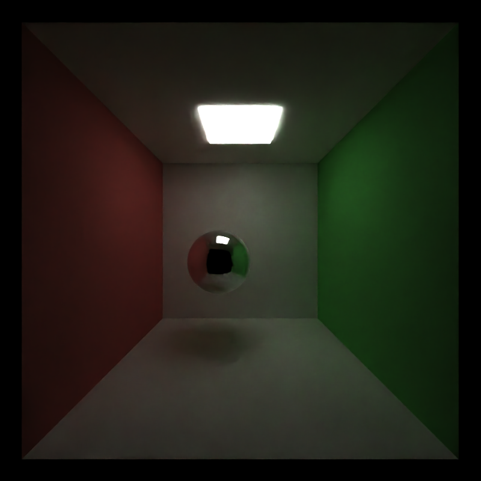 |  |

| Iterations | Raw error | Denoised error |
|---|---|---|
| 16 | 38.9 | 2.97 |
| 64 | 19.6 | 2.53 |
| 256 | 9.62 | 2.37 |

* **Performance:** one call takes 0.26 to 0.30 s at 800 x 800, including copying the buffers to the host and the result back. Sixteen denoised iterations are closer to the reference than 256 raw ones.
* **GPU vs CPU:** this step is the one part of the renderer that runs on the CPU, and it needs the buffers copied off the GPU first.
* **Next:** use OIDN's CUDA device with shared buffers to skip the copies, and denoise only on demand when rendering interactively.

### Checkpoints

Every saved image also writes a `.ckpt` file next to it: the iteration count, the camera, and the accumulated image, albedo and normal buffers (23 MB at 800 x 800). Passing that file as the second argument resumes the render. Random numbers are seeded from the iteration number, so a resumed render continues the same sequence: 100 iterations plus a resumed 100 give a byte-identical image to 200 straight.

* **Performance:** no cost while rendering. Saving copies two more buffers off the GPU.
* **GPU vs CPU:** the same on both; the GPU version only has to download and upload the buffers.
* **Next:** save automatically at an interval, and store the BVH so large scenes skip the rebuild.

## Building and running

```
cmake -S . -B build -G "Visual Studio 17 2022" -A x64
cmake --build build --config Release
cd build
bin\Release\cis565_path_tracer.exe ..\scenes\lantern_rain.json -denoise -rr
```

```
cis565_path_tracer SCENE.json [CHECKPOINT.ckpt] [flags]
```

| Flag | Effect |
|---|---|
| `-sort` | sort paths by material |
| `-nocompact` | turn stream compaction off |
| `-noaa` | turn antialiasing off |
| `-rr` | Russian roulette |
| `-direct` | direct lighting |
| `-halton` | Halton sampling |
| `-nobvh` | do not use the BVH |
| `-nocull` | do not use bounding box culling (with `-nobvh`) |
| `-denoise` | Open Image Denoise |

The same switches are checkboxes in the GUI, along with sliders for lens radius and focal distance and the time per stage. Saving an image (`S`, `Esc`, or reaching the iteration count) prints the stage timings and the number of live paths at each bounce.

On a laptop with two GPUs the program has to run on the NVIDIA one (Windows Settings > System > Display > Graphics), or CUDA-OpenGL interop fails at startup.

### Changes to CMakeLists.txt

* Added `src/bvh.h`, `src/bvh.cpp`, `src/denoise.h` and `src/denoise.cpp` to the source lists.
* On MSVC, nvcc is given `-Xcompiler=/Zc:preprocessor`. CUDA 13.3's Thrust headers refuse to compile with MSVC's traditional preprocessor.
* Open Image Denoise is optional. If `external/oidn` exists, CMake finds the package there, defines `USE_OIDN`, links it, and copies its DLLs next to the executable. To set it up, unzip the [OIDN 2.5.1 Windows release](https://github.com/RenderKit/oidn/releases/tag/v2.5.1) so that `external/oidn/lib/cmake` exists. The binaries are not in the repository. Without them the project still builds and `-denoise` shows the plain image.

The bundled `stb_image.h` and `stb_image_write.h` were replaced with newer versions, which tinygltf needs, and `tiny_gltf.h` was added to `external/include`.

### Changes to the scene format

Existing scenes load unchanged. Additions:

| Where | Field | Meaning |
|---|---|---|
| Material | `"TYPE": "Refractive"`, `"IOR"` | glass |
| Material | `"TYPE": "Subsurface"`, `"SCATTER_DIST"`, optional `"IOR"` | subsurface scattering |
| Material | `"TEXTURE"` | `"checker"`, `"marble"`, or an image path relative to the scene file |
| Material | `"TEXTURE_SCALE"` | scales procedural coordinates and UVs |
| Material | `"BUMP_MAP"`, `"BUMP_SCALE"` | height image and strength |
| Object | `"TYPE": "mesh"`, `"FILE"` | glTF file; leave out `MATERIAL` to use the file's materials |
| Object | `"EMITTANCE"` | strength of a mesh's emissive texture |
| Object | `"TYPE": "mandelbulb"` or `"menger"` | procedural shapes |
| Object | `"VELOCITY"` | movement over the exposure, for motion blur |
| Camera | `"LENS_RADIUS"`, `"FOCAL_DIST"` | depth of field |
| Top level | `"BVH_MAX_DEPTH"`, `"BVH_LEAF_SIZE"` | BVH shape (defaults 32 and 4) |

## Bloopers

| Glass cube with black edges | Speckles from direct lighting |
|---|---|
| 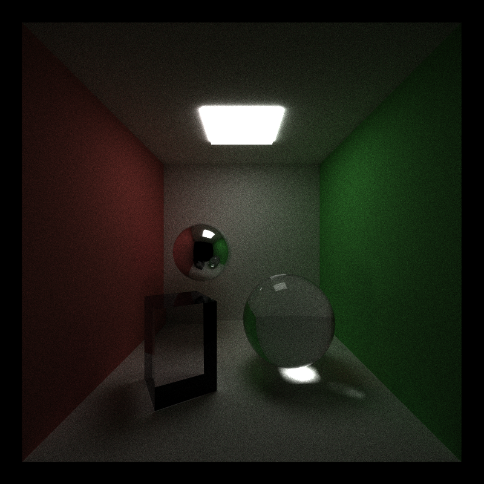 | 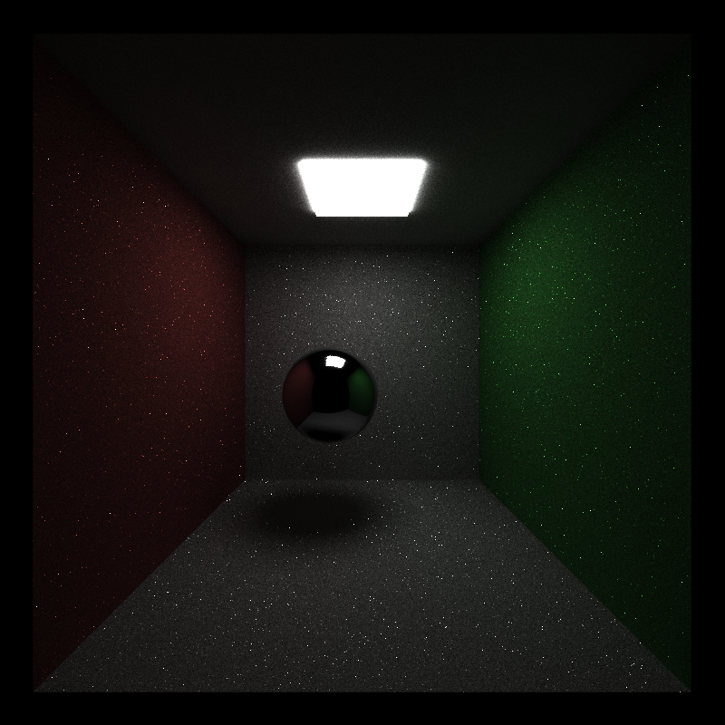 |

**Black glass.** The bundled GLM returns NaN from `glm::refract` on total internal reflection, not a zero vector. Every ray that should have bounced around inside the cube turned into NaN and went black. `scatterRay` now checks for total internal reflection itself before calling `glm::refract`.

**Speckles.** The direct lighting weight divides by the squared distance to the light, so points on the ceiling right next to the light got enormous values. Capping the weight removed them.

## Credits

Libraries:

* [tinygltf](https://github.com/syoyo/tinygltf) v2.9.7 by Syoyo Fujita and contributors, MIT license
* [stb_image and stb_image_write](https://github.com/nothings/stb) by Sean Barrett, public domain
* [Open Image Denoise](https://www.openimagedenoise.org/) 2.5.1, Apache 2.0 license
* From the base code: GLM, GLFW, GLEW, Dear ImGui, nlohmann/json

Models:

* Lantern, Damaged Helmet, Dragon Attenuation and Duck from the [Khronos glTF Sample Assets](https://github.com/KhronosGroup/glTF-Sample-Assets)
  * Lantern: Microsoft and Frank Galligan, CC0
  * Damaged Helmet: theblueturtle_ (CC BY-NC 4.0) and ctxwing (CC BY 4.0)
  * Dragon: Stanford University Computer Graphics Laboratory and Morgan McGuire, Stanford Graphics Library license; cloth by Adobe, CC0
  * Duck: Sony, SCEA Shared Source License 1.0
* [Wooden Barrels 01](https://polyhaven.com/a/wooden_barrels_01) by James Ray Cock, Poly Haven, CC0

Textures, all from [Poly Haven](https://polyhaven.com/textures), CC0: Red Brick 03, Wood Floor Deck, Cobblestone Floor 08.

References:

* [Physically Based Rendering, 4th edition](https://pbr-book.org/4ed/contents): diffuse and dielectric reflection, the thin lens camera, textures, direct lighting
* [Physically Based Rendering, 3rd edition](https://www.pbr-book.org/3ed-2018/contents): bump mapping, Russian roulette, subsurface scattering
* [Schlick's approximation](https://en.wikipedia.org/wiki/Schlick%27s_approximation)
* [Antialiasing and Raytracing](https://paulbourke.net/miscellaneous/raytracing/), Chris Cooksey and Paul Bourke
* [Better random number sequences for Monte Carlo ray tracing](https://cseweb.ucsd.edu/classes/sp17/cse168-a/CSE168_07_Random.pdf), UCSD CSE 168
* Inigo Quilez's articles on the [Mandelbulb](https://iquilezles.org/articles/mandelbulb/) and the [Menger sponge](https://iquilezles.org/articles/menger/) distance functions
