CUDA Path Tracer
================

**University of Pennsylvania, CIS 565: GPU Programming and Architecture, Project 3**

* Hangyu Zhang
* Tested on: Ubuntu 24.04.5 LTS (aarch64), NVIDIA DGX Spark (GB10 GPU, compute capability 12.1, 128 GB unified memory), CUDA 13.0, driver 580.173

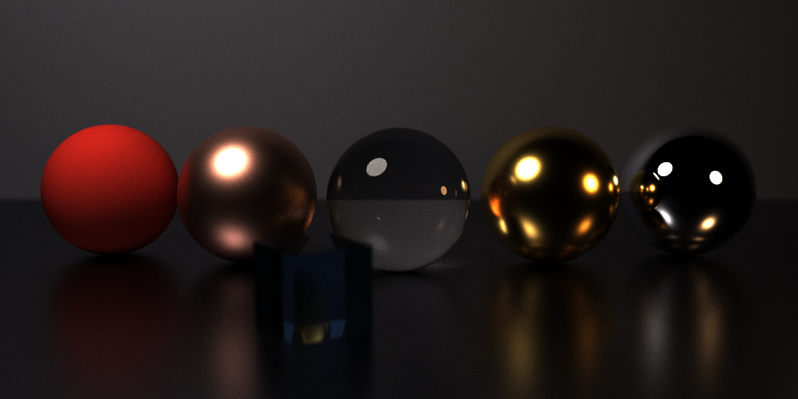

*[scenes/showcase.json](scenes/showcase.json), 1200 x 600, 3,000 samples per pixel.*

## Features

* Diffuse surfaces
* Stream compaction to remove finished paths (`thrust::partition`)
* Sorting paths by material (`thrust::sort_by_key`)
* Stochastic antialiasing
* Glass (refraction with Fresnel), mirrors and rough metal (GGX)
* Depth of field
* Direct lighting (next event estimation, NEE) with multiple importance sampling (MIS)
* Russian roulette
* Motion blur

Every feature can be turned on and off in the ImGui panel or with command-line flags (see [Usage](#usage)).

## Basic path tracer

| Cornell box | Closed Cornell box |
|:---:|:---:|
|  | 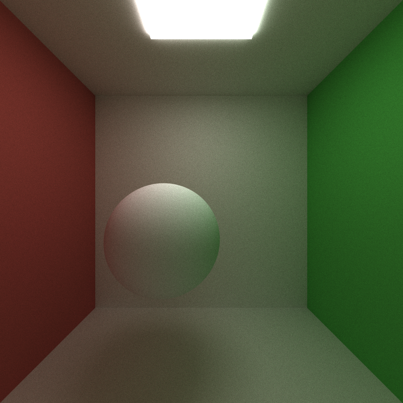 |
| 5,000 samples per pixel, max depth 8 | Front wall added, camera inside |

*Both rendered with diffuse materials only, before the other materials were added.*

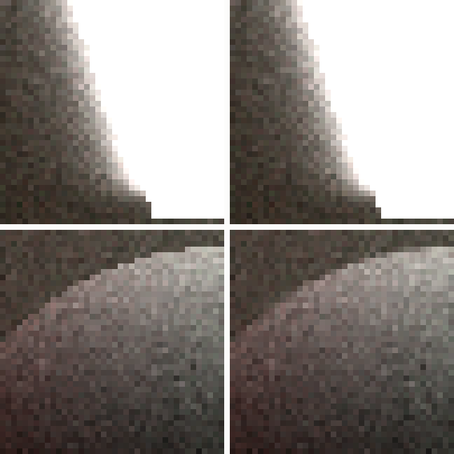

*Antialiasing, 8x crops. **Left: off. Right: on.***

For antialiasing, each iteration sends the camera ray through a random point inside the pixel instead of always the center. After averaging, edges look smooth. It has no measurable cost (21.2 vs 21.7 ms per iteration).

The random numbers only depend on the pixel, the iteration and the bounce. So turning sorting or compaction on or off gives exactly the same image, and the timing comparisons below are fair.

## Glass, mirror and rough metal

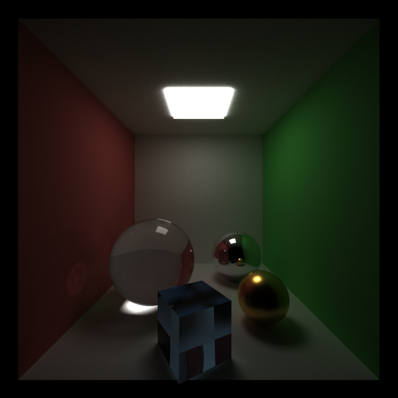

*[scenes/cornell_glass.json](scenes/cornell_glass.json), 3,000 samples per pixel: glass sphere with its caustic, tinted glass cube, mirror sphere, rough gold sphere.*

* Glass either reflects or refracts, and the Fresnel term decides which one. Metal reflects with its own color; roughness 0 is a perfect mirror.
* **Performance:** 31.2 ms per iteration, vs 29.2 ms when every material is diffuse (+7%). Glass and mirrors absorb almost no light, so paths keep bouncing longer.
* **Material sorting** makes the shading kernel faster in this scene, but the whole iteration gets slower (31.2 → 66.9 ms). See [Material sorting](#material-sorting).
* **GPU vs. CPU:** each material is cheap to compute. On the GPU the problem is divergence: when glass, metal and diffuse paths are in the same warp, the warp has to run each branch one after another. A CPU doesn't have this problem.
* **Next steps:** a faster sort, so that material sorting pays off. Rough glass.

## Depth of field

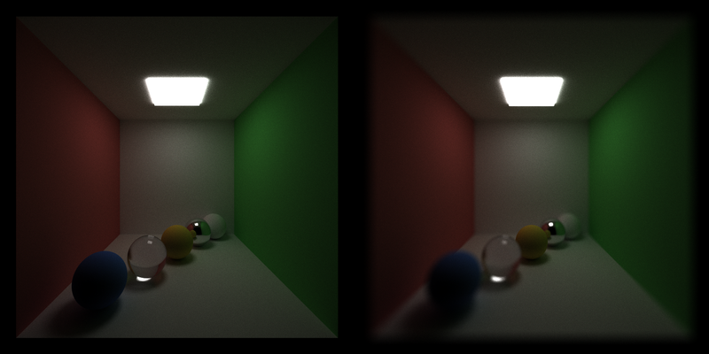

*[scenes/cornell_dof.json](scenes/cornell_dof.json), 1,000 samples per pixel. **Left: pinhole. Right: lens radius 0.5, focused on the yellow sphere.***

* Camera rays start from a random point on a lens, and all rays of a pixel go through the same point on the focal plane. Objects at the focal distance stay sharp and everything else gets blurry.
* Set with `LENS_RADIUS` and `FOCAL_DISTANCE` in the scene file, or with the ImGui sliders.
* **Performance:** no measurable cost (29.5 vs 29.8 ms per iteration).
* **GPU vs. CPU:** every camera ray is independent, so the GPU just uses one thread per pixel. On a CPU it would be a simple loop.
* **Next steps:** stratified lens samples, so the blur converges faster.

## Direct lighting: NEE + MIS

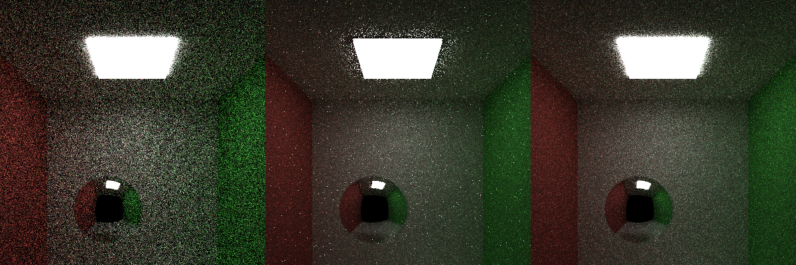

*`cornell.json`, 32 samples per pixel. **Left to right: BSDF sampling only, NEE, NEE + MIS.** Error (RMSE, 0-255) compared to a 3,000-sample reference: 29.6, 16.2, 12.2.*

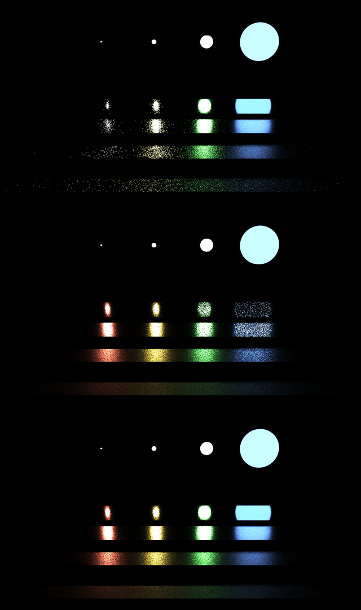

*[scenes/veach_mis.json](scenes/veach_mis.json), 64 samples per pixel. **Top to bottom: BSDF sampling only, NEE, NEE + MIS.** The plates go from smooth (back) to rough (front). All four lights have the same power.*

* Without NEE, a path only gets light if it randomly bounces into a light. With NEE, every bounce also sends a shadow ray to a random point on a light. MIS combines the two methods and weights each sample so that the better method counts more.
* The Veach scene shows why we need both: BSDF sampling alone is noisy on rough plates with small lights, and light sampling alone is noisy on smooth plates with large lights. MIS is clean in both cases.
* All three modes converge to the same image (within 0.15%). NEE alone has fireflies next to the light where it touches the ceiling; MIS removes them.

| Time per iteration | BSDF only | NEE | MIS |
|---|--:|--:|--:|
| Open Cornell box | 21.7 ms | 29.0 ms | 28.7 ms |
| Closed Cornell box | 42.9 ms | 57.1 ms | 58.3 ms |

* **Performance:** the shadow ray makes each iteration about a third slower. But BSDF sampling needs about 190 samples to reach the error MIS has at 32 samples, so MIS gets the same quality in about **4x less time**.
* **GPU vs. CPU:** paths on glass and mirrors skip the shadow ray, and the rest of their warp waits for them. A CPU doesn't waste work like this, but it has far fewer threads.
* **Next steps:** a separate kernel for shadow rays (light sampling raised the shading kernel from 78 to 115 registers per thread, see [Nsight Compute](#nsight-compute)), a BVH, and choosing lights by their power.

## Russian roulette

| MIS, time per iteration | Without | With | Live paths at bounce 8 |
|---|--:|--:|--:|
| Open Cornell box | 28.7 ms | 24.0 ms (−17%) | 119,674 → 46,337 |
| Closed Cornell box | 58.3 ms | 45.5 ms (−22%) | 561,896 → 253,994 |

* From the third bounce on, a path keeps going with probability equal to its brightest color channel, so dark paths usually stop. Paths that keep going are divided by that probability, so the image stays the same: every region matches within 0.03%.
* The closed box gains the most, because without Russian roulette almost every path lives until the max depth.
* **GPU vs. CPU:** on a CPU, a stopped path just saves work. On the GPU it only helps because stream compaction removes the stopped paths, so the two features work together.
* **Next steps:** start earlier, or use luminance for the survival probability, to stop more paths.

## Motion blur

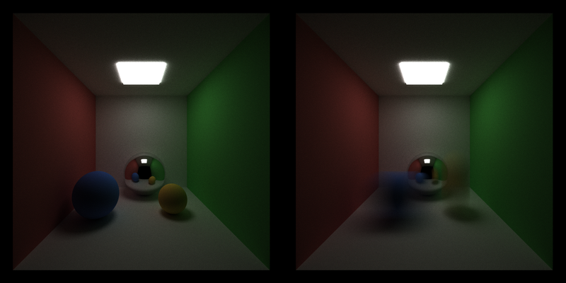

*[scenes/cornell_motion.json](scenes/cornell_motion.json), 1,000 samples per pixel. **Left: off. Right: on.** The blue sphere moves right and the yellow one moves up.*

* Objects get a `MOTION` offset in the scene file. Each path picks a random time and sees the objects at that time, so shadows and reflections blur too.
* **Performance:** no measurable cost (27.4 vs 26.6 ms per iteration).
* **GPU vs. CPU:** every path does the same small extra work, so there is no divergence.
* **Next steps:** rotating objects; stratified time samples.

## Performance analysis

The numbers in this section, except [Nsight Compute](#nsight-compute), were measured before the extra materials and lighting were added (diffuse sphere, BSDF sampling only). Image size 800 x 800, max depth 8. Total times come from CUDA events, and the per-kernel times from Nsight Systems.

### Stream compaction within one iteration

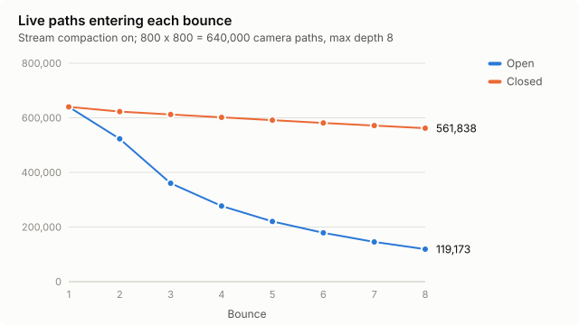

* **Open box:** paths escape at every bounce, and only 19% are still alive at bounce 8. Compaction cuts the total work to 48%.
* **Closed box:** paths can't escape, and 88% are still alive at bounce 8. Compaction only cuts the work to 93%.

### Where the time goes

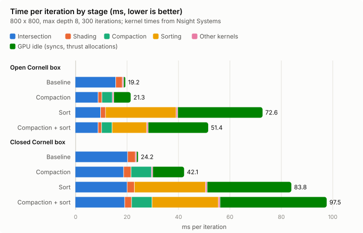

| Scene | Config | Intersection | Shading | Compaction | Sorting | Other kernels | GPU idle | **Total (ms)** |
|---|---|--:|--:|--:|--:|--:|--:|--:|
| Open | Baseline | 15.79 | 2.55 | – | – | 0.52 | 0.36 | **19.22** |
| Open | Compaction | 8.94 | 1.45 | 4.11 | – | 0.51 | 6.29 | **21.30** |
| Open | Sort | 9.90 | 1.89 | – | 27.47 | 0.59 | 32.73 | **72.59** |
| Open | Compaction + sort | 8.90 | 1.35 | 4.10 | 13.47 | 0.57 | 23.05 | **51.44** |
| Closed | Baseline | 20.39 | 3.00 | – | – | 0.53 | 0.25 | **24.16** |
| Closed | Compaction | 18.84 | 2.90 | 7.92 | – | 0.50 | 11.92 | **42.09** |
| Closed | Sort | 20.21 | 2.80 | – | 27.66 | 0.65 | 32.46 | **83.79** |
| Closed | Compaction + sort | 19.25 | 2.69 | 7.95 | 25.82 | 0.61 | 41.21 | **97.52** |

*GPU idle* is the total time minus the kernel time, i.e. time the GPU is waiting for the CPU.

**Stream compaction** does remove work: in the open box, intersection time goes from 15.8 to 8.9 ms. But on this machine compaction costs more than it saves. `thrust::partition` copies the whole path array, and every call allocates and frees temporary memory, which is slow here. Overall it is 11% slower in the open box, and 74% slower in the closed box, where almost no paths end. It should help more in heavier scenes, or when Russian roulette stops paths early.

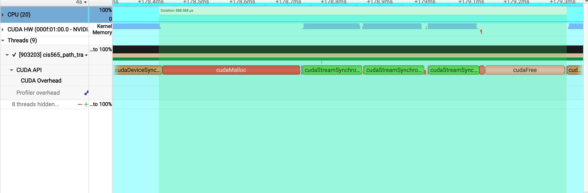

*Nsight Systems, open box with compaction on: one `thrust::partition` call (about 0.88 ms). The GPU (CUDA HW row) only works during the partition kernels in the middle (0.36 ms). During `cudaMalloc` (0.30 ms) and `cudaFree` (0.17 ms) it has nothing to do. This is where the GPU idle time comes from.*

### Material sorting

With only diffuse materials, sorting makes every configuration 2.3-3.8x slower. The sort kernels alone take 13-28 ms per iteration, each call also allocates big temporary buffers, and there is nothing to gain because all diffuse materials run the same code.

With different materials, sorting does make shading faster. Nsight Compute on the same bounce of [cornell_glass.json](scenes/cornell_glass.json) (second bounce, 522k paths):

| `shadeMaterial` | Without sort | With sort |
|---|--:|--:|
| Duration | 2.32 ms | 1.61 ms (−31%) |
| Active threads per warp (out of 32) | 9.4 | 17.4 |
| Divergent branches (average) | 715 | 166 |

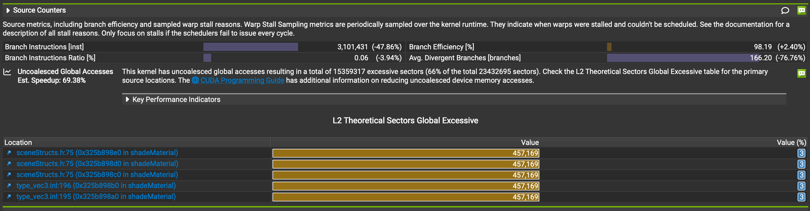

*Nsight Compute, `shadeMaterial` with sorting. The percentages compare against the run without sorting: 77% fewer divergent branches.*

After sorting, paths with the same material are next to each other, so a warp runs fewer different branches. But this only saves about 0.7 ms on this bounce, while the sort costs several milliseconds, so the whole iteration still gets slower (31.2 → 66.9 ms).

### Nsight Compute

These were measured on the final version of the code.

| Kernel | Duration | Registers per thread | Theoretical occupancy | Finding |
|---|--:|--:|--:|---|
| `shadeMaterial` (glass scene) | 2.32 ms | 115 | 33% | Register count limits occupancy |
| `computeIntersections` (Cornell box) | 1.60 ms | 115 | 33% | Memory bound: 69% memory vs 19% compute throughput |

#### `shadeMaterial`

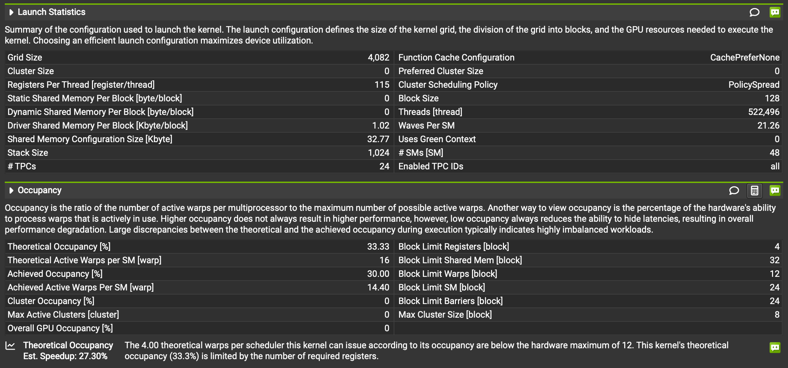

*With 115 registers per thread, only 4 blocks fit on an SM ("Block Limit Registers"), so the theoretical occupancy is 33%.*

#### `computeIntersections`

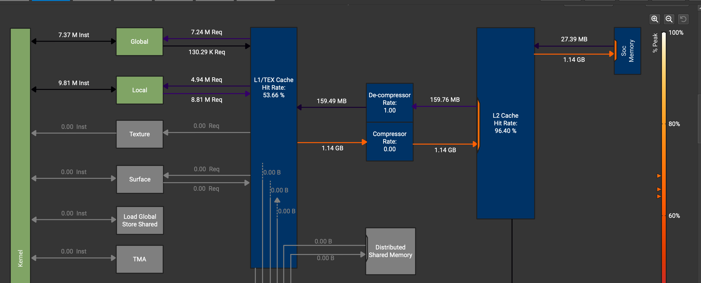

*The Local row (the stack) has almost twice as many requests as the Global row (13.8 M vs 7.4 M). Almost all of the 1.14 GB that L1 writes to L2 during this 1.6 ms kernel is stack data.*

The intersection functions take the large `Geom` struct by value. They are compiled in another file, so the struct is copied to the stack for every call.

## Usage

```
sudo apt install libglfw3-dev libglew-dev
mkdir build && cd build
cmake .. -DCMAKE_BUILD_TYPE=Release
make -j
./bin/cis565_path_tracer ../scenes/cornell.json [--sort] [--no-compact] [--no-aa] [--no-dof] [--no-rr]
                         [--no-motion-blur] [--integrator naive|nee|mis] [--iterations N]
```

Defaults: compaction, antialiasing, Russian roulette and motion blur on, sorting off, integrator `mis`.

Controls: Esc saves and exits, S saves, Space re-centers the camera. Left drag rotates, right drag zooms, middle drag moves the look-at point.

New scene file keys:

| Where | Key | Meaning |
|---|---|---|
| Material | `"TYPE":"Refractive"`, `"IOR"` | Glass. `RGB` tints the light that passes through. |
| Material | `"TYPE":"Specular"`, `"ROUGHNESS"` | Metal. Roughness 0 is a mirror. |
| Camera | `"LENS_RADIUS"`, `"FOCAL_DISTANCE"` | Depth of field (off when the radius is 0). |
| Object | `"MOTION"` | How far the object moves during the exposure. |

[scripts/benchmark.sh](scripts/benchmark.sh), [scripts/profile.sh](scripts/profile.sh) and [scripts/features.sh](scripts/features.sh) reproduce the numbers and images above.

## Changes to the base code

* `CMakeLists.txt` is unchanged.
* `main.cpp`: command-line flags, ImGui controls and stats, vsync off. Fixed the camera starting upside down in scenes that look up or down.
* `"Specular"` materials used to render as diffuse; they are now mirrors or rough metal.
* New scenes: `cornell_closed`, `cornell_glass`, `cornell_dof`, `cornell_motion`, `veach_mis`, `showcase`.

## References

* [PBRTv4](https://pbr-book.org/4ed/contents): 9.2 diffuse reflection, 9.3 dielectric Fresnel, 9.6 microfacets (GGX), 5.2.3 thin lens, 2.2 MIS and Russian roulette, 13.4 direct lighting
* Eric Veach, [Robust Monte Carlo Methods for Light Transport Simulation](https://graphics.stanford.edu/papers/veach_thesis/), 1997, chapter 9 (the MIS test scene)
* Paul Bourke, [Antialiasing and Raytracing](https://paulbourke.net/miscellaneous/raytracing/)
* [Thrust](https://nvidia.github.io/cccl/thrust/) and [CUB](https://nvidia.github.io/cccl/cub/) documentation
