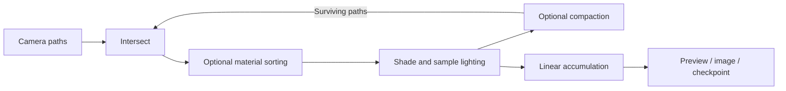

# Optical Workbench — CUDA Path Tracing

[Didrik Wiig Andersen](https://github.com/didrikwiigandersen)


A progressive CUDA path tracer built around an original optical still life. Image textures and bump mapping bring detail to the ceramic sculpture; Fresnel reflection and refraction reveal the glass sphere; ideal specular reflection shapes the gold torus. OBJ loading, iterative GPU BVH traversal, thin-lens focus, direct-light sampling, and lossless restart support the scene.

The interactive preview and headless executable share the same CUDA implementation. Each optimization can be disabled independently for controlled comparisons.

The cover uses 2,048 samples at 960 × 640. Surface, focus, and antialiasing comparisons use 512 samples at 640 × 424; the lighting comparison uses 64 samples at that resolution. All use seed 947 and depth 10. Render metadata and lossless sums are retained in `results/`.

## Rendering pipeline

Each iteration creates one stochastic camera path per pixel. Separate intersection and shading kernels advance paths through the scene. Diffuse shading samples a cosine-weighted hemisphere; mirrors and dielectrics use discrete reflection/transmission. Direct-light sampling uses visibility rays and multiple importance sampling with BSDF-sampled light hits.



Random samples use the seed, original pixel, global sample number, bounce, and sampling dimension. Compaction and sorting preserve sampling identity. Contributions are retained before removing terminated paths.

## Geometry and surface detail

The original OBJ parser supports independent position/normal/UV indices, positive and negative indices, triangles, and convex planar polygons. Invalid indices, degeneracy, concavity, and nonplanarity produce source-line diagnostics. Each mesh uses its scene-assigned material; an MTL importer is outside this implementation.

Static transforms include inverse-transpose normals and mirrored winding. Analytic spheres and cubes remain supported. Geometric normals determine surface orientation and ray offsets; shading normals include interpolation and bump detail.

The CPU builds a deterministic median-split BVH along the greatest centroid extent, targeting four primitives per leaf. A configurable depth cap retains larger leaves. GPU traversal uses a bounded iterative stack with explicit overflow handling. Toggleable brute-force traversal provides a comparison baseline.

Image colors are interpreted as sRGB, while height maps remain linear. Original bilinear repeated sampling and tangent-space height derivatives add detail without changing the silhouette. A procedural checker provides a comparison without image fetches.

| Image texture and bump | Image texture without bump | Procedural texture |
|---|---|---|
|  |  |  |

All new meshes and BMP maps are generated by [generate_assets.py](scripts/generate_assets.py). The closed ceramic profile and torus are original parametric assets.

## Glass, focus, and direct lighting

Dielectric scattering handles Fresnel reflection, Snell refraction, entering/exiting surfaces, and total internal reflection. The thin-lens camera samples an aperture and focuses on a focal plane. Zero aperture recovers the pinhole camera.

| Refraction | Mirror comparison | Thin-lens focus |
|---|---|---|
|  |  |  |

Emissive cubes, transformed spheres, and mesh triangles are sampled with PDFs matching their actual transformed geometry. Power-heuristic MIS balances direct-light and BSDF estimators without double-counting. Camera-visible and specular-chain light hits retain full emission weight.

| Direct-light sampling | BSDF sampling alone |
|---|---|
|  |  |

## Restart without losing samples

Versioned, checksummed checkpoints store completed samples, lossless linear RGB sums, seed/sampler/configuration, camera, scene/asset fingerprints, and indexed BVH data. Writes use atomic replacement. Resume permits a larger total sample target and rejects corrupted or incompatible state.

Exact continuation is checked in separate processes on the same GPU/build/configuration: uninterrupted rendering versus a partial render followed by resume, comparing raw accumulation bytes. Display conversion is separate from the stored linear sums. PNGs use the sample mean, Reinhard tone mapping `c/(1+c)`, and sRGB encoding; raw sums remain unmodified.

| Stopped after 16 samples | Resumed to 512 samples |
|---|---|
|  |  |

The resumed 512-sample sums match the uninterrupted glass comparison byte for byte.

## Performance

Measurements use an NVIDIA A10G on a g5.xlarge workstation, CUDA 12.8.93, GCC 13.3, and a Release build targeting architecture 86. Three warmup processes precede three measured repeats per variant. The tables report median GPU milliseconds per sample; plots include min–max whiskers. Camera, seed, resolution, depth, and sample count are fixed within each comparison. These short runs include their first iteration; they measure complete sample processing rather than isolated kernels. Complete process and render-loop timings are retained separately.

### BVH and mesh loading

The same OBJ loader feeds brute-force and BVH traversal. Complexity increases through three tessellations of the original ceramic mesh. At 96 × 64, eight samples, and depth 10:

| Mesh level | Brute force, ms/sample | BVH, ms/sample | Speedup |
|---|---:|---:|---:|
| Low | 12.331 | 5.539 | 2.23× |
| Medium | 41.067 | 6.566 | 6.25× |
| High | 153.670 | 7.716 | 19.92× |


Brute-force time grows with primitive count, while the hierarchy prunes unrelated geometry. BVH traversal still grows with complexity and includes divergent traversal, stack work, and memory reads. Exact accumulation and traced-hit checks confirm that culling preserves the rendered result; the reference/brute-force raw files are retained in the validation evidence.

### Compaction and material sorting

At 160 × 106, 16 samples, and depth 10:

| Scene / scheduling choice | Disabled, ms/sample | Enabled, ms/sample | Effect |
|---|---:|---:|---|
| Open scene / compaction | 1.512 | 1.466 | 3.0% faster |
| Closed scene / compaction | 2.445 | 2.563 | 4.8% slower |
| Uniform diffuse materials / sorting | 11.264 | 12.607 | 11.9% slower |
| Mixed materials / sorting | 10.931 | 12.968 | 18.6% slower |


Compaction helps the open scene by removing escaping rays, but its scan/scatter costs exceed the savings in the enclosed chamber. The uniform scene assigns one diffuse material to all non-emissive objects. Sorting does not recover its overhead in either measured workload; the compact renderer uses a unified shader, and these image sizes offer limited material-coherence benefit.


In the first measured sample, the open queue falls from 16,960 paths to 8,962 after bounce 0 and 1,337 after bounce 1. The closed queue retains 16,951 and 16,689 respectively. Emissive hits and the depth limit terminate paths in the closed scene. Per-bounce before/after counts and intersection, sorting, shading, compaction, and counting times are recorded in `single-iteration.csv`; complete phase records accompany every benchmark.

### Surface, camera, and lighting costs

At 160 × 106, 16 samples, and depth 10:

| Comparison | First variant, ms/sample | Second variant, ms/sample |
|---|---:|---:|
| File / procedural texture | 10.910 | 10.864 |
| Bump off / on | 10.926 | 10.889 |
| Mirror / refractive sphere | 11.076 | 10.952 |
| Pinhole / thin lens | 10.948 | 11.005 |
| BSDF only / direct-light sampling | 7.558 | 10.950 |


Texture, bump, and lens differences are small relative to traversal in this workload. Their rankings should not be generalized beyond the measured variation. Bump mapping, mirror/refraction, and depth of field alter ray trajectories, so their timings include changed path work. Direct lighting costs 44.9% more per sample here because it traces additional visibility rays, but the equal-sample image comparison shows its convergence benefit. At 8,192 samples, independent NEE and BSDF estimates agree in image mean within 0.074% for cube lights, 0.094% for transformed sphere lights, and 0.286% for mesh lights.

### Checkpoint overhead

Saving every eight samples changes median render-loop time from 10.961 to 11.186 ms/sample, a 2.1% increase, in the 16-sample workbench run. GPU sample time remains similar: 10.942 versus 10.951 ms. The loop measurement includes device-to-host download, serialization, checksum, and atomic file replacement; storage and checkpoint size affect this cost.


Full measurements, settings, raw files, and system specifications are linked in [verification](docs/verification.md).

| Feature | GPU versus a hypothetical CPU renderer | Further optimization |
|---|---|---|
| OBJ | Parsing is host work; independent ray/triangle tests exploit GPU concurrency. | Compact primitive layout; cache parsed assets. |
| BVH | Fewer primitive tests help either processor; GPU traversal also faces divergence and scattered reads. | Better split heuristics and traversal ordering. |
| Refraction | Independent dielectric calculations suit GPU throughput; reflection/transmission branches reduce coherence. | Specialized kernels and coherent path scheduling. |
| Texture/bump | Parallel lookups suit GPUs; procedural arithmetic trades image fetches for computation on either processor. | Texture objects, mipmaps, and footprint-aware filtering. |
| Restart | Host serialization adds a GPU download that a CPU renderer would not require. | Asynchronous staging and adjusted checkpoint cadence. |
| Depth of field | Camera sampling is inexpensive; defocus requires more samples and decreases coherence. | Better sampling and adaptive convergence. |
| Direct lighting | Extra shadow rays increase sample cost while reducing variance; GPUs process them concurrently. | Importance-weighted light selection and dedicated shadow queues. |

Compaction saves later work by removing dead paths, at the cost of scan/scatter. Sorting groups material work but adds scheduling cost. Neither is assumed to improve every scene.

## Antialiasing and diagnostics

| Stochastic antialiasing | Pixel-center camera |
|---|---|
|  |  |

First-hit semantic views help inspect surface normals, UVs, and camera depth. They use the same geometry and transformed mesh data as the beauty renderer.

| Shading normals | UV coordinates | Depth |
|---|---|---|
|  |  |  |

## Build and run

Requires CMake 3.24+, C++17, and a compatible NVIDIA driver/CUDA toolkit. Preview additionally requires OpenGL, GLFW, and GLEW. GLM, JSON, STB, and ImGui are inherited starter dependencies already present.

```sh
cmake -S . -B build -DCMAKE_BUILD_TYPE=Release -DBUILD_PREVIEW=OFF -DCMAKE_CUDA_ARCHITECTURES=86
cmake --build build -j
ctest --test-dir build --output-on-failure
build/bin/cis565_path_tracer_headless scenes/optical-workbench.json --samples 2048 --seed 947 --output results/workbench
```

Choose the architecture for your GPU; `86` is the A10G validation target. CMake preserves caller-selected architectures. `BUILD_PREVIEW` defaults to `ON`; `BUILD_RENDERER=OFF` enables host-only tests.

```sh
build/bin/cis565_path_tracer_headless scenes/optical-workbench.json --samples 64 --checkpoint results/workbench.checkpoint --output results/partial
build/bin/cis565_path_tracer_headless scenes/optical-workbench.json --samples 2048 --resume results/workbench.checkpoint --output results/resumed
build/bin/cis565_path_tracer_headless scenes/open-benchmark.json --samples 16 --compact off --sort on --benchmark --output results/diagnostic
build/bin/cis565_path_tracer_headless scenes/optical-workbench.json --resolution 17x13 --depth 7 --validate
python3 scripts/run_experiments.py --binary build/bin/cis565_path_tracer_headless
```

Additional controls: `--resolution WxH`, `--depth`, `--aa`, `--nee`, `--bvh`, `--compact`, and `--sort`. Toggle values are `on` or `off`. `--samples` denotes the total target, including previously completed samples.

Preview accepts a scene path. Left drag orbits, right drag zooms, middle drag moves the look-at point, Space recenters, S saves, and Escape saves and exits.

See [scene extensions](docs/scene-format.md), [validation and system specifications](docs/verification.md), and [source provenance](docs/provenance.md).

## References and provenance

- [Official Fall 2026 starter](https://github.com/CIS5650-Fall-2026/Project3-CUDA-Path-Tracer), revision `8695a5af18ae6fc130d1d38713be82bbbff7f38f`, including existing dependencies and retained licenses.
- Our own [Project 2](https://github.com/didrikwiigandersen/Project2-Stream-Compaction), revision `6a13e6fbe3a998c67fdbbdbe6643a5b4c4233b31`, for device scan and the adapted workstation transfer helper. The sampler also retains the official starter's `utilhash`; its counter composition is original.
- Conceptual references: [OBJ format](https://dirsig.cis.rit.edu/docs/new/obj.html), [BVH](https://pbr-book.org/4ed/Primitives_and_Intersection_Acceleration/Bounding_Volume_Hierarchies), [dielectrics](https://pbr-book.org/4ed/Reflection_Models/Dielectric_BSDF), [thin lens](https://pbr-book.org/4ed/Cameras_and_Film/Projective_Camera_Models#TheThinLensModelandDepthofField), [textures](https://pbr-book.org/4ed/Textures_and_Materials/Image_Texture), [bump mapping](https://www.pbr-book.org/3ed-2018/Materials/Bump_Mapping), [direct lighting/MIS](https://pbr-book.org/4ed/Light_Transport_I_Surface_Reflection/A_Better_Path_Tracer), and [Paul Bourke's raytracing notes](https://paulbourke.net/miscellaneous/raytracing/) supplied as a PDF.
- [Patrick Cozzi's README guide](https://github.com/pjcozzi/Articles/blob/master/CIS565/GitHubRepo/README.md) informed presentation and performance reporting.

All new implementation is independently written. No other student's code, copied/adapted internet implementations, or new third-party dependencies are used. The provenance register and change manifest distinguish inherited starter content, authorized own-code reuse, and original implementation.
