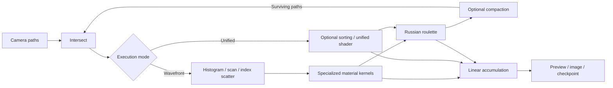

# CUDA Path Tracer
**University of Pennsylvania, CIS 565: GPU Programming and Architecture, Project 3**
* [Didrik Wiig Andersen](https://github.com/didrikwiigandersen)
* Tested on: Ubuntu 24.04.4 LTS, AMD EPYC 7R32 (4 vCPUs), 16 GiB provisioned RAM, NVIDIA A10G 23,028 MiB (AWS EC2 g5.xlarge)


A progressive CUDA path tracer built around an original optical still life. A twisted, fluted body and a swept knot combine geometric detail with analytic marble and staggered-cell textures. Fresnel reflection and refraction reveal the glass sphere. Per-material wavefront kernels, Russian roulette, iterative GPU BVH traversal, thin-lens focus, direct-light sampling, and lossless restart support the scene.

The interactive preview and headless executable share the same CUDA implementation. The execution mode and feature controls support controlled comparisons.

The cover uses 2,048 samples at 960 × 640. Surface, focus, and antialiasing comparisons use 512 samples at 640 × 424; the lighting comparison uses 64 samples at that resolution. All use seed 947 and depth 10. Render metadata and lossless sums are retained in `results/`.

## Rendering pipeline

Each iteration creates one stochastic camera path per pixel. Separate intersection and shading kernels advance paths through the scene. The default wavefront mode builds exact-material queues without sorting: a histogram, exclusive scan, and index scatter feed separate diffuse, mirror, dielectric, emission, and terminal kernels. The unified shader remains available, with optional stable material sorting for controlled comparisons. Diffuse shading samples a cosine-weighted hemisphere; mirrors and dielectrics use discrete reflection/transmission. Direct-light sampling uses visibility rays and multiple importance sampling with BSDF-sampled light hits.



Random samples use the seed, original pixel, global sample number, bounce, and sampling dimension. Compaction, sorting, and queue order preserve sampling identity. Contributions are retained before removing terminated paths.

## Geometry and surface detail

The original OBJ parser supports independent position/normal/UV indices, positive and negative indices, triangles, and convex planar polygons. Invalid indices, degeneracy, concavity, and nonplanarity produce source-line diagnostics. Each mesh uses its scene-assigned material; an MTL importer is outside this implementation.

Static transforms include inverse-transpose normals and mirrored winding. Analytic spheres and cubes remain supported. Geometric normals determine surface orientation and ray offsets; shading normals include interpolation and bump detail.

The CPU builds a deterministic median-split BVH along the greatest centroid extent, targeting four primitives per leaf. A configurable depth cap retains larger leaves. GPU traversal uses a bounded iterative stack with explicit overflow handling. Toggleable brute-force traversal provides a comparison baseline.

Image colors are interpreted as sRGB, while height maps remain linear. Original bilinear repeated sampling and tangent-space height derivatives add detail without changing the silhouette. A procedural checker provides a comparison without image fetches.

| Image texture and bump | Image texture without bump | Procedural texture |
|---|---|---|
|  |  |  |

All new meshes and BMP maps are generated by [generate_assets.py](scripts/generate_assets.py). The closed ceramic profile and torus are original parametric assets.

## Procedural sculptures and textures

The fluted body varies its radius, seven-fold fluting, elliptical cross-section, and twist with height. Separate flat caps close the surface. The swept knot follows a periodic three-lobed centerline with a varying tube radius; an analytic Frenet frame orients each ring without accumulated frame drift. Both meshes use smooth outward normals, repeated UVs, and exact position/normal seams with separate UV endpoints.

| Shape | Low triangles | Medium triangles | High triangles |
|---|---:|---:|---:|
| Fluted body | 1,600 | 6,272 | 24,832 |
| Swept knot | 1,024 | 4,096 | 16,384 |

Marble combines periodic sine fields into veins. The staggered-cell texture alternates teal and terracotta cells with gold diamond insets and dark grout. Both evaluate from wrapped UVs in linear RGB, multiply the material color, and use no image data or external noise implementation. The original checker remains available.

| Plain surface | Marble | Staggered cells |
|---|---|---|
|  |  |  |
|  |  |  |

Mesh generation and BVH construction run on the CPU once; ray traversal and procedural texture evaluation run on the GPU. The three tessellations expose the triangle-count tradeoff. Texture evaluation replaces memory fetches with arithmetic, while both representations need footprint-aware filtering to avoid distant-pattern aliasing.

## Glass, focus, and direct lighting

Dielectric scattering handles Fresnel reflection, Snell refraction, entering/exiting surfaces, and total internal reflection. The thin-lens camera samples an aperture and focuses on a focal plane. Zero aperture recovers the pinhole camera.

| Refraction | Mirror comparison | Thin-lens focus |
|---|---|---|
|  |  |  |

Emissive cubes, transformed spheres, and mesh triangles are sampled with PDFs matching their actual transformed geometry. Power-heuristic MIS balances direct-light and BSDF estimators without double-counting. Camera-visible and specular-chain light hits retain full emission weight.

| Direct-light sampling | BSDF sampling alone |
|---|---|
|  |  |

## Russian roulette

After three completed scattering events, roulette can terminate low-throughput paths. Its survival probability is the largest throughput channel, adjusted to remove accumulated refraction scaling and clamped to 0.05–0.95. A survivor divides its future throughput by that probability; a terminated path keeps all radiance already collected. This compensation preserves the expected contribution at each fixed depth limit.

Roulette uses a separate counter-sampler dimension, so queue order does not change its decisions. Emission, diagnostic output, and the final permitted vertex bypass roulette. The implementation retains the existing complementary direct-light/BSDF MIS weights. Exact checks compare execution modes at the same roulette setting; independent paired-seed measurements compare roulette enabled and disabled statistically.

## Restart without losing samples

Version 2 checksummed checkpoints store completed samples, lossless linear RGB sums, seed/sampler/configuration, camera, scene/asset fingerprints, and indexed BVH data. Writes use atomic replacement. Resume permits a larger total sample target and rejects corrupted or incompatible state, including differing wavefront or roulette settings. Version 1 checkpoints are rejected because they do not record the new configuration; raw accumulation remains version 1.

Exact continuation is checked in separate processes on the same GPU/build/configuration: uninterrupted rendering versus a partial render followed by resume, comparing raw accumulation bytes. Display conversion is separate from the stored linear sums. PNGs use the sample mean, Reinhard tone mapping `c/(1+c)`, and sRGB encoding; raw sums remain unmodified.

| Stopped after 16 samples | Resumed to 512 samples |
|---|---|
|  |  |

The resumed 512-sample sums match the uninterrupted glass comparison byte for byte.

## Performance

Measurements use a g5.xlarge workstation with AMD EPYC 7R32 (4 vCPUs), 16 GiB host RAM, NVIDIA A10G (23,028 MiB reported GPU memory), Ubuntu 24.04.4, CUDA 12.8.93, GCC 13.3, and a Release build targeting architecture 86. The fixed matrix contains 48 variants, each with three warmup processes and three measured repeats: 288 processes. Tables report median GPU milliseconds per sample; plots include min–max whiskers. Camera, seed, resolution, depth, and sample count are fixed within each comparison. Short runs include their first iteration and measure complete sample processing. Process and render-loop timings are retained separately.

CUDA phase timing synchronizes events. Overall event elapsed and loop time include profiling synchronizations and host scheduling gaps; these measurements describe the instrumented renderer. Host queue readback and submission time overlaps overall elapsed and is not added to the total. Aggregate shader time and the five specialized shader timings are alternative views of the same work.

### BVH and mesh loading

The same original OBJ loader feeds brute-force and BVH traversal. Three tessellations of the original ceramic mesh run at 96 × 64, eight samples, and depth 10, with wavefront and roulette explicitly disabled:

| Mesh level | Brute force, ms/sample | BVH, ms/sample | Speedup |
|---|---:|---:|---:|
| Low | 12.606 | 5.923 | 2.13× |
| Medium | 41.209 | 6.839 | 6.03× |
| High | 153.125 | 8.160 | 18.77× |


Brute-force time grows with primitive count; the hierarchy prunes unrelated geometry while retaining divergent traversal, stack work, and memory reads. Exact traced-hit and accumulation comparisons confirm that culling preserves the result.

### Compaction and material sorting

At 160 × 106, 16 samples, and depth 10, wavefront and roulette remain disabled:

| Scene / scheduling choice | Disabled, ms/sample | Enabled, ms/sample | Effect |
|---|---:|---:|---|
| Open scene / compaction | 2.053 | 1.822 | 11.2% faster |
| Closed scene / compaction | 3.261 | 3.357 | 3.0% slower |
| Uniform diffuse materials / sorting | 11.811 | 13.078 | 10.7% slower |
| Mixed materials / sorting | 11.482 | 13.480 | 17.4% slower |


Compaction removes escaping or terminated paths at the cost of scan/scatter. The closed chamber retains more paths than the open scene, leaving less removable work. Sorting trades scheduling cost for material coherence; the uniform workload assigns one diffuse material to every non-emissive object. The table records the measured outcome for each workload.


In the first measured sample, the open queue starts with 16,960 paths and retains 8,962 after bounce 0 and 1,337 after bounce 1. The closed queue retains 16,951 and 16,689. Per-bounce counts and phase timings are retained in `single-iteration.csv` and each benchmark CSV.

### Per-material wavefront scheduling

At 512 × 336, 32 samples, and depth 16, all modes use identical sampling, compaction, BVH, and roulette-off settings. Exact raw sums agree across all six processes for each mode in each workload.

| Workload | Unified unsorted, ms/sample | Unified sorted, ms/sample | Wavefront, ms/sample | Wavefront versus unsorted |
|---|---:|---:|---:|---|
| Uniform diffuse | 30.161 | 43.080 | 32.114 | 6.5% slower |
| Mixed materials | 29.203 | 38.430 | 41.804 | 43.2% slower |
| Closed chamber | 38.048 | 110.601 | 47.035 | 23.6% slower |
| High-complexity mesh | 22.398 | 32.285 | 31.799 | 42.0% slower |


Exact-material queues remove material switching inside the specialized launches. Unsorted unified shading is fastest in all four total-time comparisons. Wavefront beats sorted unified shading in the uniform, closed, and mesh-heavy workloads, but trails it in the mixed scene. Histogram/scan/scatter, count readback, and multiple small launches outweigh the branching savings relative to unsorted shading here.


The phase stacks replace aggregate `shade_ms` with its diffuse, mirror, dielectric, emission, and terminal breakdown. They exclude host queue time and sum individual phase medians, so their heights need not equal median overall elapsed.


### Russian roulette

Open and closed scenes run at 512 × 336, 32 samples, and depth 32 in wavefront mode. Roulette starts after three completed scattering events:

| Workload | RR off, ms/sample | RR on, ms/sample | Effect | Terminated / tested |
|---|---:|---:|---|---:|
| Open | 6.442 | 5.750 | 10.7% faster | 51.6% |
| Closed | 88.978 | 11.886 | 86.6% faster | 93.9% |


Roulette saves future work while increasing estimator variance. Separate brightness checks use every one of eight fixed paired seeds, 8,192 samples per seed, 64 × 48 pixels, and depth 32. The criterion is `abs(mean(on-off)) <= max(4*paired_SE, 1%*mean(off)) + 1e-6`. It tests statistical agreement rather than byte identity:

| Scene | RR-off mean | RR-on mean | Absolute paired mean error | Allowed error |
|---|---:|---:|---:|---:|
| Closed | 0.04394383 | 0.04394456 | 0.00000073 | 0.00044044 |
| Glass | 0.28683407 | 0.28682764 | 0.00000643 | 0.00286934 |

These checks support brightness preservation on the tested scenes; they do not measure error per unit time. Every seed estimate and both sample variances are retained in the validation summary.

### Procedural setup and shading

Python mesh construction/OBJ serialization and CPU scene loading are measured on the same EPYC workstation, separately from rendering. Each CPU operation has one warmup and three measured repeats. Generation writes temporary files, excludes subsequent validation/hashing, and measures OS-buffered writes without `fsync`. All six temporary Linux OBJ encodings differ from the canonical Mac asset bytes; the profile retains both hashes and all six geometry validations pass. Loading and rendering use the unchanged canonical assets. Scene load includes parsing, transforms, camera setup and its initial BVH; the separate BVH column rebuilds the hierarchy from loaded primitives and is not added to load time. Mesh files are warm in the OS cache.

| Mesh | Triangles | Canonical OBJ, KiB | CPU generation/write, ms | CPU load incl. BVH, ms | CPU BVH rebuild, ms |
|---|---:|---:|---:|---:|---:|
| fluted-body-low | 1,600 | 184.1 | 17.329 | 7.196 | 0.911 |
| fluted-body-medium | 6,272 | 751.3 | 65.624 | 28.513 | 4.484 |
| fluted-body-high | 24,832 | 3051.4 | 258.427 | 116.399 | 21.922 |
| swept-knot-low | 1,024 | 118.4 | 38.105 | 4.182 | 0.527 |
| swept-knot-medium | 4,096 | 481.9 | 141.692 | 16.789 | 2.657 |
| swept-knot-high | 16,384 | 1957.3 | 543.436 | 68.503 | 13.281 |


GPU procedural comparisons run at 160 × 106, 16 samples and depth 10 with wavefront and roulette enabled:

| Shape / surface | GPU total, ms/sample | GPU shading, ms/sample |
|---|---:|---:|
| Fluted body / plain | 22.598 | 12.547 |
| Fluted body / marble | 17.249 | 9.730 |
| Fluted body / cells | 15.437 | 8.866 |
| Swept knot / plain | 15.446 | 8.912 |
| Swept knot / marble | 13.137 | 7.787 |
| Swept knot / cells | 12.497 | 7.512 |


Plain, marble and cells change reflectance and hence roulette survival and subsequent path work. Their shading timings include those effects and are not isolated texture-ALU measurements. Geometry generation is CPU setup; no GPU generation time is claimed. More tessellation increases silhouette detail, file size and traversal work; caching, level of detail and footprint-aware texture filtering are useful future improvements.

### Surface, camera, and lighting costs

The original feature comparisons run at 160 × 106, 16 samples and depth 10, with wavefront and roulette disabled:

| Comparison | First variant, ms/sample | Second variant, ms/sample |
|---|---:|---:|
| File / procedural checker | 11.463 | 11.442 |
| Bump off / on | 11.421 | 11.463 |
| Mirror / refractive sphere | 11.513 | 11.462 |
| Pinhole / thin lens | 11.486 | 11.539 |
| BSDF only / direct-light sampling | 8.013 | 11.483 |


Small rankings should not be generalized beyond their measured variation. Bump mapping, reflection/refraction and depth of field change ray trajectories, so timings include changed path work. Direct lighting traces additional visibility rays and can improve convergence at equal sample counts.
At 8,192 samples, independent NEE and BSDF image means differ by 0.0732% (cube), 0.0938% (sphere), 0.2852% (mesh). Separate depth-one tests agree exactly.

### Checkpoint overhead

Saving every eight samples changes median render-loop time from 11.492 to 11.699 ms/sample (1.8% slower) in the 16-sample workbench run. GPU sample time is 11.471 versus 11.476 ms. The loop includes device download, serialization, checksum and atomic replacement; file size and storage affect this cost.


Full measurements, settings, raw files and system specifications are linked in [verification](docs/verification.md).


| Feature | GPU versus a hypothetical CPU renderer | Further optimization |
|---|---|---|
| OBJ | Parsing is host work; independent ray/triangle tests exploit GPU concurrency. | Compact primitive layout; cache parsed assets. |
| BVH | Fewer primitive tests help either processor; GPU traversal also faces divergence and scattered reads. | Better split heuristics and traversal ordering. |
| Refraction | Independent dielectric calculations suit GPU throughput; reflection/transmission branches reduce coherence. | Reduce dispatch/readback overhead and improve dielectric path scheduling. |
| Texture/bump | Parallel lookups suit GPUs; procedural arithmetic trades image fetches for computation on either processor. | Texture objects, mipmaps, and footprint-aware filtering. |
| Restart | Host serialization adds a GPU download that a CPU renderer would not require. | Asynchronous staging and adjusted checkpoint cadence. |
| Depth of field | Camera sampling is inexpensive; defocus requires more samples and decreases coherence. | Better sampling and adaptive convergence. |
| Direct lighting | Extra shadow rays increase sample cost while reducing variance; GPUs process them concurrently. | Importance-weighted light selection and dedicated shadow queues. |
| Wavefront queues | Specialized GPU kernels reduce material branching; a CPU also groups work, with lower launch overhead. Queue construction and host count readback can outweigh the savings. | Device-driven dispatch, concurrent shadow queues, and workload-dependent selection. |
| Procedural sculptures | CPU mesh generation happens once; GPU rays amortize that setup across samples. Analytic textures trade memory reads for parallel arithmetic. | Adaptive tessellation, cached assets, and filtered patterns. |
| Russian roulette | Either processor saves later work by terminating paths, at the cost of added variance and sampling overhead. GPU queues must compact the survivors. | Tune the start depth and evaluate error per unit time. |

Compaction saves later work by removing dead paths, at the cost of scan/scatter. Sorting groups material work but adds scheduling cost. Neither is assumed to improve every scene.

## Antialiasing and diagnostics

| Stochastic antialiasing | Pixel-center camera |
|---|---|
|  |  |

First-hit semantic views help inspect surface normals, UVs, and camera depth. They use the same geometry and transformed mesh data as the beauty renderer.

| Shading normals | UV coordinates | Depth |
|---|---|---|
|  |  |  |

## Build and run

Requires CMake 3.24+, C++17, and a compatible NVIDIA driver/CUDA toolkit. Preview additionally requires OpenGL, GLFW, and GLEW. GLM, JSON, STB, and ImGui are inherited starter dependencies already present.

```sh
cmake -S . -B build -DCMAKE_BUILD_TYPE=Release -DBUILD_PREVIEW=OFF -DCMAKE_CUDA_ARCHITECTURES=86
cmake --build build -j
ctest --test-dir build --output-on-failure
build/bin/cis565_path_tracer_headless scenes/procedural-optical-stilllife.json --samples 2048 --seed 947 --output results/workbench
```

Choose the architecture for your GPU; `86` is the A10G validation target. CMake preserves caller-selected architectures. `BUILD_PREVIEW` defaults to `ON`; `BUILD_RENDERER=OFF` enables host-only tests. Beyond the source list, CMake changes include a C++17 host core and tests, optional CUDA/preview targets, platform preview dependencies, separate CUDA device linking, and source-content/compiler-flag compatibility fingerprints.

```sh
build/bin/cis565_path_tracer_headless scenes/optical-workbench.json --samples 64 --checkpoint results/workbench.checkpoint --output results/partial
build/bin/cis565_path_tracer_headless scenes/optical-workbench.json --samples 2048 --resume results/workbench.checkpoint --output results/resumed
build/bin/cis565_path_tracer_headless scenes/open-benchmark.json --samples 16 --compact off --wavefront off --rr off --sort on --benchmark --output results/diagnostic
build/bin/cis565_path_tracer_headless scenes/optical-workbench.json --resolution 17x13 --depth 7 --validate
python3 scripts/run_experiments.py --binary build/bin/cis565_path_tracer_headless
```

Additional controls: `--resolution WxH`, `--depth`, `--aa`, `--nee`, `--bvh`, `--compact`, `--sort`, `--wavefront`, and `--rr`. `--rr-start N` sets the number of completed scattering events before roulette is eligible (1–4096); a value beyond the depth leaves roulette ineligible. Material sorting requires `--wavefront off`. Toggle values are `on` or `off`. `--samples` denotes the total target, including previously completed samples.

Preview accepts a scene path. Left drag orbits, right drag zooms, middle drag moves the look-at point, Space recenters, S saves, and Escape saves and exits.

See [scene extensions](docs/scene-format.md), [validation and system specifications](docs/verification.md), and [source provenance](docs/provenance.md).

## References and provenance

- [Official Fall 2026 starter](https://github.com/CIS5650-Fall-2026/Project3-CUDA-Path-Tracer), revision `8695a5af18ae6fc130d1d38713be82bbbff7f38f`, including existing dependencies and retained licenses.
- Our own [Project 2](https://github.com/didrikwiigandersen/Project2-Stream-Compaction), revision `6a13e6fbe3a998c67fdbbdbe6643a5b4c4233b31`, for device scan and the adapted workstation transfer helper. The sampler also retains the official starter's `utilhash`; its counter composition is original.
- Conceptual references: [OBJ format](https://dirsig.cis.rit.edu/docs/new/obj.html), [BVH](https://pbr-book.org/4ed/Primitives_and_Intersection_Acceleration/Bounding_Volume_Hierarchies), [dielectrics](https://pbr-book.org/4ed/Reflection_Models/Dielectric_BSDF), [thin lens](https://pbr-book.org/4ed/Cameras_and_Film/Projective_Camera_Models#TheThinLensModelandDepthofField), [textures](https://pbr-book.org/4ed/Textures_and_Materials/Image_Texture), [bump mapping](https://www.pbr-book.org/3ed-2018/Materials/Bump_Mapping), [direct lighting/MIS](https://pbr-book.org/4ed/Light_Transport_I_Surface_Reflection/A_Better_Path_Tracer), and [Paul Bourke's raytracing notes](https://paulbourke.net/miscellaneous/raytracing/) supplied as a PDF; [wavefront motivation](https://research.nvidia.com/index.php/publication/2013-07_megakernels-considered-harmful-wavefront-path-tracing-gpus); and [Russian roulette theory](https://pbr-book.org/4ed/Monte_Carlo_Integration/Improving_Efficiency).
- [Patrick Cozzi's README guide](https://github.com/pjcozzi/Articles/blob/master/CIS565/GitHubRepo/README.md) informed presentation and performance reporting.

All new implementation is independently written. No other student's code, copied/adapted internet implementations, or new third-party dependencies are used. The provenance register and change manifest distinguish inherited starter content, authorized own-code reuse, and original implementation.
