# CUDA Path Tracer
**University of Pennsylvania, CIS 565: GPU Programming and Architecture, Project 3**
* [Didrik Wiig Andersen](https://github.com/didrikwiigandersen)
* Tested on: Ubuntu 24.04.4 LTS, AMD EPYC 7R32 (4 vCPUs), 16 GiB provisioned RAM, NVIDIA A10G 23,028 MiB (AWS EC2 g5.xlarge)

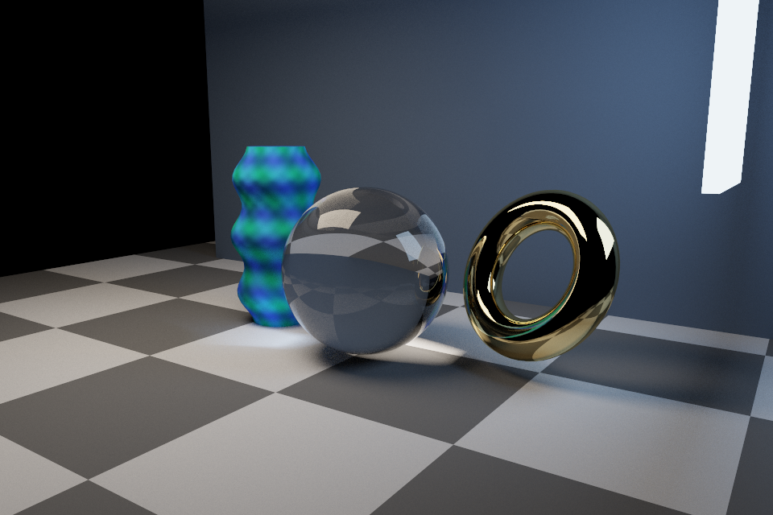

A progressive CUDA path tracer built around an original optical still life. A twisted, fluted body and a swept knot combine geometric detail with analytic marble and staggered-cell textures. Fresnel reflection and refraction reveal the glass sphere. Per-material wavefront kernels, Russian roulette, iterative GPU BVH traversal, thin-lens focus, direct-light sampling, and lossless restart support the scene.

The interactive preview and headless executable share the same CUDA implementation. The execution mode and feature controls support controlled comparisons.

The cover uses 2,048 samples at 960 × 640. Surface, focus, and antialiasing comparisons use 512 samples at 640 × 424; the lighting comparison uses 64 samples at that resolution. These still-image groups use seed 947 and depth 10. Render metadata and lossless sums are retained in `results/`.


## Interactive preview

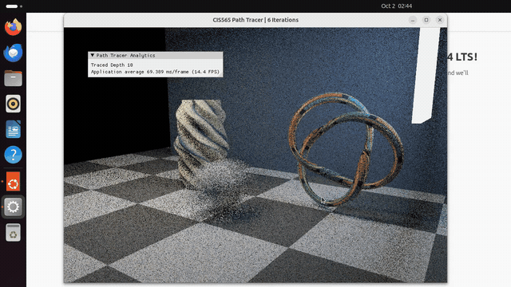

[Watch the 49.3-second MP4](img/interaction.mp4) · [Capture, controls and saved-image verification](results/submission-checkpoint-final-interaction/summary.json)

This actual desktop recording uses the glTF showcase, Halton sampling and translation motion blur on the A10G. The render stays at its native 960 × 640, depth 10, seed 1 and shutter [0,1], with antialiasing, direct-light estimation, BVH, compaction, wavefront dispatch and roulette (start 3) enabled. Material sorting is off. The 1280 × 720 recording captures at 30 fps; this capture clock is separate from renderer throughput. The GIF reproduces the same footage at 4 fps.

Relative to the first camera reset: orbit at 12–15 s, zoom at 20–22 s, pan at 27–29 s, restore the original camera at 34 s, save at 44 s and save/exit at 46 s. Convergence continues between actions. The MP4 includes the genuine encoder lead-in; the interaction schedule lasts 48 s.

The post-reset save completed 124 samples. A fresh headless render uses the same camera, sampler, physical settings and count. One RGB channel value out of 1,843,200 differs, with a maximum difference of 1 8-bit level. This is consistent with preview division versus headless reciprocal multiplication during normalization, although the cause has not been independently reproduced. Exact raw-sum equality is not claimed because preview raw sums are not retained. The actual successful recording, saved images, complete event logs, independent render and comparison are retained.

## Implemented features

Each entry links to its implementation overview and controlled comparisons. The performance sections report measured costs; the comparison table below discusses acceleration, a hypothetical CPU renderer, and further improvements.

| Implementation | Overview and comparisons |
|---|---|
| Original OBJ loading and approved glTF loading | [Geometry and surface detail](#geometry-and-surface-detail), [glTF mesh loading](#gltf-mesh-loading) |
| BVH acceleration | [BVH and mesh loading](#bvh-and-mesh-loading) |
| Fresnel reflection and refraction | [Glass and transport](#glass-focus-and-direct-lighting) |
| File/procedural texture and bump mapping | [Surface detail](#geometry-and-surface-detail) |
| Restartable rendering | [Exact continuation](#restart-without-losing-samples) |
| Thin-lens depth of field | [Pinhole and focus comparison](#glass-focus-and-direct-lighting) |
| Direct-light sampling | [Lighting comparison](#glass-focus-and-direct-lighting) |
| Per-material wavefront scheduling | [Scheduling comparison](#per-material-wavefront-scheduling) |
| Two complex procedural shapes and two procedural textures | [Original sculptures and patterns](#procedural-sculptures-and-textures) |
| Russian roulette | [Termination](#russian-roulette), [measured cost](#russian-roulette-cost) |
| Scrambled Halton sampling | [Sampling and convergence](#sampling-and-convergence) |
| Object motion and motion blur | [Motion and exposure](#object-motion-and-exposure) |

## Rendering pipeline

Each iteration creates one stochastic camera path per pixel. Separate intersection and shading kernels advance paths through the scene. The default wavefront mode builds exact-material queues without sorting: a histogram, exclusive scan, and index scatter feed separate diffuse, mirror, dielectric, emission, and terminal kernels. The unified shader remains available, with optional stable material sorting for controlled comparisons. Diffuse shading samples a cosine-weighted hemisphere; mirrors and dielectrics use discrete reflection/transmission. Direct-light sampling uses visibility rays and multiple importance sampling with BSDF-sampled light hits.

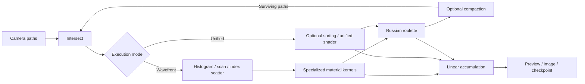

Random samples use the seed, original pixel, global sample number, bounce, and sampling dimension. Compaction, sorting, and queue order preserve sampling identity. Contributions are retained before removing terminated paths.

## Geometry and surface detail

The original OBJ parser supports independent position/normal/UV indices, positive and negative indices, triangles, and convex planar polygons. Invalid indices, degeneracy, concavity, and nonplanarity produce source-line diagnostics. Each mesh uses its scene-assigned material; an MTL importer is outside this implementation.

| Scene without imported sculptures | Original OBJ sculptures loaded |
|---|---|
| 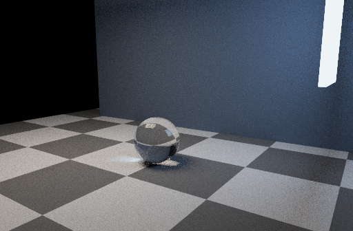 |  |

This pair illustrates mesh-loading capability by adding the sculptures. It is not an isolated timing comparison.

Static transforms include inverse-transpose normals and mirrored winding. Analytic spheres and cubes remain supported. Geometric normals determine surface orientation and ray offsets; shading normals include interpolation and bump detail.

The CPU builds a deterministic median-split BVH along the greatest centroid extent, targeting four primitives per leaf. A configurable depth cap retains larger leaves. GPU traversal uses a bounded iterative stack with explicit overflow handling. Toggleable brute-force traversal provides a comparison baseline.

Image colors are interpreted as sRGB, while height maps remain linear. Original bilinear repeated sampling and tangent-space height derivatives add detail without changing the silhouette. A procedural checker provides a comparison without image fetches.

| Image texture and bump | Image texture without bump | Procedural texture |
|---|---|---|
|  | 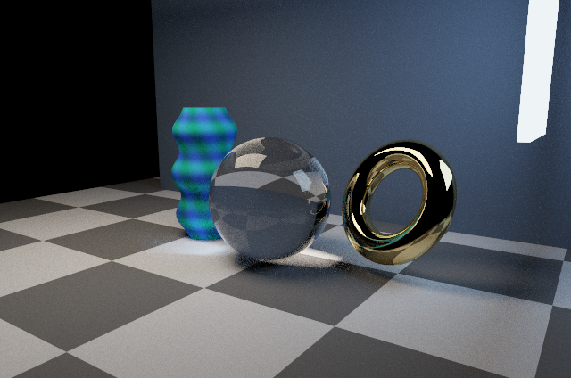 | 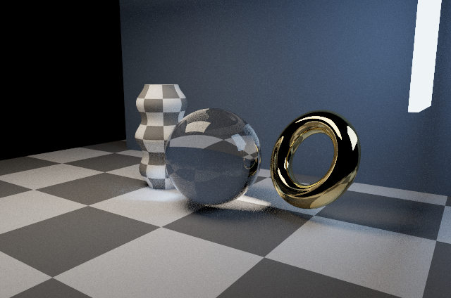 |

Our canonical OBJ meshes and BMP maps are generated by [generate_assets.py](scripts/generate_assets.py). The closed ceramic profile and torus are original parametric assets. [generate_gltf_assets.py](scripts/generate_gltf_assets.py) serializes our own geometry into the glTF test and showcase assets.

## glTF mesh loading

The glTF geometry importer uses the approved tinygltf package to read the file format. **TA Bryce Joseph said tinygltf was fine to use in class on September 21, 2026 (Special OH for Project 3).** Instructor Matthew Schwartz also explicitly approved it on October 1 in Ed post #78 (“tinygltf approved package?”). We recorded that approval and the unchanged package's exact revision, file hashes and license in the [provenance register](docs/provenance.md#approved-gltf-loader).

The package handles format decoding; our integration converts the selected scene's static triangle meshes into the same geometry buffers used by the original OBJ loader. Node transforms and mesh instances are applied during CPU loading. Scene-assigned materials and textures control shading, as they do for OBJ. Native glTF PBR materials and image pixels are not imported; our wrapper disables native image decoding and keeps the starter dependencies unchanged. This is a static geometry importer rather than a complete glTF material or animation renderer. Unsupported geometry features are rejected explicitly. Referenced external files remain part of checkpoint identity.

Imported triangles use our original GPU intersection code and toggleable BVH traversal. Loading and hierarchy construction happen once on the CPU. The performance comparison below holds the glTF asset and render settings fixed while toggling culling; it measures traversal rather than claiming GPU acceleration of file parsing. The test assets are our own generated geometry, with no downloaded models or upstream examples.

| Scene without imported sculptures | Original sculptures imported through glTF |
|---|---|
| 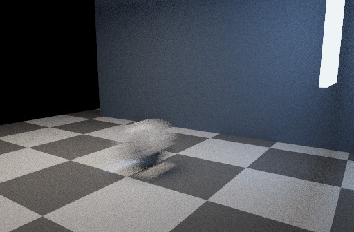 | 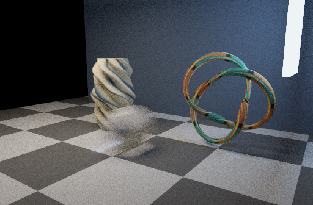 |

These 512 × 336, 128-sample images illustrate loading capability. The timed culling comparison uses the same complete glTF geometry in both traversal modes.

## Procedural sculptures and textures

The fluted body varies its radius, seven-fold fluting, elliptical cross-section, and twist with height. Separate flat caps close the surface. The swept knot follows a periodic three-lobed centerline with a varying tube radius; an analytic Frenet frame orients each ring without accumulated frame drift. Both meshes use smooth outward normals, repeated UVs, and exact position/normal seams with separate UV endpoints.

The scene-level comparison in [geometry and surface detail](#geometry-and-surface-detail) shows the addition of both generated sculptures. The rows below compare their plain surfaces with the two procedural patterns.

| Shape | Low triangles | Medium triangles | High triangles |
|---|---:|---:|---:|
| Fluted body | 1,600 | 6,272 | 24,832 |
| Swept knot | 1,024 | 4,096 | 16,384 |

Marble combines periodic sine fields into veins. The staggered-cell texture alternates teal and terracotta cells with gold diamond insets and dark grout. Both evaluate from wrapped UVs in linear RGB, multiply the material color, and use no image data or external noise implementation. The original checker remains available.

| Plain surface | Marble | Staggered cells |
|---|---|---|
| 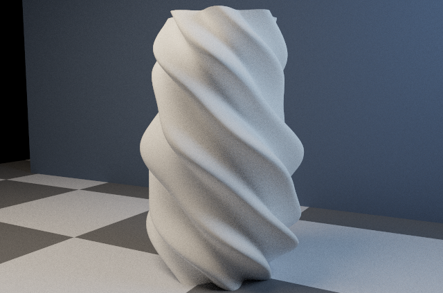 | 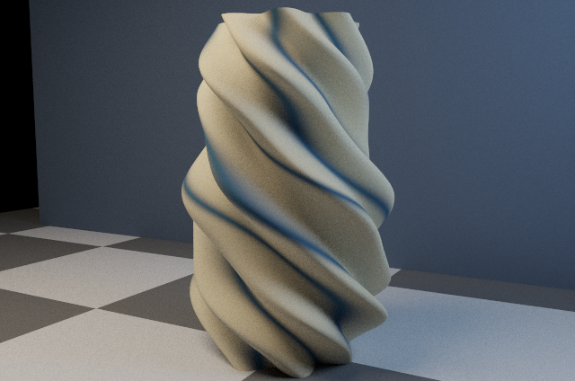 | 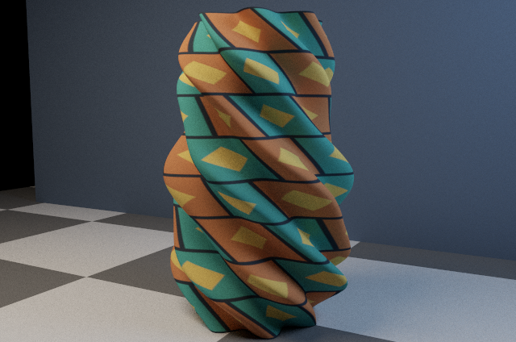 |
| 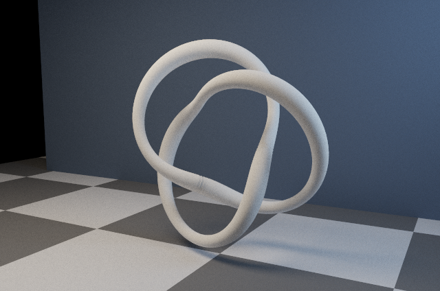 | 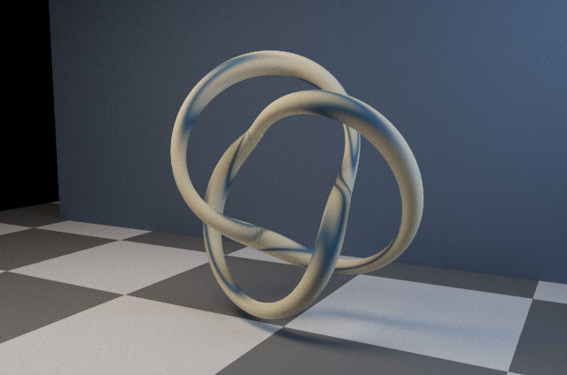 | 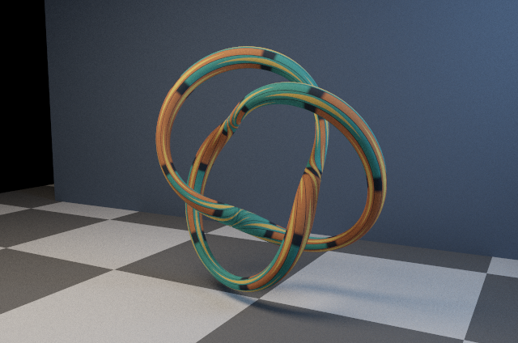 |

Mesh generation and BVH construction run on the CPU once; ray traversal and procedural texture evaluation run on the GPU. The three tessellations expose the triangle-count tradeoff. Texture evaluation replaces memory fetches with arithmetic, while both representations need footprint-aware filtering to avoid distant-pattern aliasing.

## Glass, focus, and direct lighting

Dielectric scattering handles Fresnel reflection, Snell refraction, entering/exiting surfaces, and total internal reflection. The thin-lens camera samples an aperture and focuses on a focal plane. Zero aperture recovers the pinhole camera.

| Fresnel refraction / pinhole baseline | Mirror comparison | Thin-lens focus |
|---|---|---|
|  | 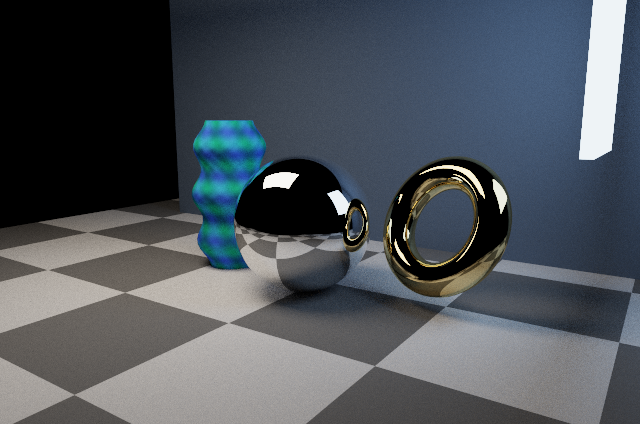 | 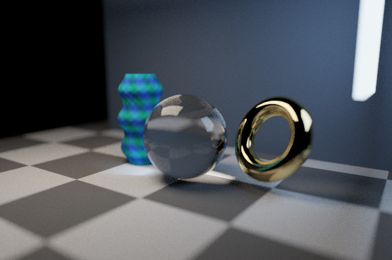 |

The pinhole and thin-lens images use the same glass scene and camera framing; aperture is the image-forming change. The mirror comparison changes the sphere's material.

Emissive cubes, transformed spheres, and mesh triangles are sampled with PDFs matching their actual transformed geometry. Power-heuristic MIS balances direct-light and BSDF estimators without double-counting. Camera-visible and specular-chain light hits retain full emission weight.

| Direct-light sampling | BSDF sampling alone |
|---|---|
| 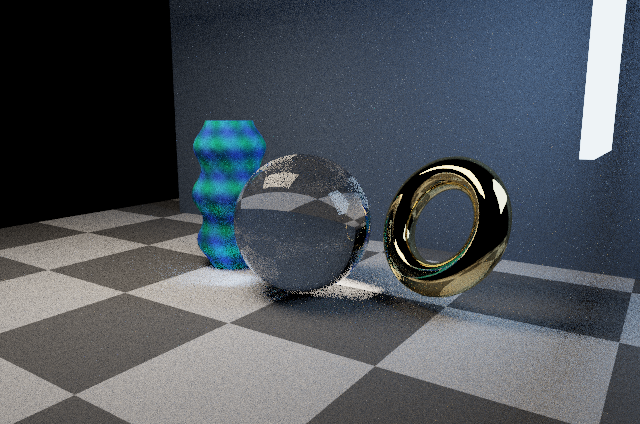 | 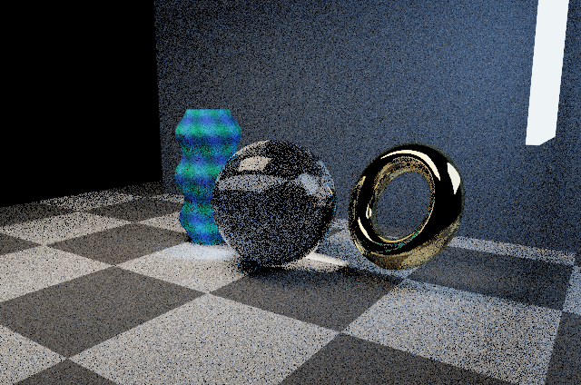 |

## Sampling and convergence

The original counter sampler remains the default. `--sampler halton` selects an independently written, scrambled and rotated Halton sequence. It addresses pixel jitter, lens position, exposure time, light-surface sampling, and diffuse directions with the original pixel and absolute sample index. Discrete light selection, dielectric decisions, and roulette retain their counter samples.

We generate the prime bases ourselves. Each semantic coordinate has a fixed base; per-digit affine permutations and a separate rotation are keyed by seed, pixel, bounce, and dimension. An anchored radical inverse processes only the integer index's present digits. The resulting 23-bit midpoint sample stays strictly inside `(0,1)`. The prime table is persistent for Halton rendering. No sequence depends on the requested sample target, so restart can extend it exactly.

[Steve Rotenberg's sampling notes](https://cseweb.ucsd.edu/classes/sp17/cse168-a/CSE168_07_Random.pdf), slides 16–18, explain the underlying prime-base radical inverse and the potential for visible sequence patterns. Our scrambling, coordinate allocation, implementation and test fixtures are independently authored.

| Counter sampling | Scrambled Halton sampling |
|---|---|
| 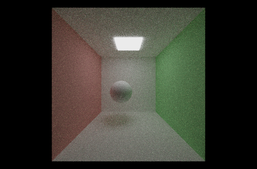 | 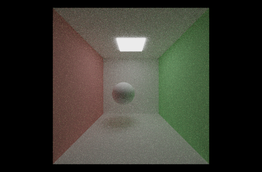 |
| 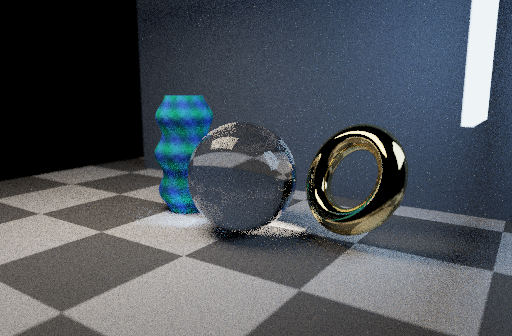 | 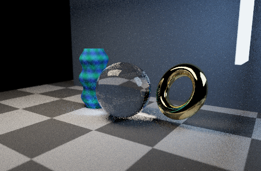 |

The visual comparisons use 64 samples at 512 × 336, with the same scene, camera, seed and depth. Linear-image error is measured separately across a predeclared seed population and sample budgets against independently seeded high-sample references. Reference uncertainty, image-mean agreement, elapsed time, and all regressions are retained. A sequence's more uniform coverage does not guarantee improvement for every high-dimensional transport problem; scrambling arithmetic also has a measurable cost.

### Measured sampling quality and cost

The final-source study uses `a1979f061a22d1a7e815bb906ba62a2eeb1f0ae65f1c7a51ecbb19aa36bdd639` on the NVIDIA A10G: 128 × 84 pixels, depth 10, two authored fixtures, eight paired seeds, and the six predeclared scene/sample comparisons below. Each MSE is the per-channel, per-pixel error of the linear RGB sample mean against independently seeded counter references; display tone mapping is excluded. The same BVH, wavefront, roulette, compaction, antialiasing, next-event estimation, and motion settings are held fixed. Evidence: [quality session](results/submission-checkpoint-final-quality/summary.json), [quality analysis](results/submission-checkpoint-final-quality/quality/summary.json), and [completed source/binary suite](results/submission-checkpoint-final-suite-new-measurements/summary.json).

| Fixture | Completed spp | Counter mean MSE | Halton mean MSE | Halton MSE reduction |
| --- | --- | --- | --- | --- |
| diffuse | 16 | 0.00324816 | 0.002538 | +21.86% |
| diffuse | 64 | 0.000805566 | 0.000550414 | +31.67% |
| diffuse | 256 | 0.00020532 | 0.000126637 | +38.32% |
| glass-dof | 16 | 0.0279018 | 0.018125 | +35.04% |
| glass-dof | 64 | 0.00714712 | 0.00401977 | +43.76% |
| glass-dof | 256 | 0.00180747 | 0.000877179 | +51.47% |

Positive reduction favors Halton; a negative value is a regression. Pooling all 48 matched seed/scene/budget pairs gives counter MSE **0.00685257**, Halton MSE **0.00437284**, and **+36.19%** reduction. Halton improves the mean in **6/6** comparisons. Qualification is **qualified**. The measured result passes the predeclared empirical quality gate. The gate requires adequate references, at least 10% pooled MSE reduction, at least four strict improvements, and all six image-mean checks.

Reference precision compares the two independent two-seed averages. Its split RMSE must be at most 0.25 times the smaller sampler's mean candidate RMSE at 256 spp. All four reference seeds are averaged for the selected reference image. A failed initial 8,192-spp-per-seed attempt triggers exactly one 16,384-spp-per-seed retry using the same four reference seeds.

| Fixture | Attempt | Reference spp/seed | Split RMSE | Allowed RMSE | Adequate |
| --- | --- | --- | --- | --- | --- |
| diffuse | initial | 8192 | 0.00252503 | 0.00281276 | yes |
| glass-dof | initial | 8192 | 0.00757971 | 0.00742675 | no |
| glass-dof | single retry | 16384 | 0.00545091 | 0.00740191 | yes |

The glass/DOF fixture receives exactly that one retry; its selected reference is adequate. No further retry is used.

The paired image-mean gate uses `abs(mean(Halton − counter)) ≤ max(4 × paired SE, 0.01 × counter mean) + 1e−6`. These finite-scene checks examine brightness agreement; passing them does not prove an unbiased estimator for arbitrary transport problems.

| Fixture | spp | Absolute paired mean difference | Allowed difference | Gate |
| --- | --- | --- | --- | --- |
| diffuse | 16 | 0.000162075 | 0.00114971 | pass |
| diffuse | 64 | 3.68246e-05 | 0.0011499 | pass |
| diffuse | 256 | 2.0944e-05 | 0.00114958 | pass |
| glass-dof | 16 | 0.000114687 | 0.00347212 | pass |
| glass-dof | 64 | 0.000129843 | 0.00346625 | pass |
| glass-dof | 256 | 5.12451e-05 | 0.00346493 | pass |

All six gates: **6/6 pass**. All predeclared qualification criteria pass.

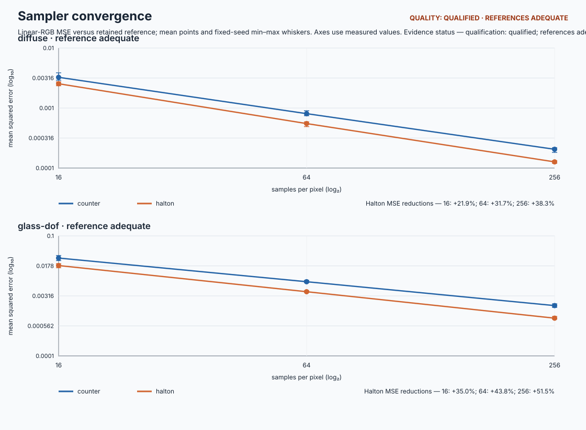

The separate equal-time experiment requests a **4,000 ms render-loop budget** for each of the same eight seeds. The budget is checked between whole samples, so the actual loop may overshoot; the measured sample counts and overshoot are retained below. MSE and sample counts are means over eight runs; times and overshoot are medians with full measured minimum–maximum ranges. GPU event time, renderer loop wall time, and complete process elapsed time measure different scopes. Process time includes loading and output.

| Fixture | Sampler | Mean actual spp [min, max] | Mean MSE | GPU ms | Loop ms | Process ms | Loop overshoot ms |
| --- | --- | --- | --- | --- | --- | --- | --- |
| diffuse | counter | 898.0 [895, 901] | 6.06846e-05 | 3983.406 [3982.304, 3986.146] | 4001.554 [4000.645, 4004.347] | 4279.080 [4274.976, 4368.883] | 1.554 [0.645, 4.347] |
| diffuse | halton | 797.0 [795, 799] | 3.78766e-05 | 3985.510 [3983.883, 3988.048] | 4001.776 [4000.242, 4004.382] | 4297.605 [4295.308, 4299.786] | 1.776 [0.242, 4.382] |
| glass-dof | counter | 281.4 [281, 282] | 0.00163544 | 4001.847 [3996.231, 4006.343] | 4007.661 [4002.033, 4012.114] | 4298.409 [4293.178, 4303.704] | 7.661 [2.033, 12.114] |
| glass-dof | halton | 274.4 [274, 275] | 0.000821347 | 4001.834 [3996.223, 4007.324] | 4007.439 [4001.753, 4012.932] | 4325.064 [4316.339, 4332.016] | 7.439 [1.753, 12.932] |

At that loop budget, **diffuse** has +37.58% Halton MSE reduction against the selected reference. Its reference passes the precision gate.

At that loop budget, **glass-dof** has +49.78% Halton MSE reduction against the selected reference. Its reference passes the precision gate.

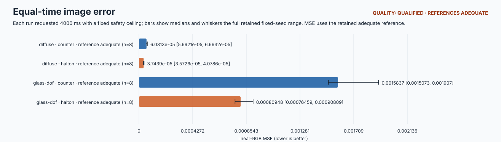

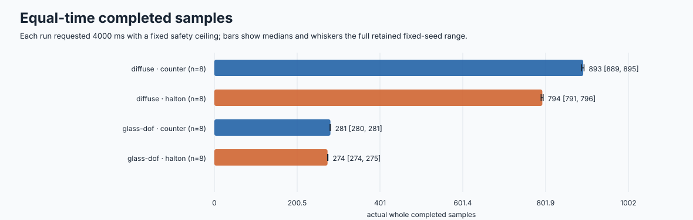

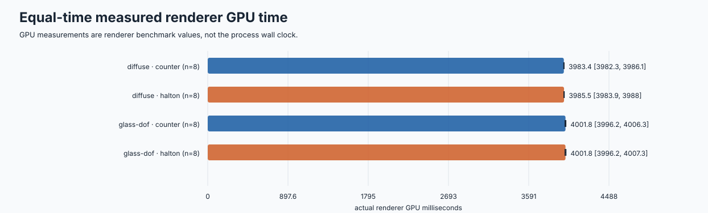

Fixed-sample timing completes **256 spp** per run with seed 947. Each configuration has three excluded warmups followed by exactly three measured repeats. The table reports **milliseconds per actual completed sample**, as median [minimum, maximum]; multiplying by 256 gives the corresponding measured total milliseconds. Evidence: [timing session](results/submission-checkpoint-final-timing/summary.json) and [timing analysis](results/submission-checkpoint-final-timing/timing/summary.json).

| Fixture | Sampler | GPU ms/spp | Loop ms/spp | Process ms/spp |
| --- | --- | --- | --- | --- |
| diffuse | counter | 4.459 [4.452, 4.464] | 4.479 [4.472, 4.484] | 5.438 [5.430, 5.444] |
| diffuse | halton | 4.917 [4.906, 4.920] | 4.937 [4.927, 4.940] | 6.001 [5.994, 6.005] |
| glass-dof | counter | 14.172 [14.165, 14.183] | 14.193 [14.185, 14.203] | 15.332 [15.320, 15.337] |
| glass-dof | halton | 14.614 [14.608, 14.630] | 14.634 [14.628, 14.651] | 15.874 [15.861, 15.886] |

For **diffuse**, Halton/counter median cost ratios are **1.103× GPU**, **1.102× loop**, and **1.103× process**. A ratio above one costs more per sample; the equal-time results show whether quality gains survive the resulting sample-rate change on this fixture.

For **glass-dof**, Halton/counter median cost ratios are **1.031× GPU**, **1.031× loop**, and **1.035× process**. A ratio above one costs more per sample; the equal-time results show whether quality gains survive the resulting sample-rate change on this fixture.

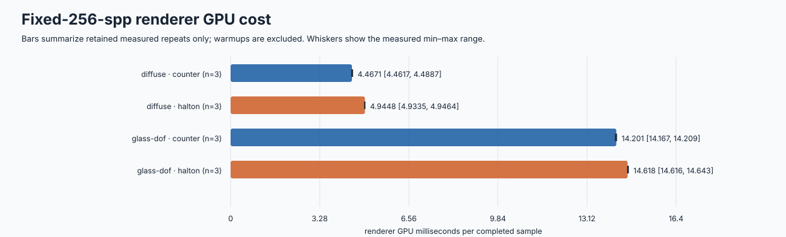

These observations describe this fixed seed population, scene set, resolution, depth, build, and GPU. More uniform sample coverage can improve some comparisons while scrambling and radical-inverse arithmetic cost time; scene-dependent path divergence can also change cost. Neither qualification nor a favorable MSE ordering guarantees improvement for every scene or sample budget.

## Object motion and exposure

Objects can translate linearly over a normalized animation interval. `MOTION_TRANSLATION` defines a world-space displacement from phase 0 to 1. Camera `SHUTTER` selects the exposure interval; a zero-width interval freezes one phase. Every primary path samples its exposure time once, and all of its bounces and shadow rays see the same scene instant.

Translation keeps the phase-zero geometry, normals, and object-attached UVs. Intersection translates the ray origin into that geometry. One swept BVH encloses the full interval, avoiding per-sample refits and geometry uploads. The static fast path preserves the original arithmetic for objects with zero displacement. Moving light samples and emissive-hit PDFs use the same path time, including the transformed-sphere area correction.

| Frozen at the exposure midpoint | Integrated over the full shutter |
|---|---|
| 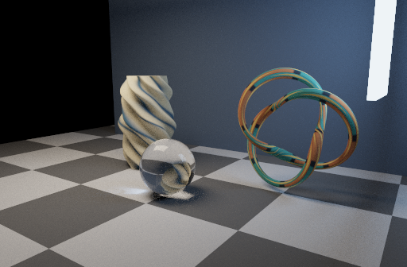 |  |

| Frozen start | Frozen end |
|---|---|
| 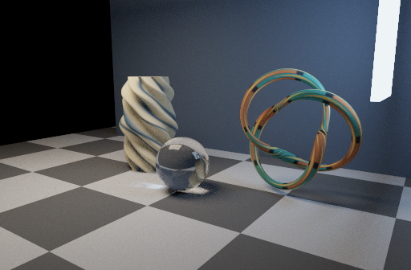 | 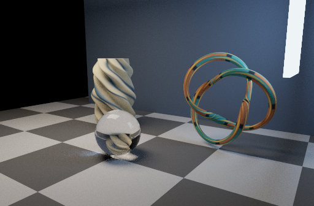 |

The 512-sample, 512 × 336 before/after comparison holds the swept BVH, sampler, seed, depth, and camera fixed. Both variants retain the declared displacement; only the shutter interval changes. This measures exposure sampling and changed path work rather than comparing a swept hierarchy with a tighter static hierarchy. Motion support is rigid translation; rotation, deformation, and time-dependent scaling are further extensions.

### Measured exposure cost with the swept BVH fixed

The midpoint exposure `[0.5, 0.5]` and full exposure `[0, 1]` retain the same authored displacement, camera, Halton sampler, seed 947, depth 10, 128 × 84 resolution, and swept BVH. The retained normalized scene hashes match after excluding only `Camera.FILE` and `Camera.SHUTTER`; all four start/midpoint/end/full scene variants are checked. Motion remains enabled in both timing configurations. The comparison therefore measures exposure sampling and changed path work with the same swept bounds, rather than the cost of building or refitting different hierarchies.

Both configurations complete 256 spp, exclude three warmups, and retain three measured repeats. Values below are milliseconds per actual completed sample, as median [minimum, maximum].

| Exposure | GPU ms/spp | Loop ms/spp | Process ms/spp |
| --- | --- | --- | --- |
| midpoint | 22.886 [22.882, 22.956] | 22.907 [22.902, 22.976] | 24.914 [24.905, 24.981] |
| full shutter | 22.620 [22.618, 22.622] | 22.641 [22.639, 22.642] | 24.660 [24.645, 24.662] |

Full/midpoint median ratios are **0.988× GPU**, **0.988× loop**, and **0.990× process**. These costs do not isolate exposure-coordinate arithmetic from the different intersections, visibility, and bounce work caused by temporal samples. [Timing evidence and swept-scene proof](results/submission-checkpoint-final-timing/timing/summary.json) retain the ratios and variant hashes.

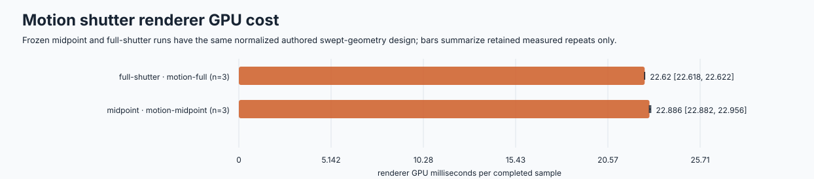

## Russian roulette

After three completed scattering events, roulette can terminate low-throughput paths. Its survival probability is the largest throughput channel, adjusted to remove accumulated refraction scaling and clamped to 0.05–0.95. A survivor divides its future throughput by that probability; a terminated path keeps all radiance already collected. This compensation preserves the expected contribution at each fixed depth limit.

Roulette uses a separate counter-sampler dimension, so queue order does not change its decisions. Emission, diagnostic output, and the final permitted vertex bypass roulette. The implementation retains the existing complementary direct-light/BSDF MIS weights. Exact checks compare execution modes at the same roulette setting; independent paired-seed measurements compare roulette enabled and disabled statistically.

## Restart without losing samples

Version 3 checksummed checkpoints store completed samples, lossless linear RGB sums, seed/sampler/configuration, camera and shutter, scene/asset fingerprints, and indexed BVH data. Writes use atomic replacement. Resume permits a larger total sample target and rejects corrupted or incompatible state, including differing sampler, motion, wavefront, or roulette settings. Checkpoint versions 1 and 2 are rejected because they lack the complete current configuration; raw accumulation remains version 1.

Exact continuation is checked in separate processes on the same GPU/build/configuration: uninterrupted rendering versus a partial render followed by resume, comparing raw accumulation bytes. Display conversion is separate from the stored linear sums. PNGs use the sample mean, Reinhard tone mapping `c/(1+c)`, and sRGB encoding; raw sums remain unmodified.

| Stopped after 16 samples | Resumed to 512 samples |
|---|---|
| 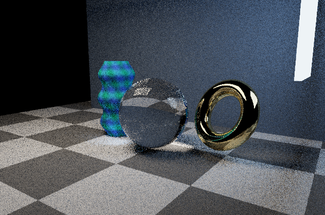 |  |

The resumed 512-sample sums match the uninterrupted glass comparison byte for byte.

## Performance

Measurements use a g5.xlarge workstation with AMD EPYC 7R32 (4 vCPUs), 16 GiB host RAM, NVIDIA A10G (23,028 MiB reported GPU memory), Ubuntu 24.04.4, CUDA 12.8.93, GCC 13.3, and a Release build targeting architecture 86. The fixed matrix contains 48 variants, each with three warmup processes and three measured repeats: 288 processes. Tables report median GPU milliseconds per sample; plots include min–max whiskers. Camera, seed, resolution, depth, and sample count are fixed within each comparison. Short runs include their first iteration and measure complete sample processing. Process and render-loop timings are retained separately.

CUDA phase timing synchronizes events. Overall event elapsed and loop time include profiling synchronizations and host scheduling gaps; these measurements describe the instrumented renderer. Host queue readback and submission time overlaps overall elapsed and is not added to the total. Aggregate shader time and the five specialized shader timings are alternative views of the same work.

### BVH and mesh loading

The same original OBJ loader feeds brute-force and BVH traversal. Three tessellations of the original ceramic mesh run at 96 × 64, eight samples, and depth 10, with wavefront and roulette explicitly disabled:

| Mesh level | Brute force, ms/sample | BVH, ms/sample | Speedup |
|---|---:|---:|---:|
| Low | 14.572 | 6.300 | 2.31× |
| Medium | 48.051 | 7.429 | 6.47× |
| High | 179.535 | 8.774 | 20.46× |

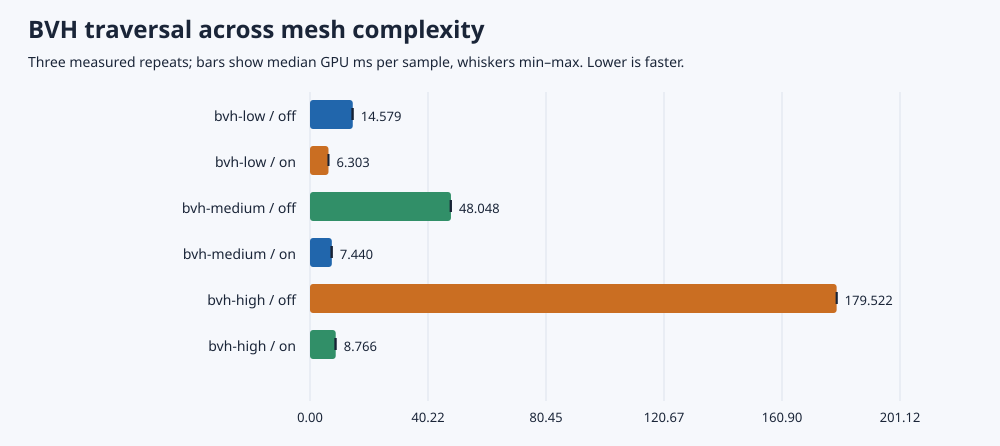

Brute-force time grows with primitive count; the hierarchy prunes unrelated geometry while retaining divergent traversal, stack work, and memory reads. Exact traced-hit and accumulation comparisons confirm that culling preserves the result.

| Brute-force traversal | BVH traversal |
|---|---|
|  | 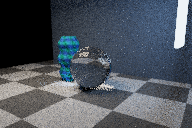 |

The raw sums and PNGs in this pair must agree exactly; the optimization changes traversal work rather than the image.

### glTF loading and culling

The glTF culling measurements use the NVIDIA A10G at 96×64, 8 samples per pixel, depth 10 and seed 947 with Counter sampling. Wavefront dispatch, material sorting and Russian roulette are off; compaction, anti-aliasing and next-event estimation are on. Each of six configurations has 3 warmups followed by 3 measured fresh processes (36 renders total); warmups are excluded. The values below are whole-renderer GPU time divided by the 8 completed samples. Brackets give the measured minimum and maximum, rather than a confidence interval. [Full glTF evidence](results/submission-checkpoint-final-gltf/summary.json), [timing records](results/submission-checkpoint-final-gltf/timing/summary.json).

| glTF scene | Triangles | BVH off, GPU ms/sample [min, max] | BVH on, GPU ms/sample [min, max] | Median speedup |
|---|---:|---:|---:|---:|
| Low | 288 | 14.450 [14.448, 14.568] | 6.313 [6.294, 6.324] | 2.29× |
| Medium | 1,088 | 48.036 [47.927, 48.049] | 7.423 [7.419, 7.432] | 6.47× |
| High | 4,224 | 179.396 [179.373, 179.538] | 8.781 [8.773, 8.797] | 20.43× |

The BVH rejects bounded subtrees before exact primitive intersections, reducing both primary/bounce-ray work and shadow-ray work. All twelve timing outputs at each complexity (six with culling off and six on, including warmups) have byte-identical linear sums and PNGs. The medium visual pair below is also byte-exact: 128 × 84, 16 samples per pixel, depth 10, Counter seed 947. The images demonstrate preserved output; the table measures the speed difference.

| glTF bounding-volume culling off | glTF bounding-volume culling on |
|---|---|
|  | 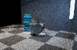 |

Loading is CPU setup performed before rendering. The following separate measurements use one warmup and three repeats per scene on the same EC2 host. Scene-load time includes parsing, transforms, camera setup and the initial BVH. The rebuild column times another BVH build from already loaded primitives; it is neither added to nor subtracted from load time. Every glTF/OBJ pair has matching triangle, total-primitive and BVH-node counts. [CPU profile records](results/submission-checkpoint-final-gltf/timing/cpu-profile/records.json).

| Scene | Format | Triangles / total primitives / BVH nodes | CPU load including initial BVH, ms [min, max] | Separate BVH rebuild, ms [min, max] |
|---|---|---:|---:|---:|
| Low | glTF (GLB) | 288 / 293 / 201 | 1.379 [1.337, 2.372] | 0.103 [0.102, 0.105] |
| Low | OBJ | 288 / 293 / 201 | 2.189 [2.176, 2.198] | 0.097 [0.096, 0.098] |
| Medium | glTF (GLB) | 1,088 / 1,093 / 649 | 3.072 [3.023, 3.096] | 0.488 [0.479, 0.496] |
| Medium | OBJ | 1,088 / 1,093 / 649 | 5.221 [5.193, 5.228] | 0.485 [0.479, 0.490] |
| High | glTF (GLB) | 4,224 / 4,229 / 2,313 | 7.119 [6.898, 7.186] | 2.388 [2.387, 2.393] |
| High | OBJ | 4,224 / 4,229 / 2,313 | 19.862 [19.781, 19.901] | 2.363 [2.358, 2.383] |

For these generated assets, the glTF/OBJ median CPU loading ratios are 0.630× (low), 0.588× (medium), 0.358× (high). A ratio below one favors glTF. Both formats feed the same flattened triangle representation and GPU traversal code, so these CPU loading results establish no format-specific GPU speedup. A hypothetical CPU path tracer would also benefit from bounding-volume rejection; the GPU adds parallel rays, while irregular traversal can still diverge and access scattered memory. These measurements cover one GPU, one camera/seed and three small scenes, and warm repeats do not establish cold-file performance. Further improvements could preserve mesh instances instead of flattening them, share mesh acceleration structures, improve BVH splitting and triangle layout, and cache parsed assets or built BVHs.

The complete glTF study retained 62 successful renders: 18 validation, 36 timing and 8 gallery. GLB, external-buffer glTF and embedded-data glTF produce byte-identical validation images and raw sums under both culling modes. A translating loaded mesh also preserves byte-exact fresh/checkpoint-resumed output within each Counter and Halton configuration; Counter and Halton outputs are not expected to match one another. Every retained render identifies the final renderer source `a1979f061a22d1a7e815bb906ba62a2eeb1f0ae65f1c7a51ecbb19aa36bdd639`. [Validation](results/submission-checkpoint-final-gltf/validation/summary.json), [gallery exactness](results/submission-checkpoint-final-gltf/gallery/summary.json).

### Compaction and material sorting

At 160 × 106, 16 samples, and depth 10, wavefront and roulette remain disabled:

| Scene / scheduling choice | Disabled, ms/sample | Enabled, ms/sample | Effect |
|---|---:|---:|---|
| Open scene / compaction | 2.146 | 1.870 | 12.9% faster |
| Closed scene / compaction | 3.392 | 3.504 | 3.3% slower |
| Uniform diffuse materials / sorting | 12.634 | 14.005 | 10.9% slower |
| Mixed materials / sorting | 12.229 | 14.576 | 19.2% slower |

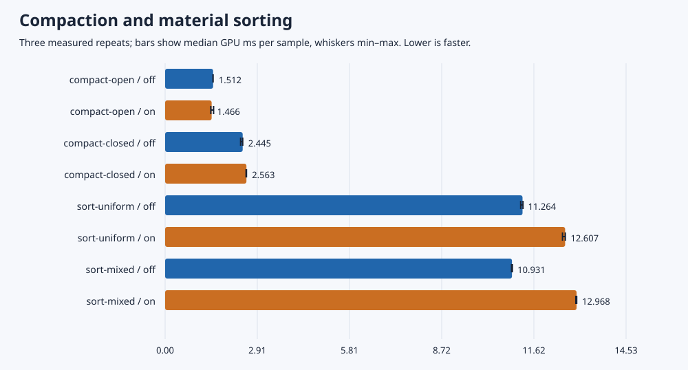

Compaction removes escaping or terminated paths at the cost of scan/scatter. The closed chamber retains more paths than the open scene, leaving less removable work. Sorting trades scheduling cost for material coherence; the uniform workload assigns one diffuse material to every non-emissive object. The table records the measured outcome for each workload.

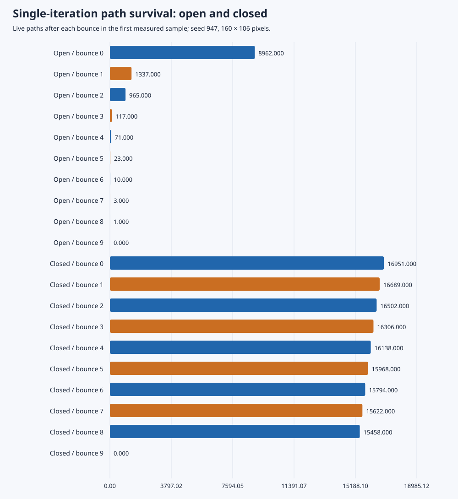

In the first measured sample, the open queue starts with 16,960 paths and retains 8,962 after bounce 0 and 1,337 after bounce 1. The closed queue starts with 16,960 paths and retains 16,951 and 16,689, respectively. Per-bounce counts and phase timings are retained in `single-iteration.csv` and the selected benchmark CSVs.

### Per-material wavefront scheduling

At 512 × 336, 32 samples, and depth 16, all modes use identical sampling, compaction, BVH, and roulette-off settings. Exact raw sums agree across all six processes for each mode in each workload.

| Workload | Unified unsorted, ms/sample | Unified sorted, ms/sample | Wavefront, ms/sample | Wavefront versus unsorted |
|---|---:|---:|---:|---|
| Uniform diffuse | 32.138 | 44.972 | 33.971 | 5.7% slower |
| Mixed materials | 31.079 | 40.381 | 44.433 | 43.0% slower |
| Closed chamber | 39.630 | 112.671 | 49.177 | 24.1% slower |
| High-complexity mesh | 23.604 | 33.664 | 33.423 | 41.6% slower |

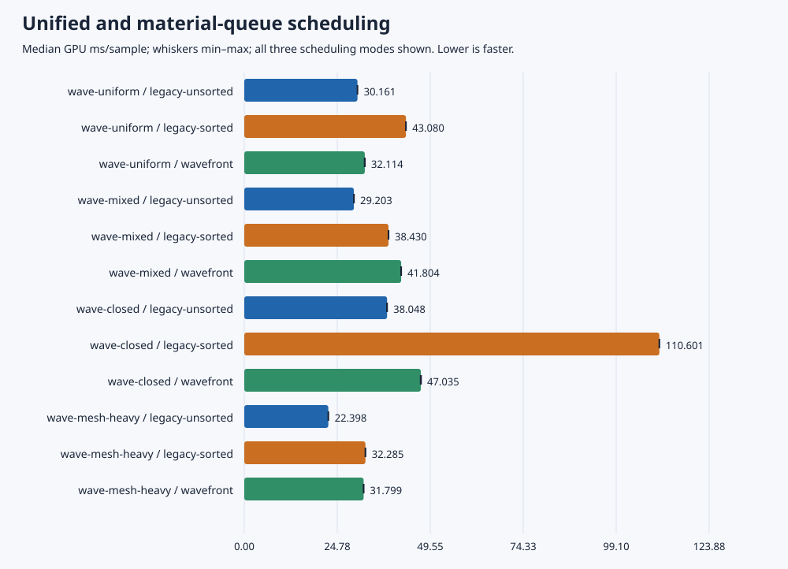

Exact-material queues remove material switching inside the specialized launches. Fastest modes by workload: Uniform diffuse — Unified unsorted; Mixed materials — Unified unsorted; Closed chamber — Unified unsorted; High-complexity mesh — Unified unsorted.
Wavefront trails unified unsorted shading in Uniform diffuse, Mixed materials, Closed chamber, and High-complexity mesh.
Wavefront beats unified sorted shading in Uniform diffuse, Closed chamber, and High-complexity mesh; trails unified sorted shading in Mixed materials.
Measured wavefront totals include queue construction, count readback, and multiple launches. These totals do not isolate any one component as the cause of a win or loss.

| Unified shading | Per-material wavefront shading |
|---|---|
|  |  |

Both images use the same counter samples and roulette setting. Their raw sums and PNGs must agree exactly.

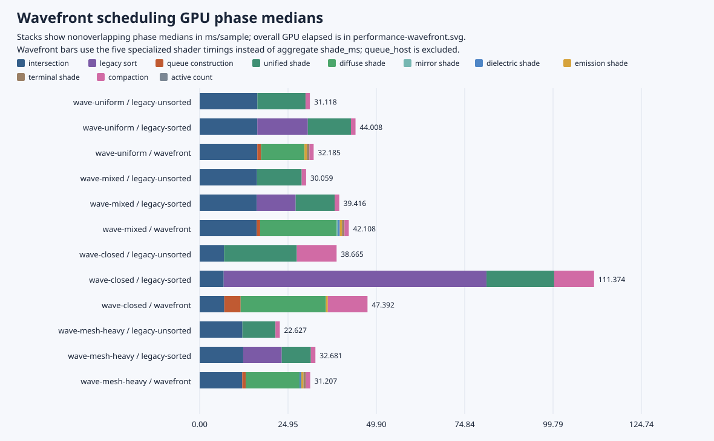

The phase stacks replace aggregate `shade_ms` with its diffuse, mirror, dielectric, emission, and terminal breakdown. They exclude host queue time and sum individual phase medians, so their heights need not equal median overall elapsed.

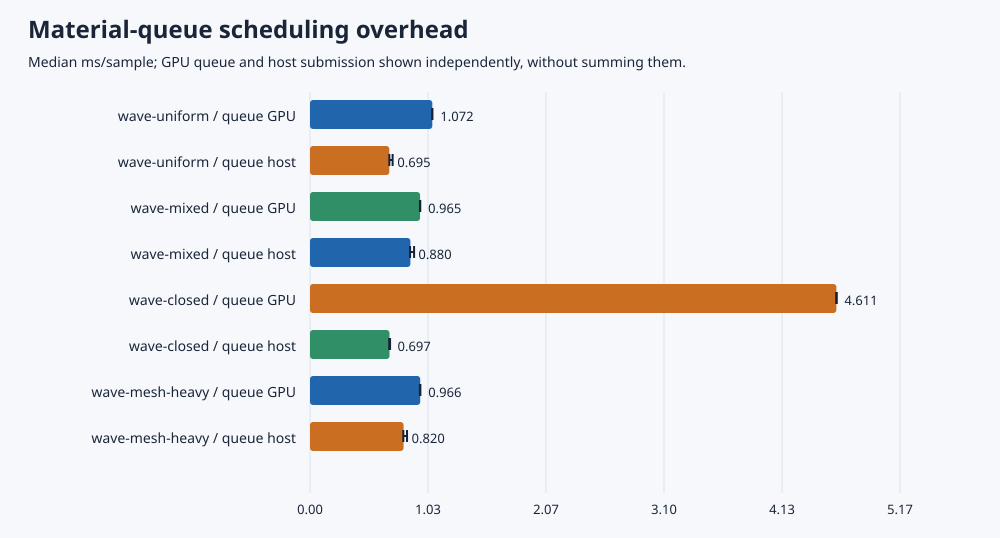

Bars show measured medians; whiskers show the measured minimum and maximum across three repeats. GPU queue timing and overlapping CPU queue scheduling time are displayed separately.

### Russian roulette cost

Open and closed scenes run at 512 × 336, 32 samples, and depth 32 in wavefront mode. Roulette starts after three completed scattering events:

| Workload | RR off, ms/sample | RR on, ms/sample | Effect | Terminated / tested |
|---|---:|---:|---|---:|
| Open | 6.562 | 5.865 | 10.6% faster | 51.6% |
| Closed | 92.790 | 12.442 | 86.6% faster | 93.9% |

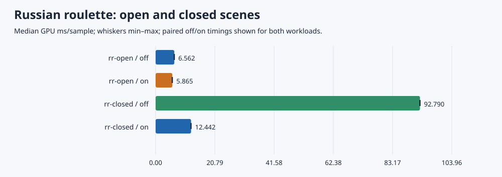

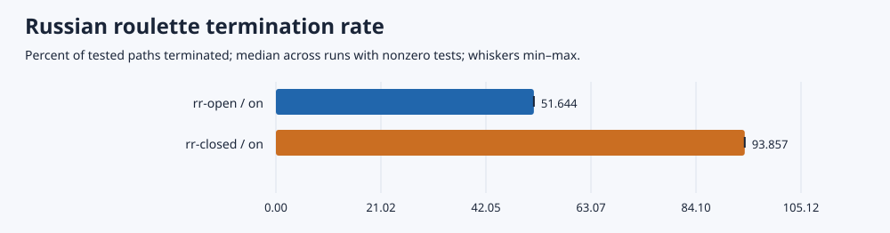

Roulette saves future work while increasing estimator variance. Separate brightness checks use every one of eight fixed paired seeds, 8,192 samples per seed, 64 × 48 pixels, and depth 32. The criterion is `abs(mean(on-off)) <= max(4*paired_SE, 1%*mean(off)) + 1e-6`. It tests statistical agreement rather than byte identity:

| Roulette disabled | Roulette enabled |
|---|---|
|  | 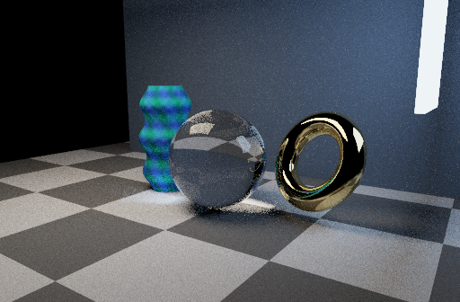 |

The equal-sample images illustrate the changed noise realization. The statistical test and timing measurements assess brightness and cost separately.

| Scene | RR-off mean | RR-on mean | Absolute paired mean error | Allowed error |
|---|---:|---:|---:|---:|
| Closed | 0.04394383 | 0.04394456 | 0.00000073 | 0.00044044 |
| Glass | 0.28683407 | 0.28682764 | 0.00000643 | 0.00286934 |

These checks support brightness preservation on the tested scenes; they do not measure error per unit time. Every seed estimate and both sample variances are retained in the validation summary.

### Procedural setup and shading

Python mesh construction/OBJ serialization and CPU scene loading are measured on the same EPYC workstation, separately from rendering. Each CPU operation has one warmup and three measured repeats. Generation writes temporary files, excludes subsequent validation/hashing, and measures OS-buffered writes without `fsync`. 6 of the six temporary Linux OBJ encodings differ from the canonical Mac asset bytes; the profile retains both hashes and 6 of six geometry validations pass. Loading and rendering use the unchanged canonical assets. Scene load includes parsing, transforms, camera setup and its initial BVH; the separate BVH column rebuilds the hierarchy from loaded primitives and is not added to load time. Mesh files are warm in the OS cache.

| Mesh | Triangles | Canonical OBJ, KiB | CPU generation/write, ms | CPU load incl. BVH, ms | CPU BVH rebuild, ms |
|---|---:|---:|---:|---:|---:|
| fluted-body-low | 1,600 | 184.1 | 16.812 | 7.264 | 0.888 |
| fluted-body-medium | 6,272 | 751.3 | 64.097 | 28.536 | 4.339 |
| fluted-body-high | 24,832 | 3,051.4 | 255.538 | 115.968 | 21.407 |
| swept-knot-low | 1,024 | 118.4 | 37.713 | 4.197 | 0.498 |
| swept-knot-medium | 4,096 | 481.9 | 141.209 | 16.746 | 2.550 |
| swept-knot-high | 16,384 | 1,957.3 | 538.362 | 68.000 | 12.832 |

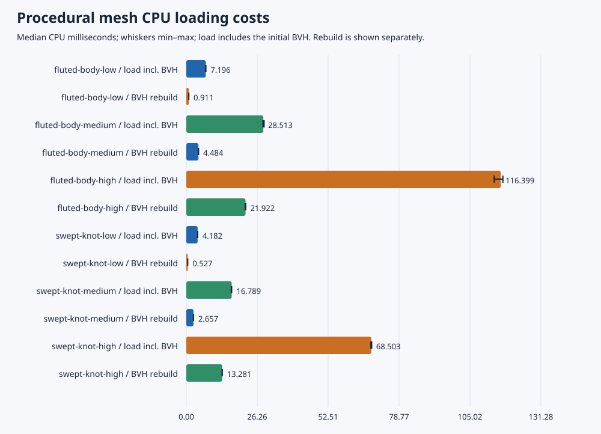

GPU procedural comparisons run at 160 × 106, 16 samples and depth 10 with wavefront and roulette enabled:

| Shape / surface | GPU total, ms/sample | GPU shading, ms/sample |
|---|---:|---:|
| Fluted body / plain | 24.311 | 13.490 |
| Fluted body / marble | 18.646 | 10.574 |
| Fluted body / cells | 16.560 | 9.530 |
| Swept knot / plain | 16.626 | 9.617 |
| Swept knot / marble | 14.153 | 8.425 |
| Swept knot / cells | 13.442 | 8.128 |

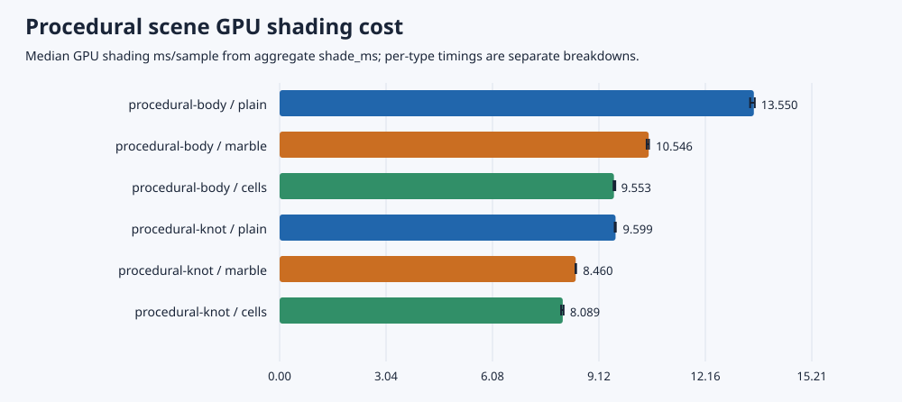

Bars show measured medians; whiskers show the measured minimum and maximum across three repeats.

Plain, marble and cells change reflectance and hence roulette survival and subsequent path work. Their shading timings include those effects and are not isolated texture-ALU measurements. Geometry generation is CPU setup; no GPU generation time is claimed. More tessellation increases silhouette detail, file size and traversal work; caching, level of detail and footprint-aware texture filtering are useful future improvements.

### Surface, camera, and lighting costs

The original feature comparisons run at 160 × 106, 16 samples and depth 10, with wavefront and roulette disabled:

| Comparison | First variant, ms/sample | Second variant, ms/sample |
|---|---:|---:|
| File / procedural checker | 12.245 | 12.137 |
| Bump off / on | 12.279 | 12.266 |
| Mirror / refractive sphere | 12.449 | 12.301 |
| Pinhole / thin lens | 12.259 | 12.379 |
| BSDF only / direct-light sampling | 8.536 | 12.279 |

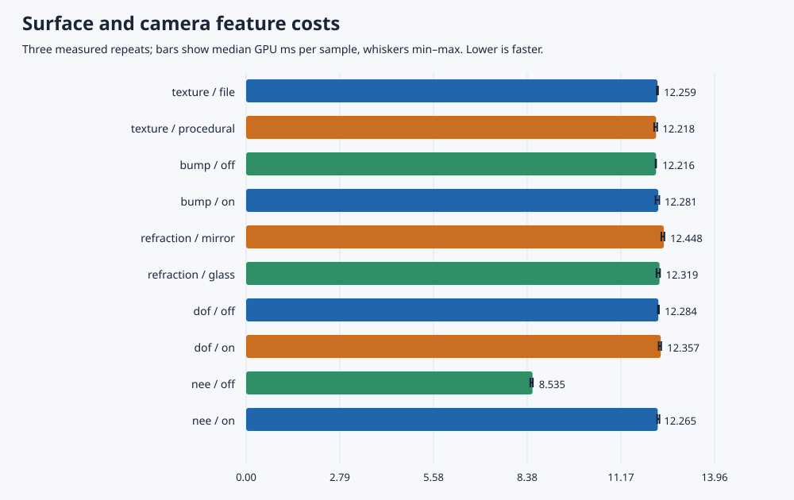

Small rankings should not be generalized beyond their measured variation. Bump mapping, reflection/refraction and depth of field change ray trajectories, so timings include changed path work. Direct lighting traces additional visibility rays and can improve convergence at equal sample counts.

| Light geometry | NEE mean | BSDF mean | Relative difference | Samples |
|---|---:|---:|---:|---:|
| Cube | 0.26157697 | 0.26176849 | 0.0732% | 8,192 |
| Sphere | 0.23266767 | 0.23288600 | 0.0938% | 8,192 |
| Mesh | 0.16763733 | 0.16811674 | 0.2852% | 8,192 |

At 8,192 samples, independent NEE and BSDF image means differ by 0.0732% (cube), 0.0938% (sphere), 0.2852% (mesh).
Present depth-one exact checks pass for cube, sphere, and mesh.
These brightness checks are not a variance or error-per-unit-time proof.

### Checkpoint overhead

Saving every 8 samples changes median render-loop time from 12.333 to 12.512 ms/sample (1.4% slower) in the 16-sample workbench run. GPU sample time is 12.312 versus 12.286 ms. The loop includes device download, serialization, checksum and atomic replacement; file size and storage affect this cost.

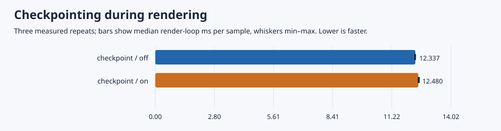

Full measurements, settings, raw files and system specifications are linked in [verification](docs/verification.md).


| Feature | Acceleration used and why | GPU versus a hypothetical CPU renderer | Further optimization |
|---|---|---|---|
| OBJ / glTF | Parse and apply transforms once on the host; reuse triangles and BVH during rendering. | File decoding is CPU setup in both versions; independent GPU ray/triangle tests amortize upload cost and exploit concurrency. | Cache parsed assets, compact primitive layout, and preserve shared mesh instances. |
| BVH | Prune primitive tests with a CPU-built hierarchy and iterative GPU traversal. | Fewer tests help either processor; GPU traversal also faces divergence and scattered reads. | Better split heuristics and traversal ordering. |
| Refraction | No dedicated dielectric acceleration; reuse the shared traversal and scheduling. | Independent dielectric calculations suit GPU throughput; reflection/transmission branches reduce coherence. | Reduce dispatch/readback overhead and improve dielectric path scheduling. |
| Texture/bump | No dedicated filtering acceleration; evaluate the image or analytic pattern at each hit. | Parallel lookups suit GPUs; procedural arithmetic trades image fetches for computation on either processor. | Texture objects, mipmaps, and footprint-aware filtering. |
| Restart | No asynchronous I/O acceleration; retain exact sums with checksummed atomic replacement. | Host serialization adds a GPU download that a CPU renderer would not require. | Asynchronous staging and adjusted checkpoint cadence. |
| Depth of field | No dedicated camera acceleration; lens sampling runs in primary-ray generation. | A CPU can use the same lens estimator. GPU throughput helps evaluate independent paths, while defocus requires more samples and reduces path coherence. | Better sampling and adaptive convergence. |
| Direct lighting | Explicit light sampling and MIS target convergence; they add visibility-ray work per sample. | GPUs process independent shadow rays concurrently; a CPU can use the same estimator. | Importance-weighted light selection and dedicated shadow queues. |
| Wavefront queues | Histogram, scan, and index scatter replace sorting and feed specialized kernels. | A CPU can also group work, with lower launch overhead. GPU queue construction and host count readback can outweigh branching savings. | Device-driven dispatch, concurrent shadow queues, and workload-dependent selection. |
| Procedural sculptures | Generate meshes once on the CPU; evaluate analytic textures on the GPU without image fetches. | CPU generation is setup; independent GPU rays amortize it. Pattern arithmetic benefits from GPU throughput. | Adaptive tessellation, cached assets, and filtered patterns. |
| Russian roulette | Terminate compensated low-throughput paths and compact survivors to avoid later work. | Either processor saves later work at the cost of added variance; GPU queues also need compaction. | Tune start depth and evaluate error per unit time. |
| Sampling | Cache the generated prime table; process only present index digits. | GPUs evaluate independent pixel/path sequences, but scrambling and integer division add work. A CPU can use the same sequence. | Cheaper arithmetic and sampling strategies tailored to transport dimensions. |
| Motion blur | Reuse phase-zero geometry and one swept BVH; keep a zero-displacement fast path. | Both processors can sample exposure time; GPUs process paths concurrently but moving scenes can reduce coherence and broaden bounds. | Tighter time-binned bounds and motion-aware traversal. |

Compaction saves later work by removing dead paths, at the cost of scan/scatter. Sorting groups material work but adds scheduling cost. Neither is assumed to improve every scene.

## Antialiasing and diagnostics

| Stochastic antialiasing | Pixel-center camera |
|---|---|
|  |  |

First-hit semantic views help inspect surface normals, UVs, and camera depth. They use the same geometry and transformed mesh data as the beauty renderer.

| Shading normals | UV coordinates | Depth |
|---|---|---|
| 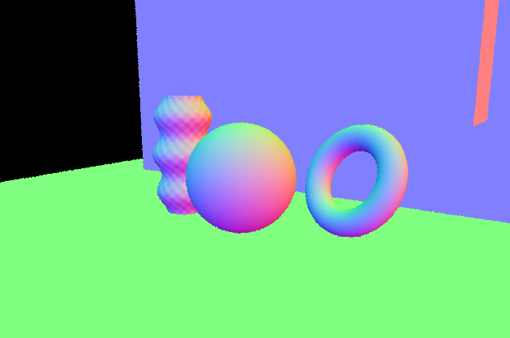 | 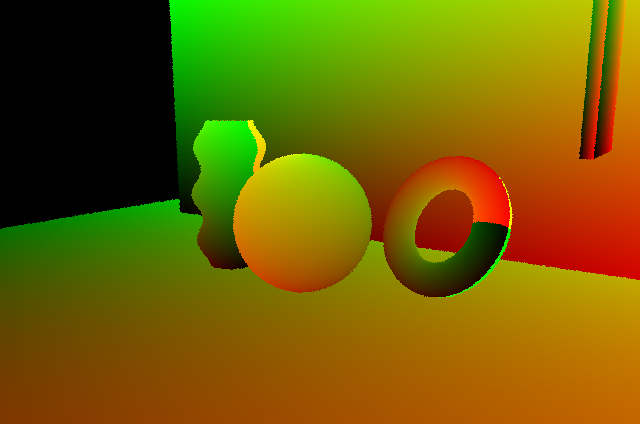 |  |

## Build and run

Requires CMake 3.24+, C++17, and a compatible NVIDIA driver/CUDA toolkit. Preview additionally requires OpenGL, GLFW, and GLEW. GLM, JSON, STB, and ImGui are inherited starter dependencies already present; the approved tinygltf header and license are bundled.

```sh
cmake -S . -B build -DCMAKE_BUILD_TYPE=Release -DBUILD_PREVIEW=OFF -DCMAKE_CUDA_ARCHITECTURES=86
cmake --build build -j
ctest --test-dir build --output-on-failure
build/bin/cis565_path_tracer_headless scenes/procedural-optical-stilllife.json --samples 2048 --seed 947 --output results/workbench
```

Choose the architecture for your GPU; `86` is the A10G validation target. CMake preserves caller-selected architectures. `BUILD_PREVIEW` defaults to `ON`; `BUILD_RENDERER=OFF` enables host-only tests. Beyond the source list, CMake changes include a C++17 host core and tests, optional CUDA/preview targets, platform preview dependencies, separate CUDA device linking, and source-content/compiler-flag compatibility fingerprints. The host core includes our glTF adapter and a separate glTF test target; the adapter reuses the existing JSON/STB include paths.

```sh
build/bin/cis565_path_tracer_headless scenes/optical-workbench.json --samples 64 --checkpoint results/workbench.checkpoint --output results/partial
build/bin/cis565_path_tracer_headless scenes/optical-workbench.json --samples 2048 --resume results/workbench.checkpoint --output results/resumed
build/bin/cis565_path_tracer_headless scenes/open-benchmark.json --samples 16 --compact off --wavefront off --rr off --sort on --benchmark --output results/diagnostic
build/bin/cis565_path_tracer_headless scenes/optical-workbench.json --resolution 17x13 --depth 7 --validate
python3 scripts/run_experiments.py --binary build/bin/cis565_path_tracer_headless
```

Additional controls: `--resolution WxH`, `--depth`, `--aa`, `--nee`, `--bvh`, `--compact`, `--sort`, `--wavefront`, `--rr`, `--sampler counter|halton`, and `--motion on|off`. `--rr-start N` sets the number of completed scattering events before roulette is eligible (1–4096); a value beyond the depth leaves roulette ineligible. Material sorting requires `--wavefront off`. Toggle values are `on` or `off`. `--samples` denotes the total target, including previously completed samples.

Preview accepts a scene path and the sampler/motion controls. Left drag orbits, right drag zooms, middle drag pans the look-at point in the camera plane, Space recenters, S saves, and Escape saves and exits.

To inspect the glTF scene with exposure averaging and the additional sampler:

```sh
build/bin/cis565_path_tracer scenes/gltf-showcase.json --sampler halton --motion on
build/bin/cis565_path_tracer_headless scenes/gltf-showcase.json --samples 2048 --sampler halton --motion on --seed 947 --output results/gltf-showcase
```

See [scene extensions](docs/scene-format.md), [validation and system specifications](docs/verification.md), and [source provenance](docs/provenance.md).

## References and provenance

- [Official Fall 2026 starter](https://github.com/CIS5650-Fall-2026/Project3-CUDA-Path-Tracer), revision `8695a5af18ae6fc130d1d38713be82bbbff7f38f`, including existing dependencies and retained licenses.
- [Approved tinygltf v2.9.7](https://github.com/syoyo/tinygltf/tree/v2.9.7), revision `488a70a3df62a4df1a736e9e56fb8836580c4888`, used unchanged for glTF format loading after Bryce Joseph's September 21 approval. Its MIT license is retained; integration and test assets are independently authored. [glTF 2.0 specification](https://registry.khronos.org/glTF/specs/2.0/glTF-2.0.html) supplies the format rules.
- Our own [Project 2](https://github.com/didrikwiigandersen/Project2-Stream-Compaction), revision `6a13e6fbe3a998c67fdbbdbe6643a5b4c4233b31`, for device scan and the adapted workstation transfer helper. The sampler also retains the official starter's `utilhash`; its counter composition is original.
- Conceptual references: [OBJ format](https://dirsig.cis.rit.edu/docs/new/obj.html), [BVH](https://pbr-book.org/4ed/Primitives_and_Intersection_Acceleration/Bounding_Volume_Hierarchies), [dielectrics](https://pbr-book.org/4ed/Reflection_Models/Dielectric_BSDF), [thin lens](https://pbr-book.org/4ed/Cameras_and_Film/Projective_Camera_Models#TheThinLensModelandDepthofField), [textures](https://pbr-book.org/4ed/Textures_and_Materials/Image_Texture), [bump mapping](https://www.pbr-book.org/3ed-2018/Materials/Bump_Mapping), [direct lighting/MIS](https://pbr-book.org/4ed/Light_Transport_I_Surface_Reflection/A_Better_Path_Tracer), and [Paul Bourke's raytracing notes](https://paulbourke.net/miscellaneous/raytracing/) supplied as a PDF; [wavefront motivation](https://research.nvidia.com/index.php/publication/2013-07_megakernels-considered-harmful-wavefront-path-tracing-gpus); and [Russian roulette theory](https://pbr-book.org/4ed/Monte_Carlo_Integration/Improving_Efficiency).
- [Patrick Cozzi's README guide](https://github.com/pjcozzi/Articles/blob/master/CIS565/GitHubRepo/README.md) informed presentation and performance reporting.

Our renderer and integration code are independently written. No other student's code or unapproved internet implementation is used. The provenance register and change manifest distinguish the approved starter, the specifically approved unchanged tinygltf package, authorized own-code reuse, original implementation and generated evidence.
